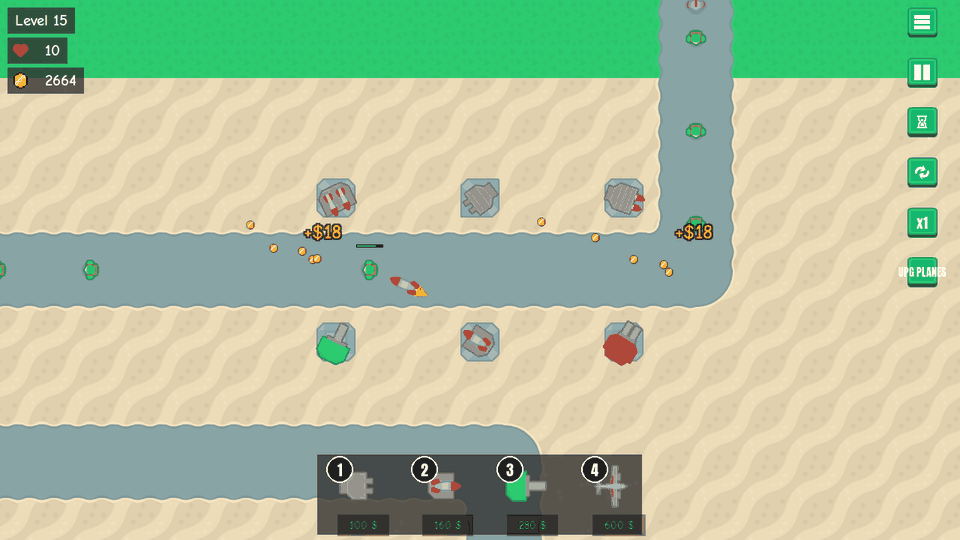
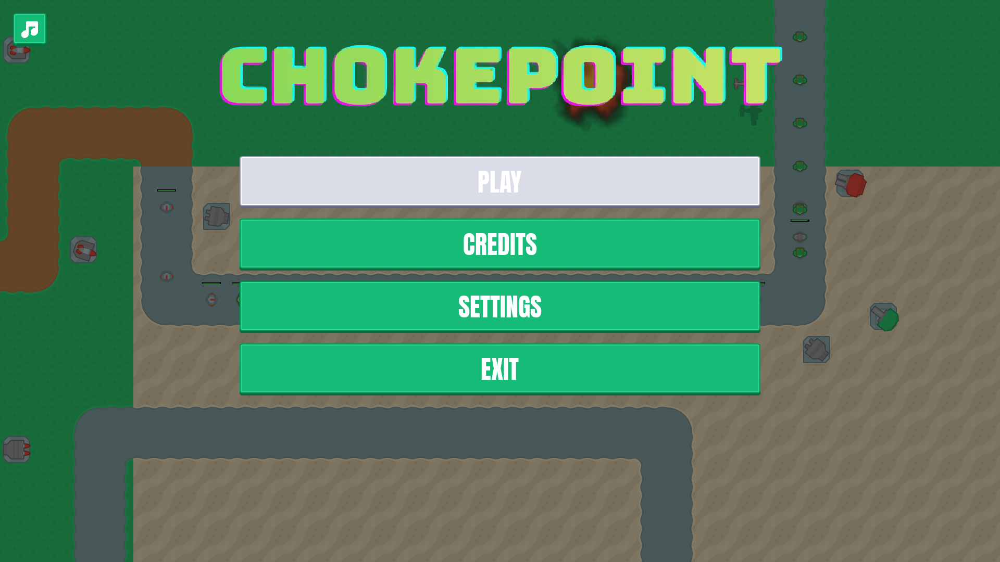
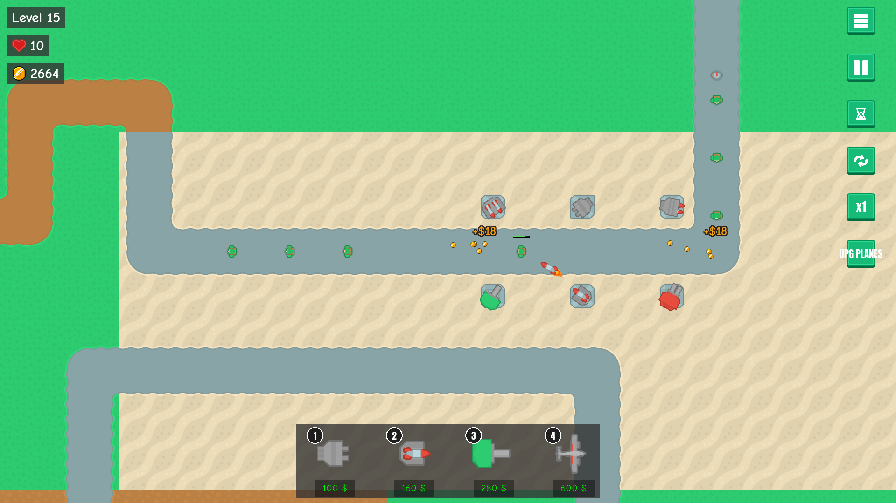
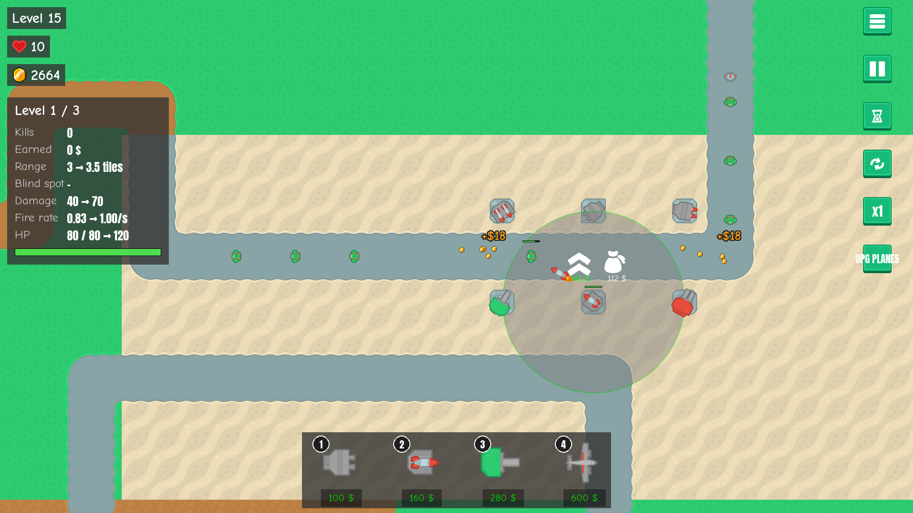
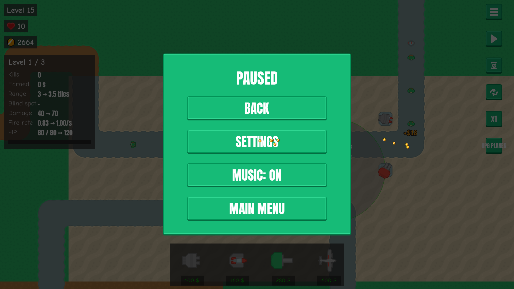
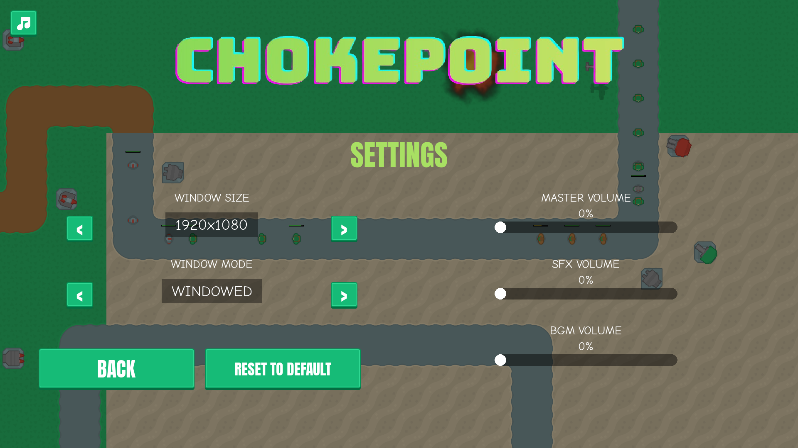

# Chokepoint


Chokepoint is a 2D tower defense game built with [pygame-ce](https://github.com/pygame-community/pygame-ce). Defend the path through 25 waves of escalating enemies — then keep going in endless mode — by buying, placing, and upgrading towers along a fixed Tiled-authored map.



The preview and screenshots below show the current source build. Downloadable releases may
lag behind these changes; see the [changelog](CHANGELOG.md) and [devlog](docs/devlog/README.md).

## Gameplay

You start with **$200** and **10 lives**. Buy towers from the bar at the bottom of the screen,
place them on the map, and upgrade them as you earn money from kills; selling a tower refunds
70% of everything you spent on it. Survive all 25 waves to win — clearing wave 25 opens a
victory screen where you can play again, return to the main menu, or continue in endless mode.
Enemy HP and kill rewards scale by `1 + 0.25 × (wave − 1)` from their base values, rounded
down to integers; this is linear growth, not a compounded 25% increase.

Click a ground tower or flying plane to inspect its stats, kills, earnings and upgrade
previews. Click an enemy to see its HP as numbers. The HUD includes toggles for continuous
placement and auto-pause between waves, and Tab slides it out of the way. The main menu has
its own live battle running in the background.

### Screenshots

Captured from the current source build at 1920×1080. The gameplay images use a staged wave-15
run with several tower types and levels; they are not a fresh $200 start.

| Main menu with a live battle | Gameplay and kill feedback |
|---|---|
|  |  |

| Tower stats and upgrade previews | Pause menu |
|---|---|
|  |  |

<details>
<summary>Display and audio settings</summary>



</details>

### Enemies

Base stats before wave scaling; Damage is the lives lost when an enemy escapes.

| # | Role         | HP   | Speed | Reward | Damage |
|---|--------------|------|-------|--------|--------|
| 1 | Grunt        | 20   | 1.0   | 4      | 1      |
| 2 | Fast runner  | 55   | 1.6   | 10     | 1      |
| 3 | Bruiser      | 160  | 0.9   | 28     | 2      |
| 4 | Heavy        | 420  | 0.7   | 75     | 3      |
| 5 | Tank         | 800  | 0.5   | 200    | 5      |
| 6 | Siege tank   | 1500 | 0.4   | 400    | 8      |

Types 5–6 are armed: while advancing, they fire on the nearest ground tower in range, chipping away its HP until it's destroyed.

### Towers

| # | Name           | Levels | Price (L1) | Behaviour                                |
|---|----------------|--------|------------|------------------------------------------|
| 1 | Rapid gun      | 1      | $100       | Cheap starter — fast, low damage         |
| 2 | Homing missile | 3      | $160       | Tracks targets; scales hard with upgrades |
| 3 | Heavy cannon   | 2      | $280       | Long range and heavy hits; cannot target enemies within its 1.5-tile blind spot |
| 4 | Plane          | 2      | $600       | Flies over the map, dropping bombs along its path |

Planes reach level 2 through the one-time **$5000 UPG PLANES** upgrade. It applies globally,
including to planes already flying. A plane makes one pass toward the right edge; its bombs
deal splash damage when they land. Fired projectiles keep flying after their source is sold,
destroyed or removed from the map.

All stats live in `config/towers.yaml`, `config/enemies.yaml`, and `config/waves.yaml` — tweak freely.

### Controls

| Action | Input |
|---|---|
| Pick a tower to buy | Click it in the bottom bar, or press 1–4 |
| Inspect a tower / plane, or an enemy's HP | Left click it |
| Hide / show the HUD | Tab (hotkeys still work; money and lives pop back briefly when they change) |
| Place it | Left click a green tile |
| Cancel placement / deselect | Right click |
| Toggle continuous placement | Press Shift, or click the circular-arrows HUD button; stays on until toggled off |
| Upgrade or sell a tower | Click the tower, then the arrow (upgrade) or money bag (sell) |
| Start / pause the waves | Space, or the play button |
| Toggle auto-pause between waves | Hourglass HUD button |
| Game speed (x1 / x2 / x4) | Speed button |
| Scroll the map | Move the mouse to a screen edge |
| Zoom | Mouse wheel |
| Toggle fullscreen | F11 |
| Open / close the pause menu | Esc, or the menu button to open it |
| Save the run and return to the main menu | Main menu inside the pause menu |

The pause menu also provides Settings and a music toggle. Settings includes window size/mode
and separate master, music and SFX volume sliders. Leaving Settings returns to the menu it
was opened from.

## Download

[](https://umutcanekinci.itch.io/chokepoint)

Grab a ready-to-play build for your OS from [itch.io](https://umutcanekinci.itch.io/chokepoint) or the [latest GitHub release](https://github.com/vectorviolet/chokepoint/releases/latest) — no Python required. Unzip and run:

| OS | Run |
|----|-----|
| Windows | Extract `chokepoint-windows.zip`, run `chokepoint.exe` |
| macOS | Extract `chokepoint-macos.zip`, open `Chokepoint.app` |
| Linux | Extract `chokepoint-linux.zip`, run `./chokepoint/chokepoint` |

> macOS Gatekeeper: the app is unsigned, so the first launch needs **right-click → Open** (or `xattr -dr com.apple.quarantine Chokepoint.app`).
>
> Windows SmartScreen: the app is unsigned, so the first launch shows **"Windows protected your PC."** Click **More info → Run anyway**. This is Microsoft's download-reputation check, not a virus warning — brand-new unsigned executables always trigger it.

## Requirements (from source)

- Python 3.12+
- [pygame-ce](https://github.com/pygame-community/pygame-ce), colorama, pyyaml, pytmx (resolved automatically from `pyproject.toml` / `uv.lock`)
- [uv](https://docs.astral.sh/uv/) (optional but recommended)

## Running

```bash
git clone --recurse-submodules https://github.com/vectorviolet/chokepoint.git
cd chokepoint
uv sync
uv run python __main__.py
```

If you forgot `--recurse-submodules`, or the engine folder is out of step after a pull:
`git submodule update --init` (on Windows, `scripts\sync-pygamine.bat` does the same).

Without `uv`: `pip install .` then `python __main__.py`.

## Building a standalone bundle

Builds are produced by [PyInstaller](https://pyinstaller.org/) from `chokepoint.spec`, which bundles `assets/` and `config/` alongside the executable (onedir). To build locally for your current OS:

```bash
uv sync --group build
uv run pyinstaller chokepoint.spec --noconfirm
```

The result lands in `dist/chokepoint/` (`dist/Chokepoint.app` on macOS).

### Cutting a release

Prepare a **Release x.y.z** PR with the version and changelog changes first. After required
CI passes and the owner merges it through the merge queue, the owner creates and pushes the
matching `vx.y.z` tag on that merged commit. Protected release tags cannot be moved or deleted.

The tag triggers [`.github/workflows/release.yml`](.github/workflows/release.yml), which builds
on each OS, zips the bundle, attaches all three to a GitHub Release, and pushes each build to
its [itch.io](https://umutcanekinci.itch.io/chokepoint) channel via
[Butler](https://itch.io/docs/butler/). Use **Run workflow** to build without publishing.

## Development and checks

Run these commands from the `chokepoint` project folder:

```bash
uv run --group dev pytest tests/ -q
uv run python scripts/smoke_test.py
```

The tests and smoke test redirect saves to temporary folders. Any custom script that creates
a `Game()` must do the same: normal gameplay can overwrite a save, and losing a run deletes it.

For a ready-made run **inside a separate worktree**, use:

```bash
uv run python scripts/make_playtest_save.py --out saves
uv run python __main__.py
```

Press **Continue** for a paused wave-10 run with $100,000, towers at every level and muted
audio. The generator always refuses the main checkout's real saves. Replacing existing
generated files in the worktree requires `--overwrite`.

Refresh the README media from the current game with:

```bash
uv run --group build python scripts/capture_readme.py
```

This captures screenshots and a six-second GIF headlessly, using temporary saves and checking
that the real save directories remain unchanged.

## Project layout

```
__main__.py            Entry point — injects src/ + src/pygamine/ into sys.path
src/app/game.py        Game class — wires all subsystems
src/domain/            Pure data (GameState, protocols)
src/gameplay/          Battle simulation, combat, tilemap, menu demo
src/gameplay/towers/   Tower hierarchy and factory
src/ui/                HUD, info panels, pause menu, tooltips, feedback effects
src/util/              Config loaders, constants
src/pygamine/          Pinned engine submodule (Application, Animator, PanelLoaderExt, ...)
config/                YAML: assets, panels, towers, enemies, waves
assets/                Images, sounds, fonts, Tiled map
scripts/               Smoke checks, play-test saves, media and documentation generators
docs/devlog/           Feature history and decisions with screenshots
docs/decisions/        Architecture decision records
```

See [CLAUDE.md](CLAUDE.md) for the architecture overview and development conventions.

## Credits

Art, UI, and sound from [Kenney](https://www.kenney.nl/) — [Tower Defense (Top-Down)](https://www.kenney.nl/assets/tower-defense-top-down), [UI Pack](https://www.kenney.nl/assets/ui-pack), [Impact Sounds](https://www.kenney.nl/assets/impact-sounds), and [Smoke Particles](https://www.kenney.nl/assets/smoke-particles). Coin pickup art from [La Red Games — Gems & Coins](https://laredgames.itch.io/gems-coins-free). Fonts: [Anton](https://fonts.google.com/specimen/Anton) and [Comic Neue](https://fonts.google.com/specimen/Comic+Neue) (SIL OFL). Music: [Sakura Girl - Clown](https://hypeddit.com/sakuragirl/clown). Full list with licenses in [CREDITS.md](CREDITS.md).

## Asset sources

Every file under `assets/` is listed in `assets/SOURCES.yaml` with its source:

- **A pack**, given by its slug (for example `kenney-ui-pack`). The entry also gives the file's
  path inside that pack as `original`. Images built from several pack files list them under
  `composited_from` instead. Edited pack files say what changed under `modified`.
- **`own`**, for files made for this game.
- **`unknown`**, for files whose origin or license isn't confirmed yet. Each needs a `todo` that
  says what to do; the credits list them as "not yet verified".

The `packs` section names each pack, its author, URL, license and what the game uses it for.
Each pack's own license text is in `licenses/assets/<slug>.txt`, and every build ships it.

When you add, replace or remove an asset:

1. Update `assets/SOURCES.yaml`, and add `licenses/assets/<slug>.txt` for any new pack.
2. Run `uv run python scripts/gen_credits.py` to regenerate CREDITS.md's asset section. Don't
   edit that section by hand.
3. Run the tests. `tests/test_sources.py` fails if a file is missing from `SOURCES.yaml`, if a
   listed file doesn't exist, if a pack has no license text, or if CREDITS.md is out of date.

Only ship assets whose license allows bundling them in a distributed game; resolve every
`unknown` entry before the next release.

## Code style

- **Formatting:** Black-compatible, enforced by `ruff format` (line length 88, double quotes,
  otherwise Black's defaults; see `[tool.ruff.format]` in `pyproject.toml`).
- **Lint:** `ruff check`, deliberately narrow (pyflakes rules only).
- **CI:** runs both. The `src/pygamine` submodule is excluded; it has its own setup.

Run both locally before committing:

```bash
uv run --group dev ruff format .          # reformat
uv run --group dev ruff check .           # lint
uv run --group dev ruff format --check .  # what CI runs: fails if anything would be reformatted
```

The commit that first applied the formatter is listed in `.git-blame-ignore-revs`. To have
`git blame` skip it and show the real author of each line:

```bash
git config blame.ignoreRevsFile .git-blame-ignore-revs
```

## Contributing

1. Fork this repository.
2. Clone your fork: `git clone --recurse-submodules https://github.com/<you>/chokepoint.git`
3. Create a branch: `git checkout -b feature/<your-feature>`
4. Run the tests, smoke test and Ruff checks.
5. Stage the intended file paths explicitly, commit, and push your branch.
6. Open a pull request. Feature and design-decision PRs include a devlog entry;
   architecture changes include an ADR.
7. After lead review and the owner's playtest, the owner queues the PR with **Merge when ready**.
   Required CI also runs on the merge group; do not push directly to protected `main`.

## Author

Umutcan Ekinci — [umutcannekinci@gmail.com](mailto:umutcannekinci@gmail.com)

See also the [contributors](https://github.com/vectorviolet/chokepoint/contributors).

## License

See [LICENSE](LICENSE).
