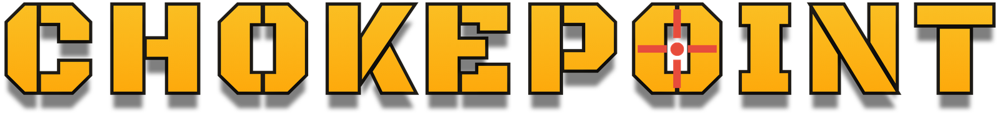
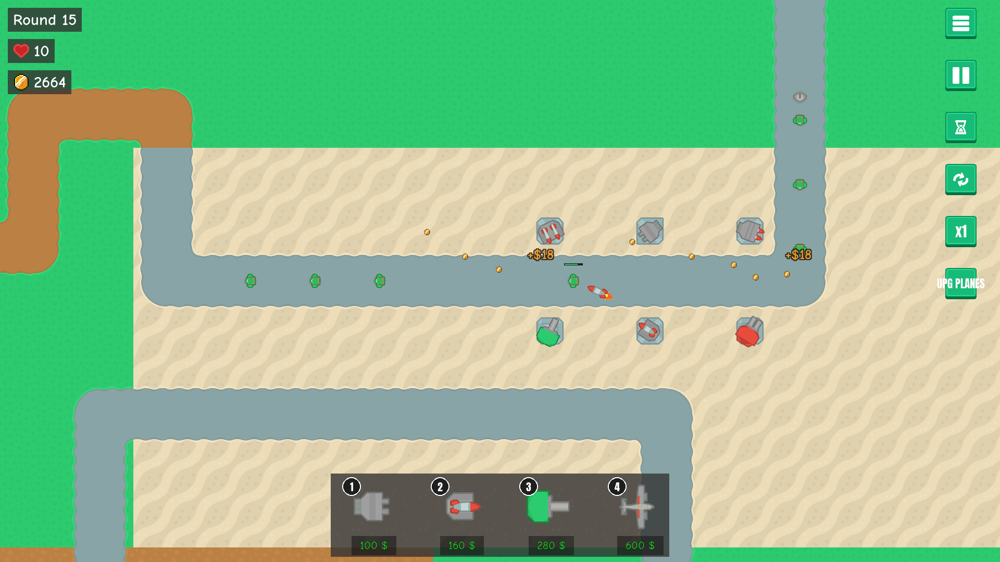
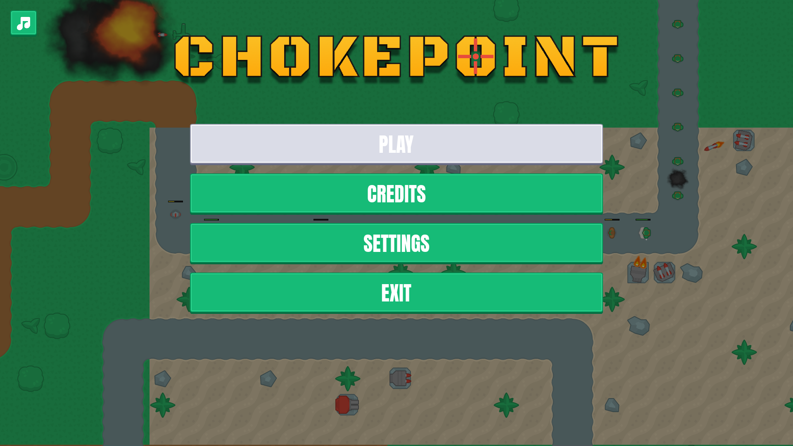
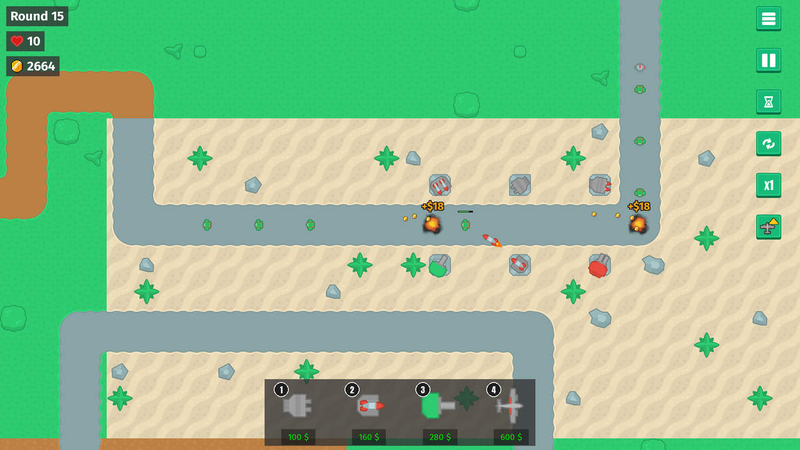
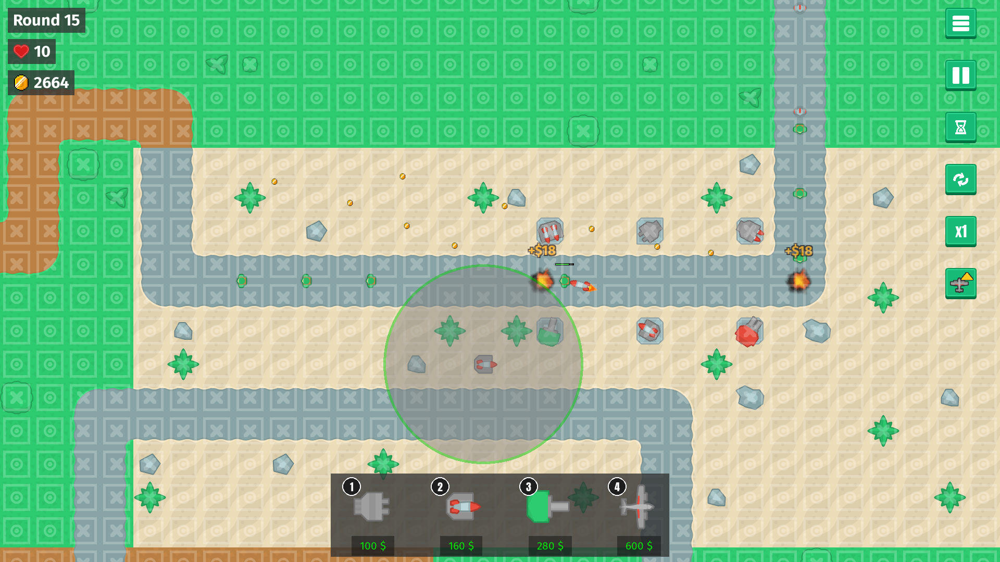
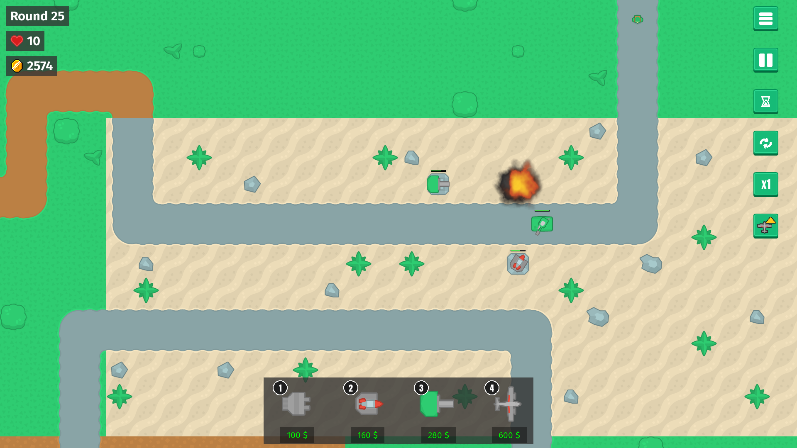
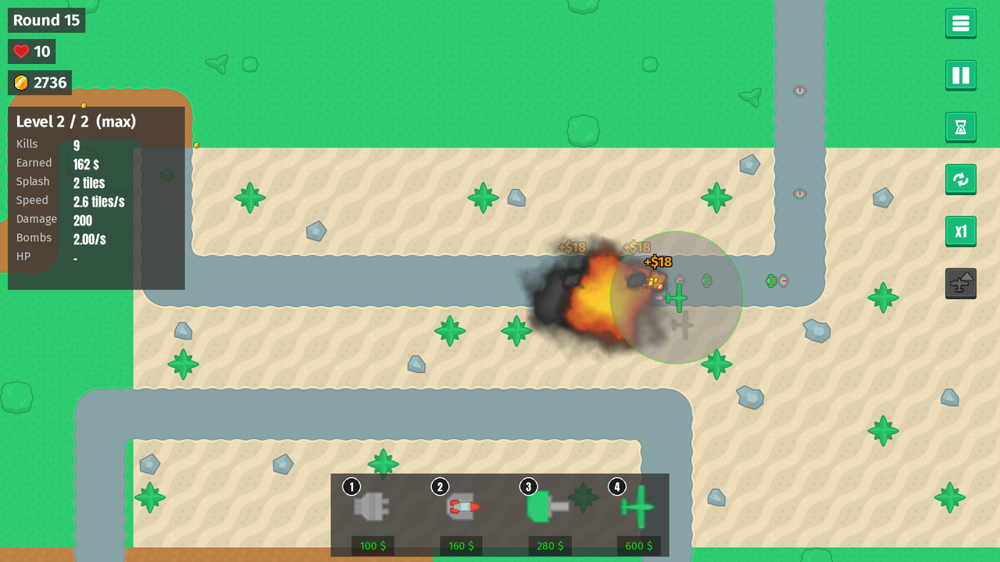
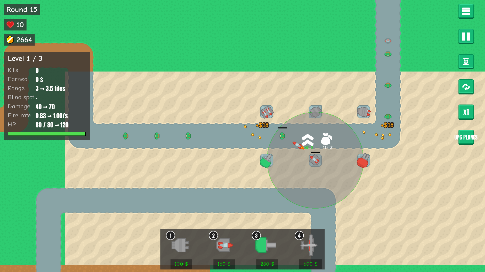

<h1 align="center">
  
</h1>

<div align="center">

[](https://github.com/vectorviolet/chokepoint/actions/workflows/ci.yml)
[](https://github.com/vectorviolet/chokepoint/releases/latest)
[](LICENSE)
[](https://github.com/vectorviolet/chokepoint/actions/workflows/ci.yml)
[](https://github.com/pygame-community/pygame-ce)

</div>

Chokepoint is a 2D tower defense game: defend a winding path through 25 rounds of escalating enemies, then keep going in endless mode, by buying, placing and upgrading towers on a Tiled-authored map. Built with [pygame-ce](https://github.com/pygame-community/pygame-ce) on the author's own [pygamine](https://github.com/vectorviolet/pygamine) engine layer.



## Download

[](https://umutcanekinci.itch.io/chokepoint)

**Play in your browser:** starting with the next release, the [itch.io page](https://umutcanekinci.itch.io/chokepoint) also has a web version for desktop browsers (not phones or tablets).

Grab a ready-to-play build for your OS from [itch.io](https://umutcanekinci.itch.io/chokepoint) or the [latest GitHub release](https://github.com/vectorviolet/chokepoint/releases/latest) — no Python required. Unzip and run:

| OS | Run |
|----|-----|
| Windows | Extract `chokepoint-windows.zip`, run `chokepoint.exe` |
| macOS | Extract `chokepoint-macos.zip`, open `Chokepoint.app` |
| Linux | Extract `chokepoint-linux.zip`, run `./chokepoint/chokepoint` |

<details>
<summary>First launch on macOS or Windows</summary>

> macOS Gatekeeper: the app is unsigned, so macOS blocks the first launch. Open **System Settings → Privacy & Security**, click **Open Anyway** next to Chokepoint, then **Open** (or run `xattr -dr com.apple.quarantine Chokepoint.app`).
>
> Windows SmartScreen: the app is unsigned, so the first launch shows **"Windows protected your PC."** Click **More info → Run anyway**. This is Microsoft's download-reputation check, not a virus warning — brand-new unsigned executables always trigger it.

</details>

## Features

- Four towers (rapid gun, homing missile, heavy cannon, plane) with upgrade paths, buy tooltips and a stats panel with upgrade previews.
- Armed tanks that shoot back and can destroy your towers.
- 25 rounds, a victory screen, then endless mode; runs are saved and can be continued.
- Game speed x1, x2 and x4, auto-pause between rounds and continuous placement.
- A live battle plays itself behind the main menu.
- Kill rewards, hit flashes, explosions and rubble, with a "reduce flashing" setting.
- English and Turkish, with window, audio and gameplay settings.
- Edge-scrolling, zooming camera over a large map.

## Screenshots

| Main menu with a live battle | Gameplay and kill feedback |
|---|---|
|  |  |

| Placing a tower: range ring and build tiles | Tank fight: tower HP bars and a destroyed tower |
|---|---|
|  |  |

| Plane bombing run with its info panel | Tower stats and upgrade previews |
|---|---|
|  |  |

## Towers and enemies

| Tower | Role |
|---|---|
| Rapid gun | Cheap starter that fires fast but short and light |
| Homing missile | Tracks its target; damage grows fast with upgrades |
| Heavy cannon | Long range and heavy hits, but can't hit enemies up close |
| Plane | Flies one pass over the map, dropping splash bombs |

Six enemy types march in, from the basic grunt to the siege tank. The two tank types are armed:
they fire on the nearest tower in range until it is destroyed. The plane gets its one-time
global upgrade from the plane-with-arrow button, or **U**. Every number (prices, ranges, DPS,
enemy HP and rewards, each wave's contents) is on the wiki:
[Stats](https://github.com/vectorviolet/chokepoint/wiki/Stats),
[Towers](https://github.com/vectorviolet/chokepoint/wiki/Stats-Towers),
[Enemies](https://github.com/vectorviolet/chokepoint/wiki/Stats-Enemies) and
[Waves](https://github.com/vectorviolet/chokepoint/wiki/Stats-Waves).

## Controls

| Action | Input |
|---|---|
| Pick a tower to buy | Click it in the bottom bar, or press 1–4 |
| Place it / cancel | Left click a green tile / right click |
| Inspect a tower, plane or enemy | Left click it |
| Upgrade or sell a tower | Click the tower, then the arrow or the money bag |
| Keep placing | Shift, or the circular-arrows button |
| Start / pause the rounds | Space, or the play button |
| Upgrade the planes | U, or the plane-with-arrow button |
| Game speed (x1 / x2 / x4) | Speed button |
| Scroll / zoom the map | Mouse at a screen edge / mouse wheel |
| Hide the HUD / fullscreen | Tab / F11 |
| Pause menu | Esc |

## Under the hood

- **Engine:** built on [pygamine](https://github.com/vectorviolet/pygamine), the author's own engine layer, pinned as a git submodule in `src/pygamine/`.
- **Simulation:** gameplay runs on a fixed tick independent of the frame rate, so pausing and x2/x4 speeds stay consistent. The same battle code drives the real game and the menu demo ([architecture](docs/ARCHITECTURE.md)).
- **Targeting:** towers and tanks find targets through per-tick spatial grids, tested to pick exactly what a full scan would ([ADR 0004](docs/decisions/0004-grid-targeting.md)).
- **Balance:** a headless simulator plays whole runs with scripted strategy bots and writes per-wave reports ([`scripts/balance_sim.py`](scripts/balance_sim.py), [ADR 0007](docs/decisions/0007-headless-balance-simulator.md)).
- **Quality:** a large pytest suite with coverage, plus mypy, ruff and codespell, run in [CI](.github/workflows/ci.yml); `main` is protected and changes land through pull requests.
- **Docs from config:** the stats reference and the wiki's stats pages are generated from the YAML config, and CI fails when they are stale ([`scripts/gen_stats.py`](scripts/gen_stats.py)).
- **Release pipeline:** a version tag builds Windows, macOS, Linux and browser (pygbag) bundles and publishes them to GitHub Releases and itch.io ([`release.yml`](.github/workflows/release.yml)).
- **History:** every feature and design decision has a [devlog](docs/devlog/README.md) entry, and architecture choices an [ADR](docs/decisions/README.md).

## Running from source

Needs Python 3.12+ and [uv](https://docs.astral.sh/uv/), which also installs the pygamine engine from its submodule.

```bash
git clone --recurse-submodules https://github.com/vectorviolet/chokepoint.git
cd chokepoint
uv sync
uv run python __main__.py
```

Tests, code style, releases and the other contributor details are in [CONTRIBUTING.md](CONTRIBUTING.md); how the code fits together is in [docs/ARCHITECTURE.md](docs/ARCHITECTURE.md).

## Links

- [Wiki](https://github.com/vectorviolet/chokepoint/wiki): [stats reference](https://github.com/vectorviolet/chokepoint/wiki/Stats)
- [Roadmap](https://github.com/vectorviolet/chokepoint/milestone/1): the 1.0 milestone
- [Devlog](docs/devlog/README.md) and [changelog](CHANGELOG.md)

## Credits

Art, UI, and sound from [Kenney](https://www.kenney.nl/) — [Tower Defense (Top-Down)](https://www.kenney.nl/assets/tower-defense-top-down), [UI Pack](https://www.kenney.nl/assets/ui-pack), [Impact Sounds](https://www.kenney.nl/assets/impact-sounds), and [Smoke Particles](https://www.kenney.nl/assets/smoke-particles). Coin pickup art from [La Red Games — Gems & Coins](https://laredgames.itch.io/gems-coins-free). Fonts: [Anton](https://fonts.google.com/specimen/Anton) and [Fira Sans](https://fonts.google.com/specimen/Fira+Sans) (SIL OFL). Music: [Sakura Girl - Clown](https://hypeddit.com/sakuragirl/clown). Full list with licenses in [CREDITS.md](CREDITS.md).

## Author

[Umutcan Ekinci](https://www.linkedin.com/in/umutcanekinci/)

Built with Claude Code as a coding assistant; game design, art direction, playtesting and review by me.

## License

See [LICENSE](LICENSE).
