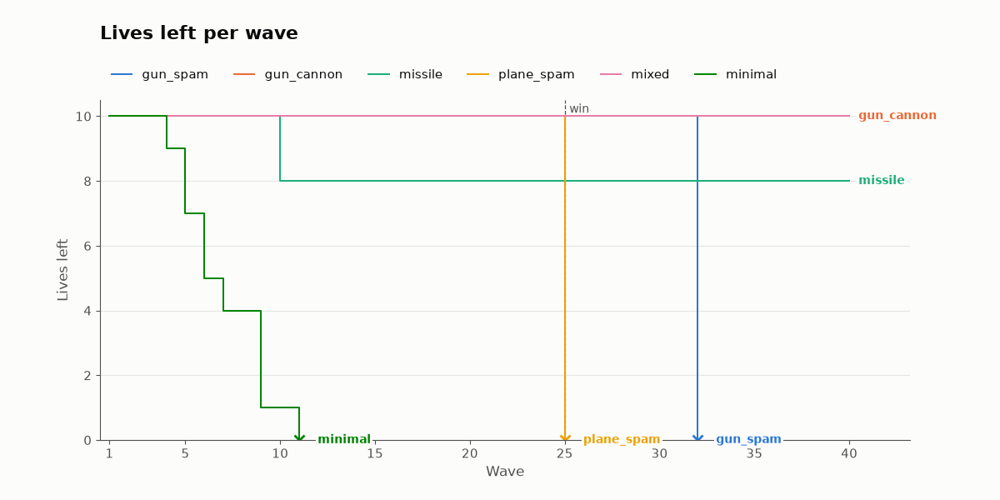
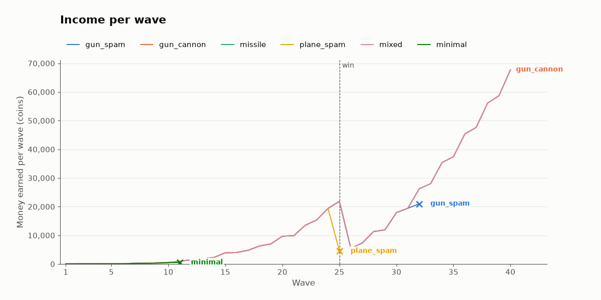
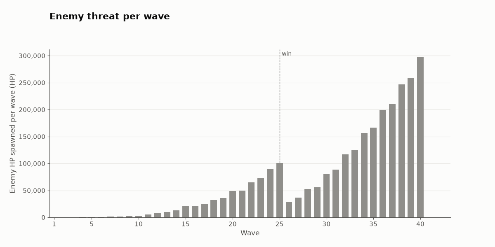
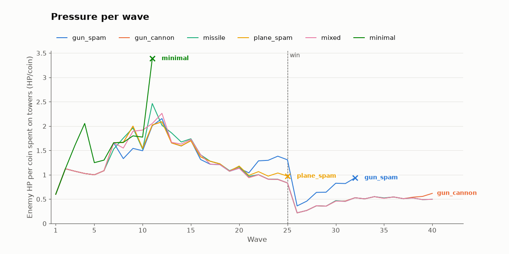

# Balance simulation

Generated by `scripts/balance_sim.py` (see docs/BALANCE.md); --waves 40, --seed 70, --game-speed 4.
ROI is a tower type's kill money so far divided by everything spent on it so far (purchases and upgrades; UPG PLANES counts for planes).
Damage is enemy HP taken in that wave, overkill not counted.

## Charts

*Each line is one strategy: read where it steps down (a wave that leaked) and where it ends in a cross (the run was lost there); runs that play alike draw on top of each other.*

*Money earned in each wave, all of it kill money: read how fast the payout grows and where a line stops because that run was lost.*

*The difficulty curve: the total HP of every enemy a wave spawns, after the game's +25% HP per wave scaling, the same for every strategy.*

*A wave's threat divided by all the money spent on towers so far (a proxy for the defense built): a rising line means the defense is falling behind, a falling one that it is pulling ahead.*

A cross ends the line of a run that was lost; the dashed line is the win wave (25). Each strategy has the same color in every chart.

## Summary

| strategy | result | lives left | lives lost 1-10 | lost 11-25 | lost 26+ | spent | earned | money left | towers lost | ROI gun | ROI missile | ROI cannon | ROI plane |
|---|---|---:|---:|---:|---:|---:|---:|---:|---:|---:|---:|---:|---:|
| gun_spam | died in wave 32 | 0 | 0 | 0 | 10 | 124100 | 218303 | 94403 | 834 | 1.76 |  |  |  |
| gun_cannon | cleared 40 of 40 | 10 | 0 | 0 | 0 | 479180 | 599939 | 120959 | 626 | 0.51 |  | 1.39 |  |
| missile | cleared 40 of 40 | 8 | 2 | 0 | 0 | 595160 | 599848 | 4888 | 174 | 6.17 | 1.0 |  |  |
| plane_spam | died in wave 25 | 0 | 0 | 10 | 0 | 103720 | 106661 | 3141 | 93 | 1.36 |  | 3.54 | 0.06 |
| mixed | cleared 40 of 40 | 10 | 0 | 0 | 0 | 595680 | 599939 | 4459 | 381 | 0.61 | 1.78 | 0.7 | 0.04 |
| minimal | died in wave 11 | 0 | 9 | 1 | 0 | 1600 | 2079 | 679 | 0 | 1.3 |  |  |  |

## gun_spam

Rapid guns only, on the best tiles on both sides of the path. Died in wave 32.

| wave | lives | lost | money | earned | spent | killed | escaped | towers | towers lost | dmg gun | dmg missile | dmg cannon | dmg plane | ROI gun | ROI missile | ROI cannon | ROI plane |
|---:|---:|---:|---:|---:|---:|---:|---:|---:|---:|---:|---:|---:|---:|---:|---:|---:|---:|
| 1 | 10 | 0 | 24 | 24 | 200 | 6 | 0 | 2 | 0 | 120 | 0 | 0 | 0 | 0.12 | - | - | - |
| 2 | 10 | 0 | 69 | 45 | 0 | 9 | 0 | 2 | 0 | 225 | 0 | 0 | 0 | 0.34 | - | - | - |
| 3 | 10 | 0 | 32 | 63 | 100 | 9 | 0 | 3 | 0 | 322 | 0 | 0 | 0 | 0.44 | - | - | - |
| 4 | 10 | 0 | 12 | 80 | 100 | 10 | 0 | 4 | 0 | 411 | 0 | 0 | 0 | 0.53 | - | - | - |
| 5 | 10 | 0 | 8 | 96 | 100 | 9 | 0 | 5 | 0 | 500 | 0 | 0 | 0 | 0.62 | - | - | - |
| 6 | 10 | 0 | 33 | 125 | 100 | 11 | 0 | 6 | 0 | 651 | 0 | 0 | 0 | 0.72 | - | - | - |
| 7 | 10 | 0 | 148 | 215 | 100 | 11 | 0 | 7 | 0 | 1161 | 0 | 0 | 0 | 0.93 | - | - | - |
| 8 | 10 | 0 | 94 | 246 | 300 | 12 | 0 | 10 | 0 | 1333 | 0 | 0 | 0 | 0.89 | - | - | - |
| 9 | 10 | 0 | 90 | 396 | 400 | 15 | 0 | 14 | 0 | 2160 | 0 | 0 | 0 | 0.92 | - | - | - |
| 10 | 10 | 0 | 101 | 511 | 500 | 14 | 0 | 19 | 0 | 2840 | 0 | 0 | 0 | 0.95 | - | - | - |
| 11 | 10 | 0 | 277 | 976 | 800 | 19 | 0 | 27 | 0 | 5422 | 0 | 0 | 0 | 1.03 | - | - | - |
| 12 | 10 | 0 | 643 | 1466 | 1100 | 22 | 0 | 38 | 0 | 8192 | 0 | 0 | 0 | 1.12 | - | - | - |
| 13 | 10 | 0 | 363 | 1720 | 2000 | 24 | 0 | 58 | 0 | 9600 | 0 | 0 | 0 | 1.03 | - | - | - |
| 14 | 10 | 0 | 364 | 2301 | 2300 | 27 | 0 | 81 | 0 | 12892 | 0 | 0 | 0 | 1.02 | - | - | - |
| 15 | 10 | 0 | 386 | 3922 | 3900 | 35 | 0 | 120 | 0 | 20470 | 0 | 0 | 0 | 1.02 | - | - | - |
| 16 | 10 | 0 | 408 | 4022 | 4000 | 29 | 0 | 158 | 2 | 21040 | 0 | 0 | 0 | 1.01 | - | - | - |
| 17 | 10 | 0 | 413 | 4805 | 4800 | 32 | 0 | 200 | 6 | 25325 | 0 | 0 | 0 | 1.01 | - | - | - |
| 18 | 10 | 0 | 1098 | 6285 | 5600 | 35 | 0 | 247 | 9 | 31911 | 0 | 0 | 0 | 1.03 | - | - | - |
| 19 | 10 | 0 | 1124 | 7026 | 7000 | 37 | 0 | 305 | 12 | 35854 | 0 | 0 | 0 | 1.03 | - | - | - |
| 20 | 10 | 0 | 1221 | 9697 | 9600 | 46 | 0 | 378 | 23 | 48814 | 0 | 0 | 0 | 1.02 | - | - | - |
| 21 | 10 | 0 | 6309 | 9888 | 4800 | 36 | 0 | 407 | 19 | 49740 | 0 | 0 | 0 | 1.13 | - | - | - |
| 22 | 10 | 0 | 17001 | 13492 | 2800 | 40 | 0 | 407 | 28 | 65145 | 0 | 0 | 0 | 1.33 | - | - | - |
| 23 | 10 | 0 | 26743 | 15342 | 5600 | 41 | 0 | 407 | 56 | 72955 | 0 | 0 | 0 | 1.47 | - | - | - |
| 24 | 10 | 0 | 37132 | 19389 | 9000 | 45 | 0 | 407 | 90 | 90176 | 0 | 0 | 0 | 1.57 | - | - | - |
| 25 | 10 | 0 | 46986 | 21854 | 12000 | 49 | 0 | 407 | 120 | 101010 | 0 | 0 | 0 | 1.61 | - | - | - |
| 26 | 10 | 0 | 51802 | 5416 | 600 | 19 | 0 | 407 | 6 | 28124 | 0 | 0 | 0 | 1.66 | - | - | - |
| 27 | 10 | 0 | 57920 | 7318 | 1200 | 21 | 0 | 407 | 12 | 36296 | 0 | 0 | 0 | 1.73 | - | - | - |
| 28 | 10 | 0 | 65637 | 11317 | 3600 | 24 | 0 | 407 | 36 | 52814 | 0 | 0 | 0 | 1.79 | - | - | - |
| 29 | 10 | 0 | 73449 | 11912 | 4100 | 25 | 0 | 407 | 41 | 55800 | 0 | 0 | 0 | 1.84 | - | - | - |
| 30 | 10 | 0 | 80875 | 17926 | 10500 | 29 | 0 | 407 | 105 | 80430 | 0 | 0 | 0 | 1.83 | - | - | - |
| 31 | 10 | 0 | 90011 | 19436 | 10300 | 32 | 0 | 407 | 103 | 88267 | 0 | 0 | 0 | 1.84 | - | - | - |
| 32 | 0 | 10 | 94403 | 20992 | 16600 | 35 | 2 | 407 | 166 | 107798 | 0 | 0 | 0 | 1.76 | - | - | - |

## gun_cannon

6 rapid guns, then a front line of guns with heavy cannons in the row behind (2 guns per cannon), cannons upgraded. Cleared 40 of 40.

| wave | lives | lost | money | earned | spent | killed | escaped | towers | towers lost | dmg gun | dmg missile | dmg cannon | dmg plane | ROI gun | ROI missile | ROI cannon | ROI plane |
|---:|---:|---:|---:|---:|---:|---:|---:|---:|---:|---:|---:|---:|---:|---:|---:|---:|---:|
| 1 | 10 | 0 | 24 | 24 | 200 | 6 | 0 | 2 | 0 | 120 | 0 | 0 | 0 | 0.12 | - | - | - |
| 2 | 10 | 0 | 69 | 45 | 0 | 9 | 0 | 2 | 0 | 225 | 0 | 0 | 0 | 0.34 | - | - | - |
| 3 | 10 | 0 | 32 | 63 | 100 | 9 | 0 | 3 | 0 | 322 | 0 | 0 | 0 | 0.44 | - | - | - |
| 4 | 10 | 0 | 12 | 80 | 100 | 10 | 0 | 4 | 0 | 411 | 0 | 0 | 0 | 0.53 | - | - | - |
| 5 | 10 | 0 | 8 | 96 | 100 | 9 | 0 | 5 | 0 | 500 | 0 | 0 | 0 | 0.62 | - | - | - |
| 6 | 10 | 0 | 33 | 125 | 100 | 11 | 0 | 6 | 0 | 651 | 0 | 0 | 0 | 0.72 | - | - | - |
| 7 | 10 | 0 | 148 | 215 | 100 | 11 | 0 | 7 | 0 | 1161 | 0 | 0 | 0 | 0.93 | - | - | - |
| 8 | 10 | 0 | 294 | 246 | 100 | 12 | 0 | 8 | 0 | 1333 | 0 | 0 | 0 | 1.12 | - | - | - |
| 9 | 10 | 0 | 410 | 396 | 280 | 15 | 0 | 9 | 0 | 1578 | 0 | 582 | 0 | 1.55 | - | 0.17 | - |
| 10 | 10 | 0 | 161 | 511 | 760 | 14 | 0 | 11 | 0 | 1684 | 0 | 1156 | 0 | 1.67 | - | 0.16 | - |
| 11 | 10 | 0 | 297 | 976 | 840 | 19 | 0 | 12 | 0 | 2878 | 0 | 2544 | 0 | 2.12 | - | 0.39 | - |
| 12 | 10 | 0 | 523 | 1466 | 1240 | 22 | 0 | 17 | 0 | 3864 | 0 | 4328 | 0 | 2.1 | - | 0.52 | - |
| 13 | 10 | 0 | 363 | 1720 | 1880 | 24 | 0 | 21 | 0 | 3194 | 0 | 6406 | 0 | 2.08 | - | 0.63 | - |
| 14 | 10 | 0 | 384 | 2301 | 2280 | 27 | 0 | 29 | 0 | 3951 | 0 | 8941 | 0 | 1.86 | - | 0.71 | - |
| 15 | 10 | 0 | 346 | 3922 | 3960 | 35 | 0 | 38 | 1 | 5312 | 0 | 15158 | 0 | 1.53 | - | 0.85 | - |
| 16 | 10 | 0 | 1048 | 4022 | 3320 | 29 | 0 | 45 | 4 | 7510 | 0 | 13530 | 0 | 1.37 | - | 0.96 | - |
| 17 | 10 | 0 | 1413 | 4805 | 4440 | 32 | 0 | 54 | 4 | 7792 | 0 | 17533 | 0 | 1.22 | - | 1.02 | - |
| 18 | 10 | 0 | 1458 | 6285 | 6240 | 35 | 0 | 61 | 11 | 9276 | 0 | 22635 | 0 | 1.05 | - | 1.05 | - |
| 19 | 10 | 0 | 1204 | 7026 | 7280 | 37 | 0 | 77 | 5 | 8722 | 0 | 27132 | 0 | 0.96 | - | 1.05 | - |
| 20 | 10 | 0 | 1541 | 9697 | 9360 | 46 | 0 | 90 | 14 | 10359 | 0 | 38455 | 0 | 0.79 | - | 1.09 | - |
| 21 | 10 | 0 | 1309 | 9888 | 10120 | 36 | 0 | 108 | 11 | 11650 | 0 | 38090 | 0 | 0.7 | - | 1.1 | - |
| 22 | 10 | 0 | 2521 | 13492 | 12280 | 40 | 0 | 119 | 23 | 13287 | 0 | 51858 | 0 | 0.66 | - | 1.13 | - |
| 23 | 10 | 0 | 2823 | 15342 | 15040 | 41 | 0 | 137 | 27 | 11750 | 0 | 61205 | 0 | 0.61 | - | 1.14 | - |
| 24 | 10 | 0 | 2732 | 19389 | 19480 | 45 | 0 | 158 | 35 | 12211 | 0 | 77965 | 0 | 0.56 | - | 1.14 | - |
| 25 | 10 | 0 | 3026 | 21854 | 21560 | 49 | 0 | 177 | 45 | 11492 | 0 | 89518 | 0 | 0.54 | - | 1.14 | - |
| 26 | 10 | 0 | 602 | 5416 | 7840 | 19 | 0 | 198 | 0 | 2570 | 0 | 25554 | 0 | 0.57 | - | 1.11 | - |
| 27 | 10 | 0 | 1580 | 7318 | 6340 | 21 | 0 | 213 | 4 | 3312 | 0 | 32984 | 0 | 0.54 | - | 1.13 | - |
| 28 | 10 | 0 | 3157 | 11317 | 9740 | 24 | 0 | 230 | 12 | 6497 | 0 | 46317 | 0 | 0.53 | - | 1.14 | - |
| 29 | 10 | 0 | 3629 | 11912 | 11440 | 25 | 0 | 253 | 10 | 6238 | 0 | 49562 | 0 | 0.51 | - | 1.15 | - |
| 30 | 10 | 0 | 3315 | 17926 | 18240 | 29 | 0 | 274 | 30 | 8827 | 0 | 71603 | 0 | 0.6 | - | 1.12 | - |
| 31 | 10 | 0 | 6951 | 19436 | 15800 | 32 | 0 | 293 | 28 | 10274 | 0 | 77993 | 0 | 0.56 | - | 1.15 | - |
| 32 | 10 | 0 | 3793 | 26242 | 29400 | 37 | 0 | 337 | 41 | 11035 | 0 | 105512 | 0 | 0.57 | - | 1.12 | - |
| 33 | 10 | 0 | 3730 | 28017 | 28080 | 40 | 0 | 386 | 32 | 11596 | 0 | 113999 | 0 | 0.55 | - | 1.13 | - |
| 34 | 10 | 0 | 3746 | 35376 | 35360 | 45 | 0 | 445 | 43 | 14144 | 0 | 142078 | 0 | 0.51 | - | 1.13 | - |
| 35 | 10 | 0 | 3941 | 37415 | 37220 | 48 | 0 | 488 | 35 | 14904 | 0 | 151576 | 0 | 0.49 | - | 1.13 | - |
| 36 | 10 | 0 | 4307 | 45346 | 44980 | 53 | 0 | 530 | 36 | 12911 | 0 | 186570 | 0 | 0.55 | - | 1.1 | - |
| 37 | 10 | 0 | 4497 | 47650 | 47460 | 56 | 0 | 577 | 28 | 10272 | 0 | 200678 | 0 | 0.54 | - | 1.1 | - |
| 38 | 10 | 0 | 18127 | 56130 | 42500 | 61 | 0 | 612 | 44 | 10929 | 0 | 235365 | 0 | 0.52 | - | 1.13 | - |
| 39 | 10 | 0 | 67645 | 58698 | 9180 | 64 | 0 | 612 | 40 | 11284 | 0 | 247689 | 0 | 0.51 | - | 1.26 | - |
| 40 | 10 | 0 | 120959 | 67754 | 14440 | 69 | 0 | 612 | 63 | 13173 | 0 | 283522 | 0 | 0.51 | - | 1.39 | - |

## missile

6 rapid guns, then homing missiles only, each upgraded to level 3 before the next. Cleared 40 of 40.

| wave | lives | lost | money | earned | spent | killed | escaped | towers | towers lost | dmg gun | dmg missile | dmg cannon | dmg plane | ROI gun | ROI missile | ROI cannon | ROI plane |
|---:|---:|---:|---:|---:|---:|---:|---:|---:|---:|---:|---:|---:|---:|---:|---:|---:|---:|
| 1 | 10 | 0 | 24 | 24 | 200 | 6 | 0 | 2 | 0 | 120 | 0 | 0 | 0 | 0.12 | - | - | - |
| 2 | 10 | 0 | 69 | 45 | 0 | 9 | 0 | 2 | 0 | 225 | 0 | 0 | 0 | 0.34 | - | - | - |
| 3 | 10 | 0 | 32 | 63 | 100 | 9 | 0 | 3 | 0 | 322 | 0 | 0 | 0 | 0.44 | - | - | - |
| 4 | 10 | 0 | 12 | 80 | 100 | 10 | 0 | 4 | 0 | 411 | 0 | 0 | 0 | 0.53 | - | - | - |
| 5 | 10 | 0 | 8 | 96 | 100 | 9 | 0 | 5 | 0 | 500 | 0 | 0 | 0 | 0.62 | - | - | - |
| 6 | 10 | 0 | 33 | 125 | 100 | 11 | 0 | 6 | 0 | 651 | 0 | 0 | 0 | 0.72 | - | - | - |
| 7 | 10 | 0 | 88 | 215 | 160 | 11 | 0 | 7 | 0 | 1161 | 0 | 0 | 0 | 1.08 | 0.0 | - | - |
| 8 | 10 | 0 | 334 | 246 | 0 | 12 | 0 | 7 | 0 | 808 | 525 | 0 | 0 | 1.44 | 0.21 | - | - |
| 9 | 10 | 0 | 390 | 396 | 340 | 15 | 0 | 7 | 0 | 900 | 1260 | 0 | 0 | 1.96 | 0.23 | - | - |
| 10 | 8 | 2 | 50 | 420 | 760 | 13 | 1 | 8 | 0 | 1382 | 1450 | 0 | 0 | 2.52 | 0.15 | - | - |
| 11 | 8 | 0 | 686 | 976 | 340 | 19 | 0 | 8 | 0 | 1004 | 4418 | 0 | 0 | 3.57 | 0.34 | - | - |
| 12 | 8 | 0 | 292 | 1466 | 1860 | 22 | 0 | 10 | 0 | 843 | 7349 | 0 | 0 | 4.39 | 0.44 | - | - |
| 13 | 8 | 0 | 912 | 1720 | 1100 | 24 | 0 | 11 | 0 | 308 | 9292 | 0 | 0 | 5.07 | 0.62 | - | - |
| 14 | 8 | 0 | 673 | 2301 | 2540 | 27 | 0 | 13 | 0 | 345 | 12547 | 0 | 0 | 5.6 | 0.68 | - | - |
| 15 | 8 | 0 | 535 | 3922 | 4060 | 35 | 0 | 17 | 0 | 800 | 19670 | 0 | 0 | 6.17 | 0.75 | - | - |
| 16 | 8 | 0 | 1417 | 4022 | 3140 | 29 | 0 | 19 | 0 | 0 | 21040 | 0 | 0 | 6.17 | 0.87 | - | - |
| 17 | 8 | 0 | 1322 | 4805 | 4900 | 32 | 0 | 24 | 0 | 0 | 25325 | 0 | 0 | 6.17 | 0.9 | - | - |
| 18 | 8 | 0 | 1347 | 6285 | 6260 | 35 | 0 | 30 | 0 | 0 | 31911 | 0 | 0 | 6.17 | 0.92 | - | - |
| 19 | 8 | 0 | 1433 | 7026 | 6940 | 37 | 0 | 36 | 0 | 0 | 35854 | 0 | 0 | 6.17 | 0.94 | - | - |
| 20 | 8 | 0 | 2330 | 9697 | 8800 | 46 | 0 | 42 | 2 | 0 | 48814 | 0 | 0 | 6.17 | 0.98 | - | - |
| 21 | 8 | 0 | 2658 | 9888 | 9560 | 36 | 0 | 50 | 1 | 0 | 49740 | 0 | 0 | 6.17 | 0.99 | - | - |
| 22 | 8 | 0 | 2610 | 13492 | 13540 | 40 | 0 | 59 | 3 | 0 | 65145 | 0 | 0 | 6.17 | 0.99 | - | - |
| 23 | 8 | 0 | 2892 | 15342 | 15060 | 41 | 0 | 68 | 5 | 0 | 72955 | 0 | 0 | 6.17 | 0.99 | - | - |
| 24 | 8 | 0 | 3081 | 19389 | 19200 | 45 | 0 | 81 | 5 | 0 | 90176 | 0 | 0 | 6.17 | 1.0 | - | - |
| 25 | 8 | 0 | 2935 | 21854 | 22000 | 49 | 0 | 93 | 8 | 0 | 101010 | 0 | 0 | 6.17 | 1.0 | - | - |
| 26 | 8 | 0 | 1751 | 5416 | 6600 | 19 | 0 | 99 | 0 | 0 | 28124 | 0 | 0 | 6.17 | 0.99 | - | - |
| 27 | 8 | 0 | 1709 | 7318 | 7360 | 21 | 0 | 106 | 0 | 0 | 36296 | 0 | 0 | 6.17 | 0.99 | - | - |
| 28 | 8 | 0 | 3126 | 11317 | 9900 | 24 | 0 | 114 | 1 | 0 | 52814 | 0 | 0 | 6.17 | 1.0 | - | - |
| 29 | 8 | 0 | 3698 | 11912 | 11340 | 25 | 0 | 121 | 3 | 0 | 55800 | 0 | 0 | 6.17 | 1.0 | - | - |
| 30 | 8 | 0 | 6724 | 17926 | 14900 | 29 | 0 | 130 | 4 | 0 | 80430 | 0 | 0 | 6.17 | 1.02 | - | - |
| 31 | 8 | 0 | 3660 | 19436 | 22500 | 32 | 0 | 143 | 8 | 0 | 88267 | 0 | 0 | 6.17 | 1.0 | - | - |
| 32 | 8 | 0 | 3502 | 26242 | 26400 | 37 | 0 | 161 | 6 | 0 | 116547 | 0 | 0 | 6.17 | 1.0 | - | - |
| 33 | 8 | 0 | 3859 | 28017 | 27660 | 40 | 0 | 179 | 8 | 0 | 125595 | 0 | 0 | 6.17 | 1.0 | - | - |
| 34 | 8 | 0 | 4035 | 35376 | 35200 | 45 | 0 | 198 | 13 | 0 | 156222 | 0 | 0 | 6.17 | 1.0 | - | - |
| 35 | 8 | 0 | 8110 | 37415 | 33340 | 48 | 0 | 213 | 15 | 0 | 166480 | 0 | 0 | 6.17 | 1.02 | - | - |
| 36 | 8 | 0 | 3956 | 45346 | 49500 | 53 | 0 | 245 | 13 | 0 | 199481 | 0 | 0 | 6.17 | 1.0 | - | - |
| 37 | 8 | 0 | 4146 | 47650 | 47460 | 56 | 0 | 270 | 19 | 0 | 210950 | 0 | 0 | 6.17 | 1.0 | - | - |
| 38 | 8 | 0 | 4176 | 56130 | 56100 | 61 | 0 | 306 | 15 | 0 | 246294 | 0 | 0 | 6.17 | 1.0 | - | - |
| 39 | 8 | 0 | 4234 | 58698 | 58640 | 64 | 0 | 336 | 23 | 0 | 258973 | 0 | 0 | 6.17 | 1.0 | - | - |
| 40 | 8 | 0 | 4888 | 67754 | 67100 | 69 | 0 | 375 | 22 | 0 | 296695 | 0 | 0 | 6.17 | 1.0 | - | - |

## plane_spam

The gun_cannon build up to wave 19, then from wave 20 only planes: one along the longest straight whenever affordable while enemies are on it, UPG PLANES after the 5th. Died in wave 25.

| wave | lives | lost | money | earned | spent | killed | escaped | towers | towers lost | dmg gun | dmg missile | dmg cannon | dmg plane | ROI gun | ROI missile | ROI cannon | ROI plane |
|---:|---:|---:|---:|---:|---:|---:|---:|---:|---:|---:|---:|---:|---:|---:|---:|---:|---:|
| 1 | 10 | 0 | 24 | 24 | 200 | 6 | 0 | 2 | 0 | 120 | 0 | 0 | 0 | 0.12 | - | - | - |
| 2 | 10 | 0 | 69 | 45 | 0 | 9 | 0 | 2 | 0 | 225 | 0 | 0 | 0 | 0.34 | - | - | - |
| 3 | 10 | 0 | 32 | 63 | 100 | 9 | 0 | 3 | 0 | 322 | 0 | 0 | 0 | 0.44 | - | - | - |
| 4 | 10 | 0 | 12 | 80 | 100 | 10 | 0 | 4 | 0 | 411 | 0 | 0 | 0 | 0.53 | - | - | - |
| 5 | 10 | 0 | 8 | 96 | 100 | 9 | 0 | 5 | 0 | 500 | 0 | 0 | 0 | 0.62 | - | - | - |
| 6 | 10 | 0 | 33 | 125 | 100 | 11 | 0 | 6 | 0 | 651 | 0 | 0 | 0 | 0.72 | - | - | - |
| 7 | 10 | 0 | 148 | 215 | 100 | 11 | 0 | 7 | 0 | 1161 | 0 | 0 | 0 | 0.93 | - | - | - |
| 8 | 10 | 0 | 294 | 246 | 100 | 12 | 0 | 8 | 0 | 1333 | 0 | 0 | 0 | 1.12 | - | - | - |
| 9 | 10 | 0 | 410 | 396 | 280 | 15 | 0 | 9 | 0 | 1578 | 0 | 582 | 0 | 1.55 | - | 0.17 | - |
| 10 | 10 | 0 | 161 | 511 | 760 | 14 | 0 | 11 | 0 | 1684 | 0 | 1156 | 0 | 1.67 | - | 0.16 | - |
| 11 | 10 | 0 | 297 | 976 | 840 | 19 | 0 | 12 | 0 | 2878 | 0 | 2544 | 0 | 2.12 | - | 0.39 | - |
| 12 | 10 | 0 | 523 | 1466 | 1240 | 22 | 0 | 17 | 0 | 3864 | 0 | 4328 | 0 | 2.1 | - | 0.52 | - |
| 13 | 10 | 0 | 363 | 1720 | 1880 | 24 | 0 | 21 | 0 | 3194 | 0 | 6406 | 0 | 2.08 | - | 0.63 | - |
| 14 | 10 | 0 | 384 | 2301 | 2280 | 27 | 0 | 29 | 0 | 3951 | 0 | 8941 | 0 | 1.86 | - | 0.71 | - |
| 15 | 10 | 0 | 346 | 3922 | 3960 | 35 | 0 | 38 | 1 | 5312 | 0 | 15158 | 0 | 1.53 | - | 0.85 | - |
| 16 | 10 | 0 | 1048 | 4022 | 3320 | 29 | 0 | 45 | 4 | 7510 | 0 | 13530 | 0 | 1.37 | - | 0.96 | - |
| 17 | 10 | 0 | 1413 | 4805 | 4440 | 32 | 0 | 54 | 4 | 7792 | 0 | 17533 | 0 | 1.22 | - | 1.02 | - |
| 18 | 10 | 0 | 1458 | 6285 | 6240 | 35 | 0 | 61 | 11 | 9276 | 0 | 22635 | 0 | 1.05 | - | 1.05 | - |
| 19 | 10 | 0 | 1204 | 7026 | 7280 | 37 | 0 | 77 | 5 | 8722 | 0 | 27132 | 0 | 0.96 | - | 1.05 | - |
| 20 | 10 | 0 | 2901 | 9697 | 8000 | 46 | 0 | 63 | 14 | 9370 | 0 | 36345 | 3099 | 1.19 | - | 1.35 | 0.02 |
| 21 | 10 | 0 | 3789 | 9888 | 9000 | 36 | 0 | 54 | 9 | 2928 | 0 | 23666 | 23146 | 1.19 | - | 1.71 | 0.03 |
| 22 | 10 | 0 | 6481 | 13492 | 10800 | 40 | 0 | 48 | 6 | 264 | 0 | 36555 | 28326 | 1.19 | - | 2.2 | 0.05 |
| 23 | 10 | 0 | 8023 | 15342 | 13800 | 41 | 0 | 33 | 15 | 2014 | 0 | 44983 | 25958 | 1.33 | - | 2.72 | 0.05 |
| 24 | 10 | 0 | 15412 | 19389 | 12000 | 45 | 0 | 13 | 20 | 2238 | 0 | 62428 | 25510 | 1.36 | - | 3.42 | 0.05 |
| 25 | 0 | 10 | 3141 | 4529 | 16800 | 33 | 4 | 9 | 4 | 408 | 0 | 26424 | 13330 | 1.36 | - | 3.54 | 0.06 |

## mixed

6 rapid guns, then all three ground towers with upgrades (gun, missile, cannon behind, upgrades), plus from wave 20 a plane each cycle if enemies are on the longest straight. Cleared 40 of 40.

| wave | lives | lost | money | earned | spent | killed | escaped | towers | towers lost | dmg gun | dmg missile | dmg cannon | dmg plane | ROI gun | ROI missile | ROI cannon | ROI plane |
|---:|---:|---:|---:|---:|---:|---:|---:|---:|---:|---:|---:|---:|---:|---:|---:|---:|---:|
| 1 | 10 | 0 | 24 | 24 | 200 | 6 | 0 | 2 | 0 | 120 | 0 | 0 | 0 | 0.12 | - | - | - |
| 2 | 10 | 0 | 69 | 45 | 0 | 9 | 0 | 2 | 0 | 225 | 0 | 0 | 0 | 0.34 | - | - | - |
| 3 | 10 | 0 | 32 | 63 | 100 | 9 | 0 | 3 | 0 | 322 | 0 | 0 | 0 | 0.44 | - | - | - |
| 4 | 10 | 0 | 12 | 80 | 100 | 10 | 0 | 4 | 0 | 411 | 0 | 0 | 0 | 0.53 | - | - | - |
| 5 | 10 | 0 | 8 | 96 | 100 | 9 | 0 | 5 | 0 | 500 | 0 | 0 | 0 | 0.62 | - | - | - |
| 6 | 10 | 0 | 33 | 125 | 100 | 11 | 0 | 6 | 0 | 651 | 0 | 0 | 0 | 0.72 | - | - | - |
| 7 | 10 | 0 | 148 | 215 | 100 | 11 | 0 | 7 | 0 | 1161 | 0 | 0 | 0 | 0.93 | - | - | - |
| 8 | 10 | 0 | 234 | 246 | 160 | 12 | 0 | 8 | 0 | 1173 | 160 | 0 | 0 | 1.28 | 0.0 | - | - |
| 9 | 10 | 0 | 350 | 396 | 280 | 15 | 0 | 9 | 0 | 1019 | 660 | 481 | 0 | 1.75 | 0.15 | 0.15 | - |
| 10 | 10 | 0 | 521 | 511 | 340 | 14 | 0 | 9 | 0 | 1028 | 1264 | 548 | 0 | 2.28 | 0.2 | 0.38 | - |
| 11 | 10 | 0 | 337 | 976 | 1160 | 19 | 0 | 9 | 0 | 1446 | 1994 | 1982 | 0 | 3.12 | 0.19 | 0.45 | - |
| 12 | 10 | 0 | 823 | 1466 | 980 | 22 | 0 | 13 | 0 | 2146 | 3964 | 2082 | 0 | 3.33 | 0.41 | 0.53 | - |
| 13 | 10 | 0 | 403 | 1720 | 2140 | 24 | 0 | 17 | 0 | 1928 | 5008 | 2664 | 0 | 3.3 | 0.57 | 0.4 | - |
| 14 | 10 | 0 | 564 | 2301 | 2140 | 27 | 0 | 21 | 0 | 2309 | 7122 | 3461 | 0 | 2.87 | 0.84 | 0.48 | - |
| 15 | 10 | 0 | 546 | 3922 | 3940 | 35 | 0 | 28 | 1 | 3052 | 11740 | 5678 | 0 | 2.72 | 0.7 | 0.8 | - |
| 16 | 10 | 0 | 1528 | 4022 | 3040 | 29 | 0 | 29 | 3 | 2006 | 15058 | 3976 | 0 | 2.63 | 0.85 | 0.88 | - |
| 17 | 10 | 0 | 473 | 4805 | 5860 | 32 | 0 | 39 | 2 | 1632 | 20753 | 2940 | 0 | 2.0 | 0.89 | 0.87 | - |
| 18 | 10 | 0 | 1118 | 6285 | 5640 | 35 | 0 | 47 | 2 | 1872 | 28441 | 1598 | 0 | 1.63 | 1.05 | 0.83 | - |
| 19 | 10 | 0 | 1284 | 7026 | 6860 | 37 | 0 | 59 | 2 | 2948 | 31716 | 1190 | 0 | 1.5 | 1.22 | 0.65 | - |
| 20 | 10 | 0 | 1221 | 9697 | 9760 | 46 | 0 | 72 | 5 | 3057 | 39248 | 5109 | 1400 | 1.3 | 1.3 | 0.67 | 0.0 |
| 21 | 10 | 0 | 1609 | 9888 | 9500 | 36 | 0 | 81 | 5 | 4532 | 42996 | 1412 | 800 | 1.14 | 1.42 | 0.61 | 0.0 |
| 22 | 10 | 0 | 2601 | 13492 | 12500 | 40 | 0 | 95 | 6 | 4512 | 52280 | 7453 | 900 | 0.96 | 1.61 | 0.51 | 0.0 |
| 23 | 10 | 0 | 2703 | 15342 | 15240 | 41 | 0 | 111 | 8 | 3991 | 55109 | 12255 | 1600 | 0.87 | 1.7 | 0.45 | 0.0 |
| 24 | 10 | 0 | 2972 | 19389 | 19120 | 45 | 0 | 130 | 12 | 3698 | 70237 | 14041 | 2200 | 0.74 | 1.78 | 0.43 | 0.0 |
| 25 | 10 | 0 | 3166 | 21854 | 21660 | 49 | 0 | 146 | 16 | 4200 | 74842 | 18530 | 3438 | 0.63 | 1.79 | 0.48 | 0.01 |
| 26 | 10 | 0 | 1562 | 5416 | 7020 | 19 | 0 | 158 | 0 | 1704 | 18549 | 7771 | 100 | 0.59 | 1.76 | 0.47 | 0.01 |
| 27 | 10 | 0 | 1600 | 7318 | 7280 | 21 | 0 | 167 | 3 | 2280 | 24848 | 8668 | 500 | 0.57 | 1.79 | 0.46 | 0.01 |
| 28 | 10 | 0 | 3697 | 11317 | 9220 | 24 | 0 | 177 | 3 | 2544 | 38611 | 11059 | 600 | 0.54 | 1.84 | 0.44 | 0.01 |
| 29 | 10 | 0 | 3709 | 11912 | 11900 | 25 | 0 | 191 | 6 | 3264 | 38182 | 13854 | 500 | 0.5 | 1.85 | 0.43 | 0.01 |
| 30 | 10 | 0 | 3395 | 17926 | 18240 | 29 | 0 | 209 | 12 | 3727 | 56622 | 18681 | 1400 | 0.45 | 1.84 | 0.45 | 0.01 |
| 31 | 10 | 0 | 3671 | 19436 | 19160 | 32 | 0 | 225 | 13 | 3451 | 62104 | 20918 | 1794 | 0.42 | 1.85 | 0.45 | 0.03 |
| 32 | 10 | 0 | 3513 | 26242 | 26400 | 37 | 0 | 252 | 15 | 4266 | 79723 | 29950 | 2608 | 0.38 | 1.86 | 0.42 | 0.09 |
| 33 | 10 | 0 | 3990 | 28017 | 27540 | 40 | 0 | 275 | 19 | 5616 | 85214 | 31465 | 3300 | 0.35 | 1.89 | 0.4 | 0.1 |
| 34 | 10 | 0 | 4006 | 35376 | 35360 | 45 | 0 | 301 | 30 | 8209 | 102409 | 41104 | 4500 | 0.66 | 1.76 | 0.51 | 0.08 |
| 35 | 10 | 0 | 3881 | 37415 | 37540 | 48 | 0 | 331 | 30 | 8638 | 100066 | 52376 | 5400 | 0.63 | 1.69 | 0.61 | 0.07 |
| 36 | 10 | 0 | 4447 | 45346 | 44780 | 53 | 0 | 371 | 32 | 11474 | 116160 | 64847 | 7000 | 0.62 | 1.65 | 0.68 | 0.06 |
| 37 | 10 | 0 | 4237 | 47650 | 47860 | 56 | 0 | 406 | 41 | 10834 | 117862 | 75854 | 6400 | 0.66 | 1.63 | 0.69 | 0.05 |
| 38 | 10 | 0 | 4267 | 56130 | 56100 | 61 | 0 | 450 | 36 | 13316 | 133877 | 89001 | 10100 | 0.62 | 1.63 | 0.7 | 0.05 |
| 39 | 10 | 0 | 4605 | 58698 | 58360 | 64 | 0 | 480 | 44 | 13084 | 127551 | 105438 | 12900 | 0.62 | 1.67 | 0.71 | 0.04 |
| 40 | 10 | 0 | 4459 | 67754 | 67900 | 69 | 0 | 524 | 35 | 10525 | 120484 | 148286 | 17400 | 0.61 | 1.78 | 0.7 | 0.04 |

## minimal

Rapid guns only, bought only after a life is lost and until a wave passes without a leak. Died in wave 11.

| wave | lives | lost | money | earned | spent | killed | escaped | towers | towers lost | dmg gun | dmg missile | dmg cannon | dmg plane | ROI gun | ROI missile | ROI cannon | ROI plane |
|---:|---:|---:|---:|---:|---:|---:|---:|---:|---:|---:|---:|---:|---:|---:|---:|---:|---:|
| 1 | 10 | 0 | 24 | 24 | 200 | 6 | 0 | 2 | 0 | 120 | 0 | 0 | 0 | 0.12 | - | - | - |
| 2 | 10 | 0 | 69 | 45 | 0 | 9 | 0 | 2 | 0 | 225 | 0 | 0 | 0 | 0.34 | - | - | - |
| 3 | 10 | 0 | 132 | 63 | 0 | 9 | 0 | 2 | 0 | 322 | 0 | 0 | 0 | 0.66 | - | - | - |
| 4 | 9 | 1 | 195 | 63 | 0 | 9 | 1 | 2 | 0 | 399 | 0 | 0 | 0 | 0.97 | - | - | - |
| 5 | 7 | 2 | 51 | 56 | 200 | 7 | 2 | 4 | 0 | 484 | 0 | 0 | 0 | 0.63 | - | - | - |
| 6 | 5 | 2 | 32 | 81 | 100 | 9 | 2 | 5 | 0 | 597 | 0 | 0 | 0 | 0.66 | - | - | - |
| 7 | 4 | 1 | 22 | 190 | 200 | 10 | 1 | 7 | 0 | 1120 | 0 | 0 | 0 | 0.75 | - | - | - |
| 8 | 4 | 0 | 168 | 246 | 100 | 12 | 0 | 8 | 0 | 1333 | 0 | 0 | 0 | 0.96 | - | - | - |
| 9 | 1 | 3 | 50 | 282 | 400 | 13 | 2 | 12 | 0 | 2103 | 0 | 0 | 0 | 0.88 | - | - | - |
| 10 | 1 | 0 | 161 | 511 | 400 | 14 | 0 | 16 | 0 | 2840 | 0 | 0 | 0 | 0.98 | - | - | - |
| 11 | 0 | 1 | 679 | 518 | 0 | 16 | 1 | 16 | 0 | 5100 | 0 | 0 | 0 | 1.3 | - | - | - |
