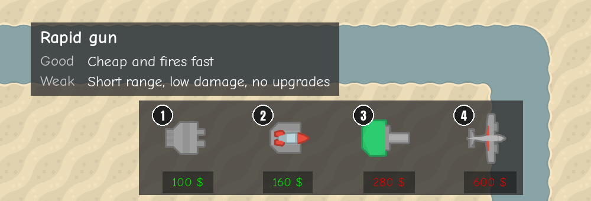
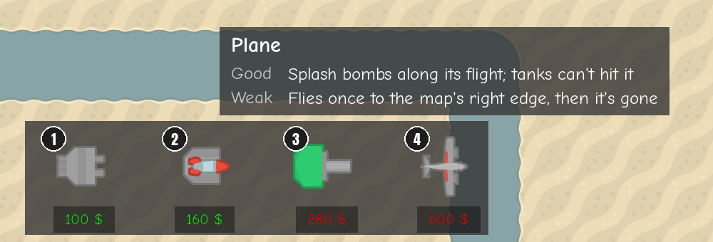

# Buy-button tooltips
<!-- index | refs: #6, PR #36 -->

**Date:** 2026-10-26 · **Area:** UI · **Issue:** [#6](https://github.com/vectorviolet/chokepoint/issues/6) · **PR:** [#36](https://github.com/vectorviolet/chokepoint/pull/36)

## Context

The four buy buttons show only an icon and a price, so players learned what each tower is good at
by trial and error. Issue #6 asked for a tooltip on hover with one line of strength and one of
weakness, with the text in config, on screen at every window size and hidden while the HUD is
hidden.

## Options

<table>
<tr>
<td> Rapid gun: the tooltip is centred above its button.</td>
<td> Plane: the rightmost button; the tooltip is clamped to the screen.</td>
</tr>
</table>

The choices listed for review in PR #36:

- **Text** in `config/towers.yaml` (`name` + `tooltip: {strength, weakness}` per tower), validated
  by `config_loader.load_tower_tooltips()`. The tower names come from the README's tower table; they
  weren't shown in the game before.
- **Row labels** "Good" and "Weak", in the tower info panel's grey label style, so the tooltip
  looks like the [tower info panel](2026-10-26-tower-info-panel.md).
- **Position** 8 px above the tower bar, centred on the button, clamped to the screen; the width
  follows the text, so each tooltip has a different width.
- It also shows in placement mode when a button is hovered. It takes no clicks.

## Decision

Text and layout chosen by Claude in PR #36, approved by the owner at merge. The texts are meant to
be edited freely in config.

| Tower | Good | Weak (at merge) |
|---|---|---|
| Rapid gun | Cheap and fires fast | Short range, low damage, no upgrades |
| Homing missile | Missiles home in; damage grows fast with upgrades | Slow reload; full power needs costly upgrades |
| Heavy cannon | Long range, heavy hits, sturdy | Slowest to fire, and expensive |
| Plane | Splash bombs along its flight; tanks can't hit it | Flies once to the map's right edge, then it's gone |

The heavy cannon's weak line later became "Slow to fire, expensive, can't hit enemies up close" with
the [blind spot](2026-10-27-cannon-blind-spot.md).

## Rejected alternatives

- Text in code: the issue required the text to come from config.

## Result

Merged in PR #36. Tests cover config validation, show/hide on hover, the Tab toggle, clicks still
buying, and on-screen fit for all four towers at every common window size plus 800x600 and
3840x2160.
