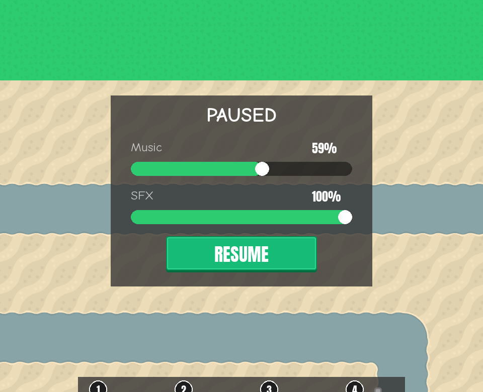

# Pause menu: from volume sliders to a menu
<!-- index | refs: #8, PR #42 -->

**Date:** 2026-10-26 · **Area:** UI · **Issue:** [#8](https://github.com/vectorviolet/chokepoint/issues/8) · **PR:** [#42](https://github.com/vectorviolet/chokepoint/pull/42)

## Context

Issue #8 first asked for volume sliders on pause. The first commit of PR #42 built that: a "PAUSED"
panel with Music and SFX sliders and a Resume button. On 2026-10-26 the owner rewrote the issue: Esc
or the HUD menu button should open a pause menu at any point of a run, with **Back**, **Settings**,
**Music toggle** and **Main menu**, and the separate in-game music button should go.

## Options

<table>
<tr>
<td> First version: Music and SFX sliders and Resume.</td>
<td> Owner's version, as merged: Back, Settings, Music, Main menu.</td>
</tr>
</table>

## Decision

The owner chose the pause menu (issue #8, updated 2026-10-26). The sliders were removed from the PR;
volumes stay in Settings.

Details chosen by Claude in PR #42 and approved by the owner at merge:

- Opening pauses the game; Back or Esc restores the state from before: a running game resumes, a
  game paused with Space stays paused, a run not started yet keeps waiting.
- Settings opened from the pause menu returns to it (its Back and Esc both do).
- The Music label is text ("MUSIC: ON" / "MUSIC: OFF"), one switch shared with the menus' music
  toggle, saved the moment it is toggled.
- The menu is modal: Space, Tab, hotkeys, map clicks and edge-scrolling wait while it is open.
- Victory and game-over popups keep their own Esc behaviour.
- The window's close button (X) goes to the same pygamine hook as Esc, so in a run it opens the
  pause menu. Telling X from Esc would need overriding a private pygamine method, so this was left.
- Styled like the victory/game-over popups (overlay plus nine-slice panel, Anton buttons), no new
  assets.

## Rejected alternatives

- **Volume sliders on pause** (the first version): replaced by the owner's request for a menu.
  Volume control already lives in Settings, which the menu opens.

## Result

Merged in PR #42. Follow-ups:

- [#44](2026-10-27-pause-menu-icons.md): icon buttons instead of text (mock-ups made, postponed).
- [#54](2026-10-27-music-state-bug.md): the music button could show the wrong state after a
  restart.
