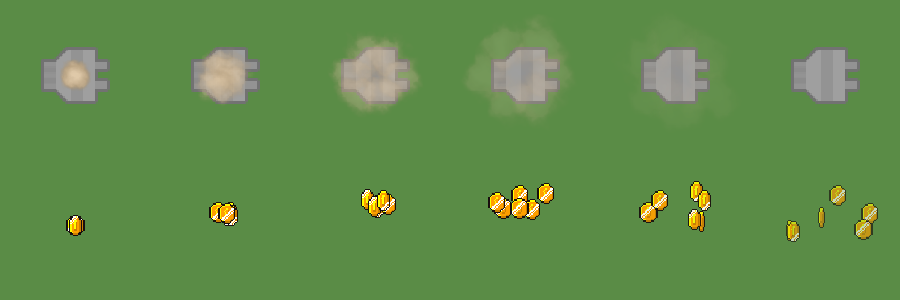

# Place and sell effects, and the quiet wood sound
<!-- index | refs: #3, PR #41 -->

**Date:** 2026-10-26 · **Area:** Feedback, audio · **Issue:** [#3](https://github.com/vectorviolet/chokepoint/issues/3) · **PR:** [#41](https://github.com/vectorviolet/chokepoint/pull/41)

## Context

Placing and selling a tower had no feedback. Issue #3 asked for a sound and a short dust puff on
placing, and a sound and a coins effect on selling.

PR #41 also bumped pygamine to v0.26.0, whose `GameAudio.play_sfx()` plays sounds on a pool of
channels so they no longer cut each other off (see
[ADR 0001](../decisions/0001-sfx-channel-pool.md)).

## Options

Frames of both effects, left to right. Top: dust puff on placing (6 brown-tinted smoke puffs, about
0.45 s). Bottom: coins bursting up and falling back on selling (6 coins, about 0.65 s).

Two questions came up during play-testing:

1. **Clock.** Should the effects run on game time (freeze while paused, speed up at x2/x4) or on
   real time?
2. **Place sound.** The first choice, `impactWood_heavy_000` from Kenney Impact Sounds, was nearly
   inaudible.

## Decision

Both by the owner after play-testing:

1. **Real time.** The effects are cosmetic and don't affect game state, so they play out while the
   game is paused and x2/x4 doesn't speed them up (owner decision 2026-10-26; the issue's criterion
   was changed to say so).
2. **Place sound `impactPlank_medium_001`** (same Kenney pack, CC0). The wood sound sits around
   320 Hz and is about 9 dB quieter to the ear (A-weighted) than the other sound effects.

The sell sound is `impactMetal_light_000` from the same pack. The dust reuses the Kenney smoke
particles and the coins reuse the HUD coin animation, so the only new files are the two sounds.

## Rejected alternatives

- **Game time** for the effects: they would freeze while paused, including before the first wave,
  and run faster at x2/x4. The owner's rule is that cosmetic effects don't follow the game clock.
- **`impactWood_heavy_000`**: too quiet next to the other sounds.

## Result

Merged in PR #41. `PlaceSellFeedback` draws the effects in world space through the camera, capped at
48 particles; the menu demo has none. Later cosmetic effects followed the same real-time rule (see
[bomb impacts](2026-10-27-bomb-impacts-and-draw-order.md)).
