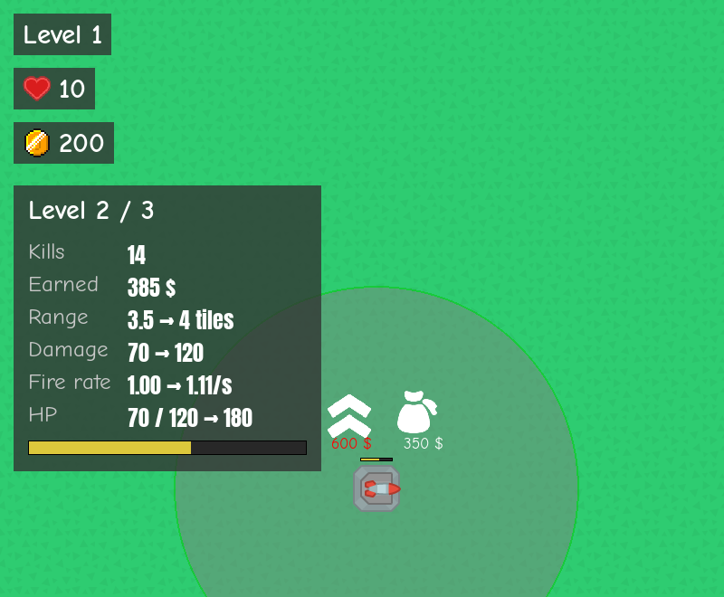
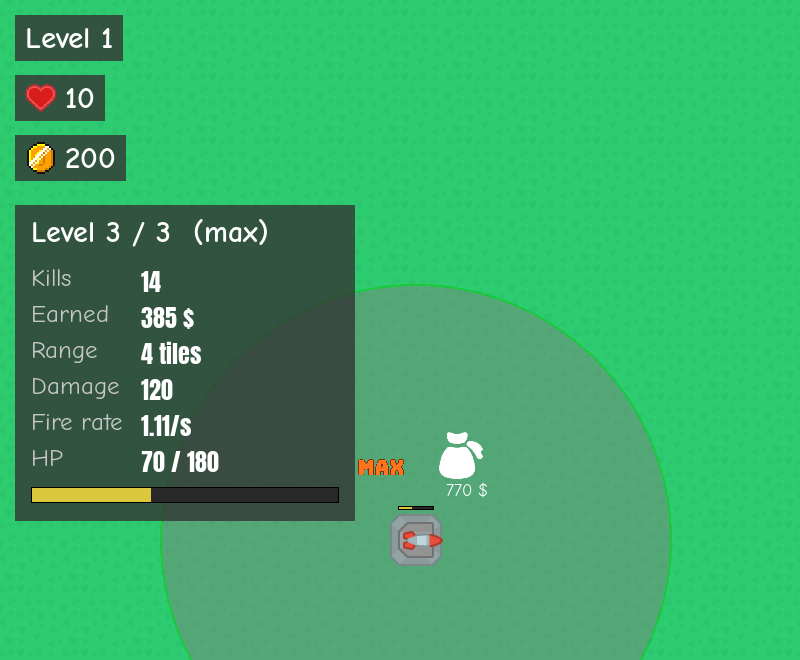
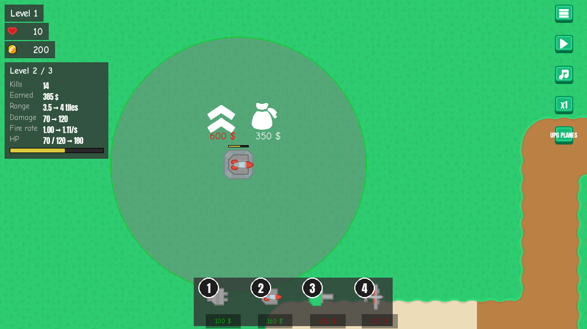

# Tower info panel
<!-- index | refs: #5, PR #28 -->

**Date:** 2026-10-26 · **Area:** UI · **Issue:** [#5](https://github.com/vectorviolet/chokepoint/issues/5) · **PR:** [#28](https://github.com/vectorviolet/chokepoint/pull/28)

## Context

Players had no way to see a tower's stats or what an upgrade would buy. Issue #5 asked for a panel
on click with kills, money earned, range, damage, fire rate and HP, plus "current → next" previews
for each stat an upgrade changes, hidden at max level. Kills and money had to be tracked per tower
and survive save/load, and the panel had to fit every supported window size.

## Options

There was one implementation; the options were in its details, listed in PR #28 as design choices
for review:

<table>
<tr>
<td> Level 2 missile tower: previews show "current → next".</td>
<td> Level 3 (max): no arrows, the title says "(max)".</td>
</tr>
</table>

- **Placement:** a floating panel top left, under the money counter, using the counters' grey
  background (`[50, 50, 50, 200]`) and no new art. A sidebar was not tried at this point; it came
  up later in [#33](2026-10-27-info-panel-placement.md).
- **Units:** range in tiles (`3.5 → 4 tiles`) instead of pixels; fire rate in shots per second with
  two decimals (`1000 / reload ms` from `towers.yaml`).
- **HP preview:** shows the next level's max HP, because an upgrade refills HP to it.
- **Fonts:** labels in Comic Neue, values in Anton, because Comic Neue has no `→` glyph.

## Decision

Defaults chosen by Claude in PR #28, approved by the owner at merge. Two behaviour changes came with
it:

- **Kill attribution:** each kill and its money go to the tower whose missile, muzzle flash or bomb
  dealt the killing blow (`Enemy.decrease_hp(..., source=tower)`). Twin-barrel towers count one kill
  per volley.
- **Upgrading keeps the selection.** Before, a successful upgrade deselected the tower, which would
  have closed the panel the player was reading.

## Rejected alternatives

- Range in pixels: tiles are what the player sees on the map.
- Showing the exact fire rate including tick rounding: the real rate is at most one tick (~6 ms) per
  shot slower; the difference is explained in `ui/tower_info.py` rather than shown.

## Result

The panel at 1024x576. It is declared in `config/panels.yaml` (`tower_info_*`) and a test checks
that it fits without overlapping the counters, tower bar or control buttons at every size from
1024x576 to 3840x2160. Merged in PR #28.

Known trade-off at the time: the panel can cover a tower near the left edge; scrolling or Tab moves
it out of the way. Planes could not be selected yet (see the
[plane info panel](2026-10-27-plane-info-panel.md)).

## Revisit if

- The panel placement changes: see [Info panel placement](2026-10-27-info-panel-placement.md).
