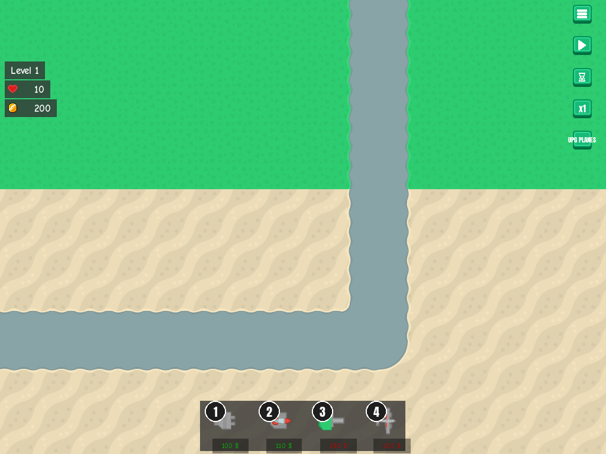
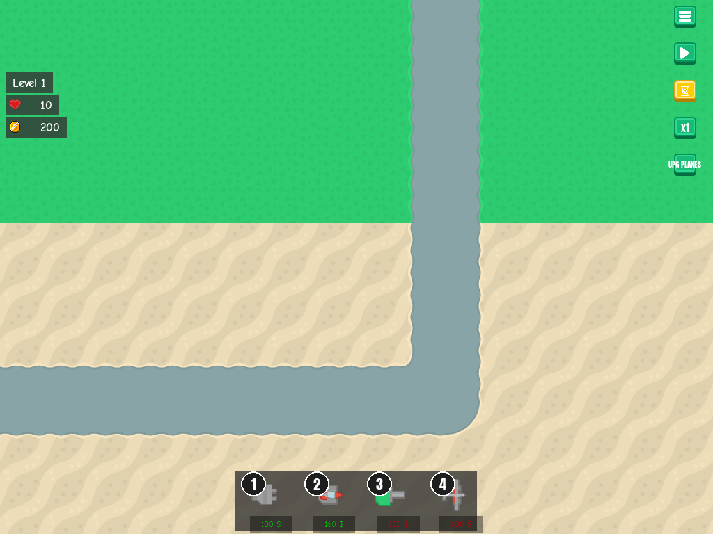

# Auto-pause between waves

**Date:** 2026-10-27 · **Area:** Gameplay, UI · **Issue:** [#34](https://github.com/vectorviolet/chokepoint/issues/34) · **PR:** [#53](https://github.com/vectorviolet/chokepoint/pull/53)

## Context

The next wave starts on its own `LEVEL_END_DELAY_MS` after a wave's last spawn. Issue #34 asked for
an optional toggle that pauses the game as soon as a wave is cleared, so the player can build calmly
and start the next wave with the existing start button. The issue left three questions open: default
on or off, the button's icon and position, and whether the setting is global or per run.

## Options

<table>
<tr>
<td> Off: the hourglass button is grey.</td>
<td> On: yellow, the same highlight as x2 and a bought UPG PLANES.</td>
</tr>
</table>

The control column: menu, start/pause, **auto-pause**, speed, UPG PLANES.

## Decision

PR #53 proposed answers to the open questions (the owner was away and had asked for sensible
defaults); the owner approved them afterwards in chat on 2026-10-27 and merged the PR:

- **Default off**, so nothing changes for players who don't use it.
- **Global setting** (`auto_pause_between_waves` in the settings file, next to music and volumes),
  saved when toggled and reset by Settings > Reset. Old settings files load with it off.
- **Third in the control column**, next to the start button it works with. Icon: the hourglass from
  Kenney Board Game Icons (CC0, a pack already in the repo).
- **When:** at the first tick where the spawn queue is finished and no enemy is left, once per wave.
  `WaveManager` got an `on_wave_cleared` hook for it; the menu demo leaves it unset.
- **Resuming** doesn't skip or restart `LEVEL_END_DELAY_MS`. Usually the 5 s have passed by the time
  a wave is cleared, so the next wave starts at once.
- A run saved at a cleared wave doesn't pause a second time after Continue.

## Rejected alternatives

- **Per-run setting** (in the save): the PR chose global, alongside the other player preferences.
- **A tooltip on the button:** the control buttons have none today; only the buy buttons do.

## Result

Merged in PR #53.
