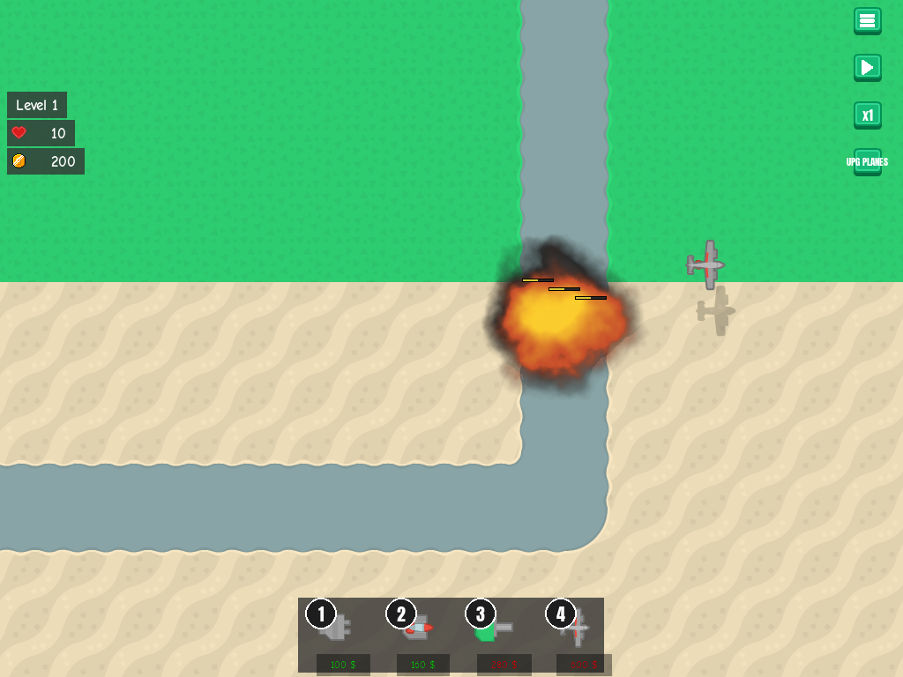
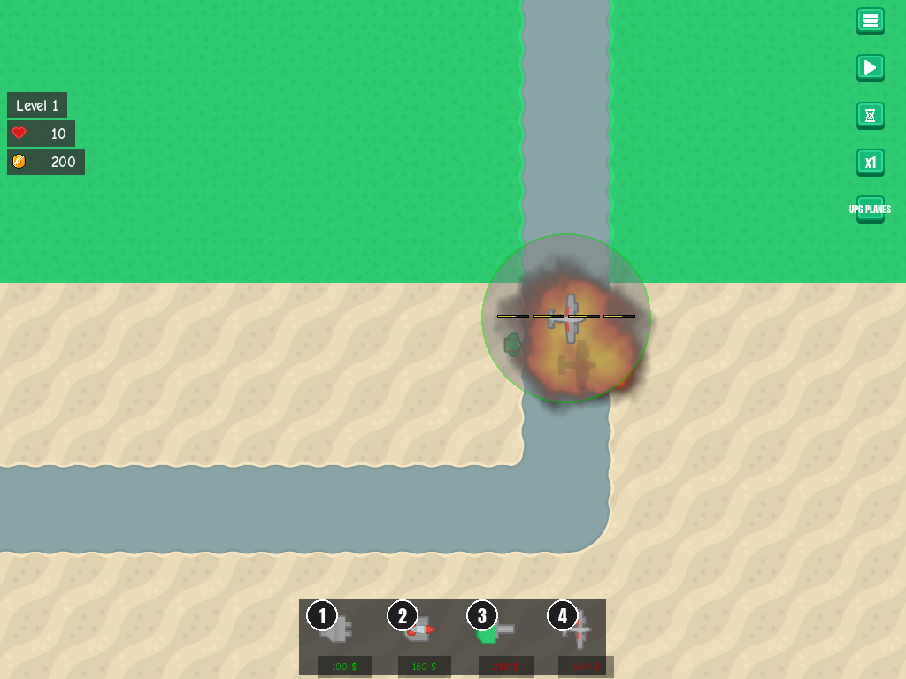
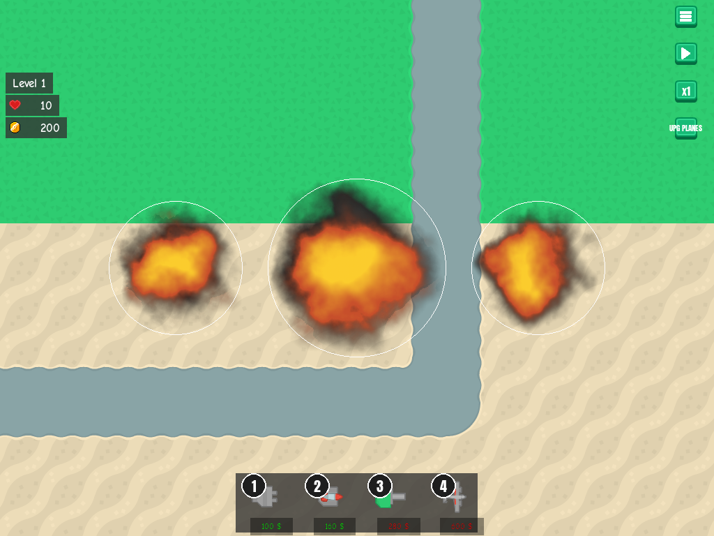

# Bomb impacts and draw order

**Date:** 2026-10-27 · **Area:** Feedback, rendering · **Issues:** [#4](https://github.com/vectorviolet/chokepoint/issues/4), [#55](https://github.com/vectorviolet/chokepoint/issues/55), [#60](https://github.com/vectorviolet/chokepoint/issues/60) · **PRs:** [#49](https://github.com/vectorviolet/chokepoint/pull/49), [#61](https://github.com/vectorviolet/chokepoint/pull/61)

## Context

Issue #4 asked for an explosion and a sound where each plane bomb lands, sized to its splash radius,
with a cap on the sound so a full run doesn't clip. Play-testing PR #49 then raised two drawing
questions: what goes on top of what (#55), and later where planes belong (#60).

## Options

**1. Explosion clock and damage.** Before, an `Explosion` bullet both dealt the damage and drew the
animation on game time. The owner decided on 2026-10-27 that damage is applied at the moment of
impact, on game time, and the explosion is cosmetic and runs on real time: it plays out while paused
and x2/x4 don't speed it up. This is the same rule as the
[place/sell effects](2026-10-26-place-sell-effects.md); the code side is
[ADR 0002](../decisions/0002-bombs-damage-at-landing.md).

**2. Sound.** Candidates from Kenney "Sci-Fi Sounds" (CC0), loudness A-weighted over the loudest
100 ms:

| Candidate | Loudness | Length |
|---|---|---|
| `explosionCrunch_002` (chosen) | -15.3 dB | 1.26 s |
| `explosionCrunch_001` | -15.3 dB | 1.36 s |
| `explosionCrunch_000` | -19.0 dB | 0.78 s |
| `explosionCrunch_003` | -20.2 dB | |
| `explosionCrunch_004` | -22.2 dB | |
| `lowFrequency_explosion_001` | -26.6 dB | |
| `lowFrequency_explosion_000` | -28.7 dB | |

For comparison, the sell clink is -14.6 dB and the place thud -24.1 dB. The low-frequency ones were
too quiet; `explosionCrunch_000` is the shorter fallback if 1.26 s feels long.

**3. Draw order** (#55, reported by the owner on PR #49): explosions were drawn behind the soldiers,
so enemies walked over the fire, and a plane's falling bombs were drawn on top of the plane. Then
(#60, owner decision) planes were drawn in the tower layer, so enemies and explosions covered a plane
flying over them.

<table>
<tr>
<td> After #55: the explosion over the path and enemies, under the HP bars.</td>
<td> After #60: the plane and its shadow over an explosion.</td>
</tr>
</table>

No "before" screenshots of the draw-order bugs were kept.

## Decision

- **Damage at impact, explosion on real time:** owner, 2026-10-27.
- **Sound** `explosionCrunch_002`, capped in `BombImpactFeedback` at 1 sound per 150 ms and 3 per
  second; impacts over the cap still show their explosion. Chosen by Claude in PR #49, approved by
  the owner at merge. A single plane at x1 drops a bomb every 500 ms, so every impact is heard; at
  x4 about 3 per second are.
- **Explosion size** 1.0 x the splash diameter (before: 1.1 x the radius, about 55% of the
  diameter), so the blast roughly covers the damage circle. Chosen by Claude, approved at merge.
- **Draw order** (owner decisions in #55 and #60; HP bars above both was suggested by Claude and
  accepted): explosions over enemies and towers; a plane draws shadow → its bombs → splash ring if
  selected → plane, so bombs fall from under it; planes after explosions; HP bars on top of all of
  it, because planes are small and pass quickly and the bars must stay readable.

Final battle order: tilemap → ground towers + bullets → orphan bombs → enemies + bullets → bomb
explosions → planes → HP bars → (game only) the selected enemy's HP numbers and the UI.

## Rejected alternatives

- Explosions on game time (the old behaviour): they froze when paused and ran faster at x4.
- The low-frequency explosion sounds: 11 to 13 dB quieter than the chosen one.
- Planes covering HP bars: bars would be hidden while a plane passes.

## Result

Explosions sized to the splash circle. Merged in PR #49 (closing #4 and #55) and PR #61 (closing
#60). `tests/test_draw_order.py` records the order in the game and the menu demo, which stays
silent.
