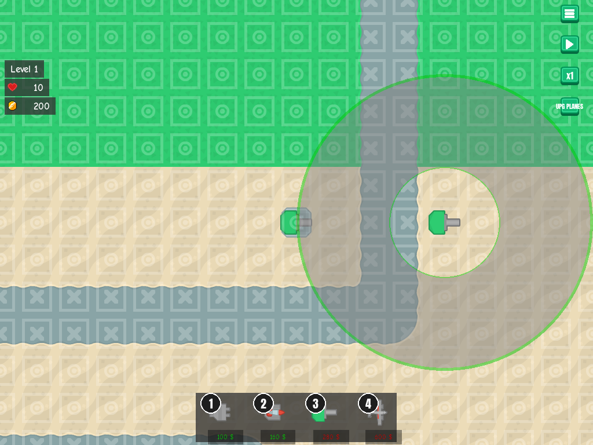
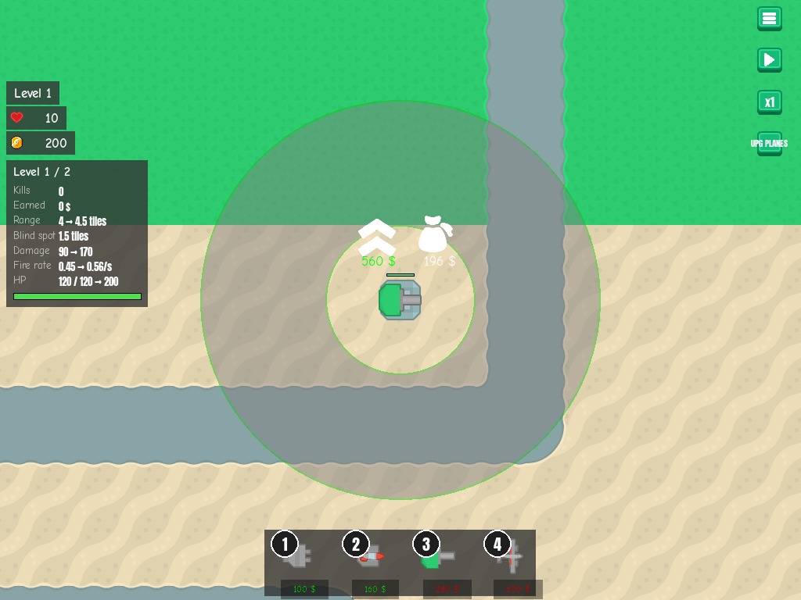

# Heavy cannon blind spot
<!-- index | refs: #11, PR #56 -->

**Date:** 2026-10-27 · **Area:** Gameplay · **Issue:** [#11](https://github.com/vectorviolet/chokepoint/issues/11) · **PR:** [#56](https://github.com/vectorviolet/chokepoint/pull/56)

## Context

To give towers more distinct strengths and make placement matter, issue #11 gave the heavy cannon a
minimum range: it can't target enemies inside it. The range ring had to show the blind spot.

## Options

<table>
<tr>
<td> Placement preview: the blind spot is a clear hole in the shaded disc.</td>
<td> Selected cannon: the same ring, and a "Blind spot 1.5 tiles" row in the info panel.</td>
</tr>
</table>

The choices listed for review in PR #56:

- **Size:** 96 px (1.5 tiles) at both cannon levels (ranges 256 and 288 px), set as
  `min_ranges: [96, 96]` in `config/towers.yaml`. The key is optional; other towers have none.
- **Edge rule:** an enemy exactly at the minimum range is in the blind spot (exclusive edge); the
  outer range stays inclusive.
- **Ring style:** a transparent hole plus a 2 px inner ring in the outline colour (green, or red
  when the tile can't be built on).
- **Info panel label:** "Blind spot", because "Min range" (111 px) didn't fit the 110 px label
  column. Other towers show "-".
- **Tooltip:** the cannon's weak line became "Slow to fire, expensive, can't hit enemies up close".

## Decision

Values and visuals chosen by Claude in PR #56, approved by the owner at merge. Targets are chosen
afresh every tick, so a target that walks into the blind spot is dropped for the nearest enemy
outside it. The grid targeting ([ADR 0004](../decisions/0004-grid-targeting.md)) takes the blind spot
as an inner radius, and towers without one pick exactly what they did before.

## Rejected alternatives

- "Min range" as the label: at 111 px it didn't fit the 110 px label column and ran into its value.

## Result

Merged in PR #56.

## Revisit if

- Cannon-heavy builds can no longer clear wave 25. No balance simulation was run for this change
  (the repo has no balance script); it needs a play-test or a sim. Balance is tracked in
  [#10](https://github.com/vectorviolet/chokepoint/issues/10).
