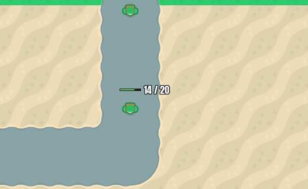

# Enemy HP on click

**Date:** 2026-10-27 · **Area:** UI · **Issue:** [#7](https://github.com/vectorviolet/chokepoint/issues/7) · **PR:** [#47](https://github.com/vectorviolet/chokepoint/pull/47)

## Context

An enemy's HP bar shows roughly how hurt it is, but not whether the defence will finish it. Issue #7
asked for a click on an enemy to show its HP as numbers ("320 / 420") next to the bar, updating
live, without getting in the way of tower selection or placement.

## Options

There was one implementation. The open points, listed in PR #47 for review:

- **Where to show it:** the issue asked for the numbers next to the enemy's own HP bar. A fuller
  enemy info panel is part of the placement question in [#33](2026-10-27-info-panel-placement.md).
- **Hit area:** the enemy's sprite rect grown by 8 world px on every side, so a moving enemy is easy
  to click. If several overlap, the one drawn on top wins.
- **Enemy or tower:** if a click hits both an enemy and a tower tile, the enemy wins (enemies are
  drawn over towers). The selected tower's upgrade/sell buttons still come first.
- **Second click:** clicking the selected enemy again keeps it selected (no toggle), so a double
  click on a moving enemy doesn't hide the numbers.
- **Text size:** a fixed 16 px on screen (Anton, white with a dark outline), not scaled with zoom.

## Decision

Defaults chosen by Claude in PR #47, approved by the owner at merge. The selected enemy's HP bar is
drawn even at full HP, so the numbers always have a bar next to them. In placement mode a click
places the tower and never selects an enemy.

## Rejected alternatives

- Toggling the selection on a second click, as towers do: easy to trigger by accident on a moving
  target.

## Result

"14 / 20" next to a selected enemy's bar. Merged in PR #47. The numbers are drawn after the whole
battle, so explosions and planes never cover them (see
[draw order](2026-10-27-bomb-impacts-and-draw-order.md)).
