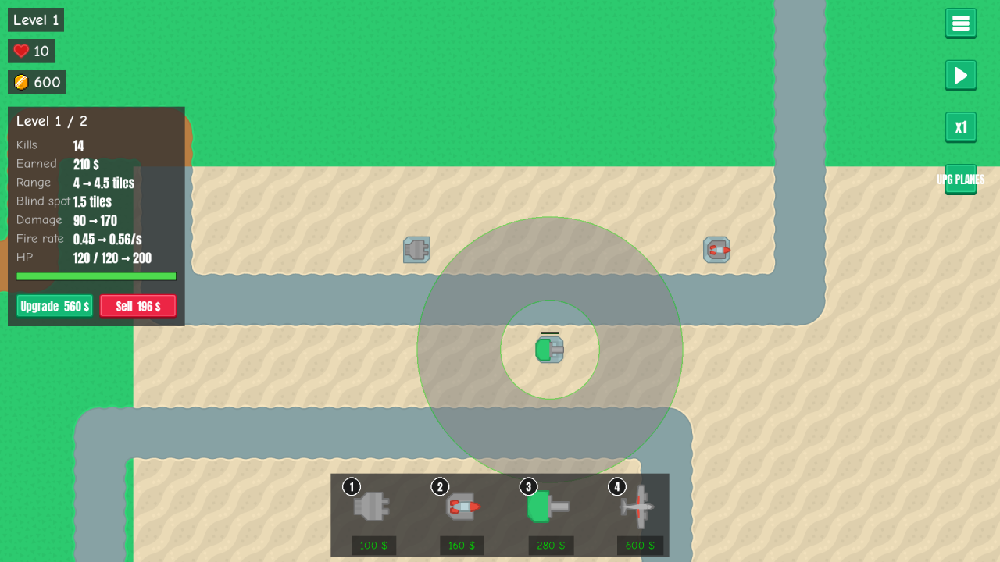
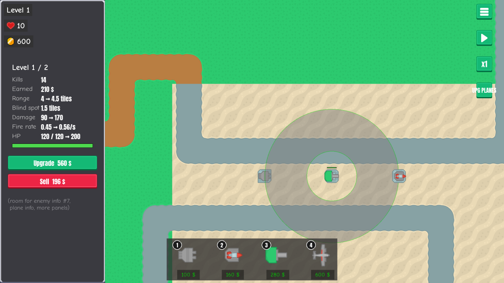
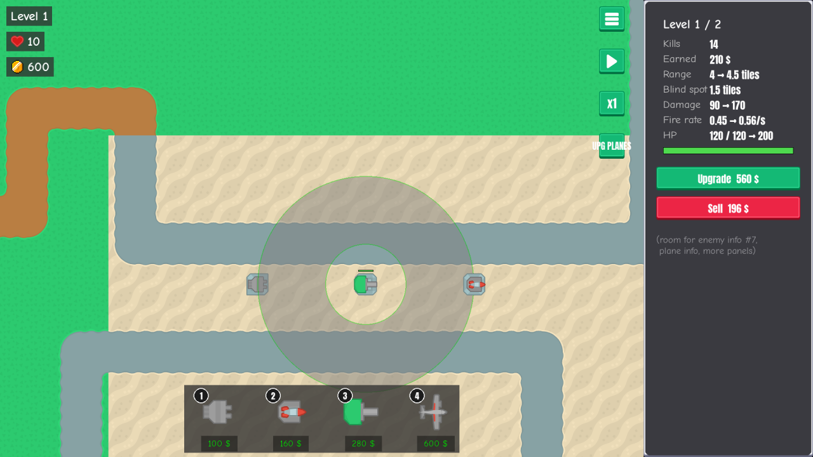

# Info panel placement: overlay or sidebar

**Date:** 2026-10-27 · **Area:** UI design · **Issue:** [#33](https://github.com/vectorviolet/chokepoint/issues/33)

## Context

The [tower info panel](2026-10-26-tower-info-panel.md) floats over the map, top left. More is
planned for it: Upgrade/Sell buttons inside it
([#32](https://github.com/vectorviolet/chokepoint/issues/32)), new visuals
([#31](https://github.com/vectorviolet/chokepoint/issues/31)), and possibly enemy and plane info.
Issue #33 asked where info panels should live: a HUD overlay (A) or an opaque sidebar (B).

## Options

Mock-ups rendered from the UI code with a level-1 heavy cannon selected. The Upgrade/Sell buttons
are sketched with the repo's Kenney `button_green` / `button_red`; option B is a faked render (camera
viewport shrunk, an opaque sidebar of nine-sliced Kenney `button_grey` drawn on top, the real panel
objects moved into it). The sidebar is 400 px wide at 1080p and scales with the HUD. The 1024x576
versions are in the issue.

<table>
<tr>
<td> A: HUD overlay (current), Upgrade/Sell added at the bottom.</td>
<td> B left: opaque sidebar; the counters sit on it.</td>
<td> B right: opaque sidebar; control buttons move left of it.</td>
</tr>
</table>

| | A: overlay | B: sidebar |
|---|---|---|
| Map | Whole map visible; the panel covers about 340x420 px top left while a tower is selected | Nothing covered, but the visible map is about 21% narrower (400 of 1920 px) |
| 1024x576 | Panel takes about a third of the screen height | Map viewport drops to about 811x576 |
| Room for #32 and enemy/plane info | Two buttons fit; more info needs another floating panel or must share this one | Full-width buttons and room for more panels |
| Effort | Smallest: grow the panel, add two buttons | Larger: camera viewport and edge-scroll offset, HUD re-layout, and a choice between always shown or shown on selection (the map would resize on every click) |

Claude recommended **B on the right, always shown**: a stable home for #32 and #7, nothing covering
the map, counters staying top left.

## Decision

**A, for now** (owner, 2026-10-27). It may be revisited, so follow-up work must keep the switch
cheap:

- The panel's content (rows, values, buttons) is one component that doesn't know where it is
  hosted. Its position and size come from `config/panels.yaml` only.
- #31 and #32 are built that way, so moving to a sidebar later means a new layout entry plus the
  camera viewport change (B's effort), not a rewrite.

The rule is recorded as [ADR 0005](../decisions/0005-panel-content-independent-of-placement.md).

## Rejected alternatives

- **B left / B right**, for now. The owner didn't give a reason on the issue beyond "for now"; the
  cost listed above (camera viewport, edge-scroll, HUD re-layout) is what B would take.

## Result

No PR: the current layout stays. The mock-ups stay on the issue as the record of the options.

## Revisit if

- Enemy or plane info, or the Upgrade/Sell buttons, no longer fit in one floating panel.
- The panel covers too much of the map on small screens in play-tests.
- The owner asks to switch: add a sidebar layout entry in `config/panels.yaml` and give the camera a
  viewport offset; the panel content should not need changes.
