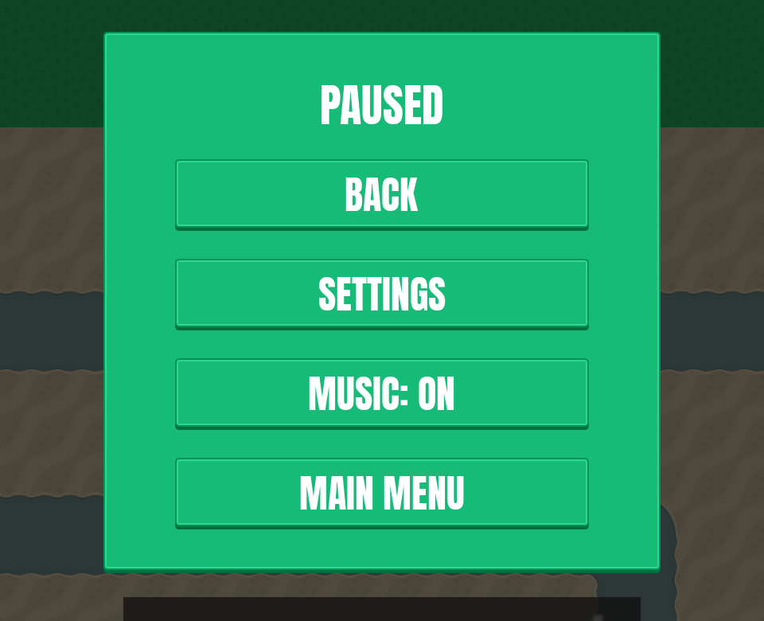
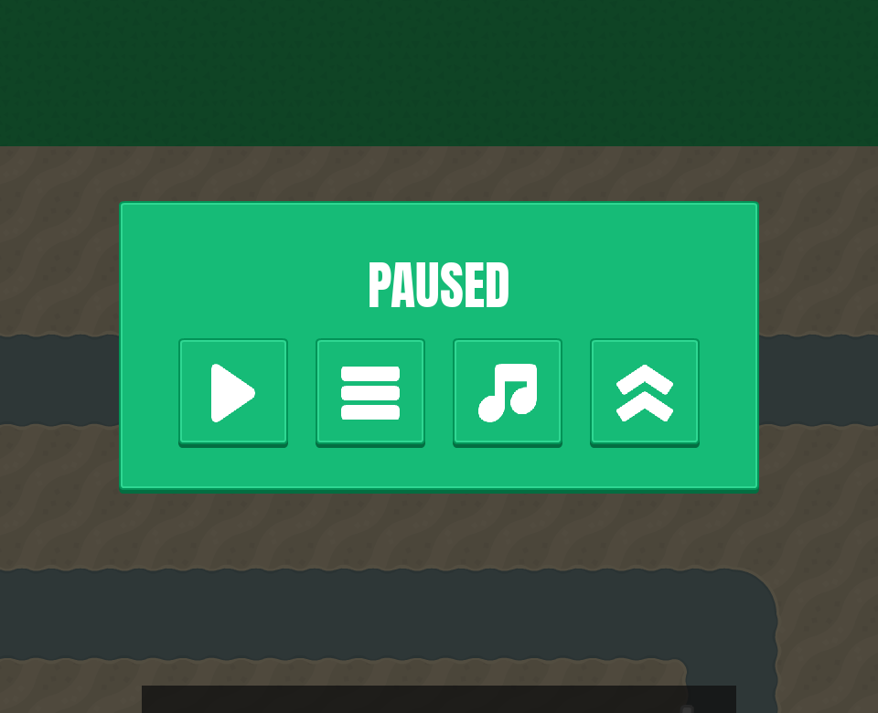
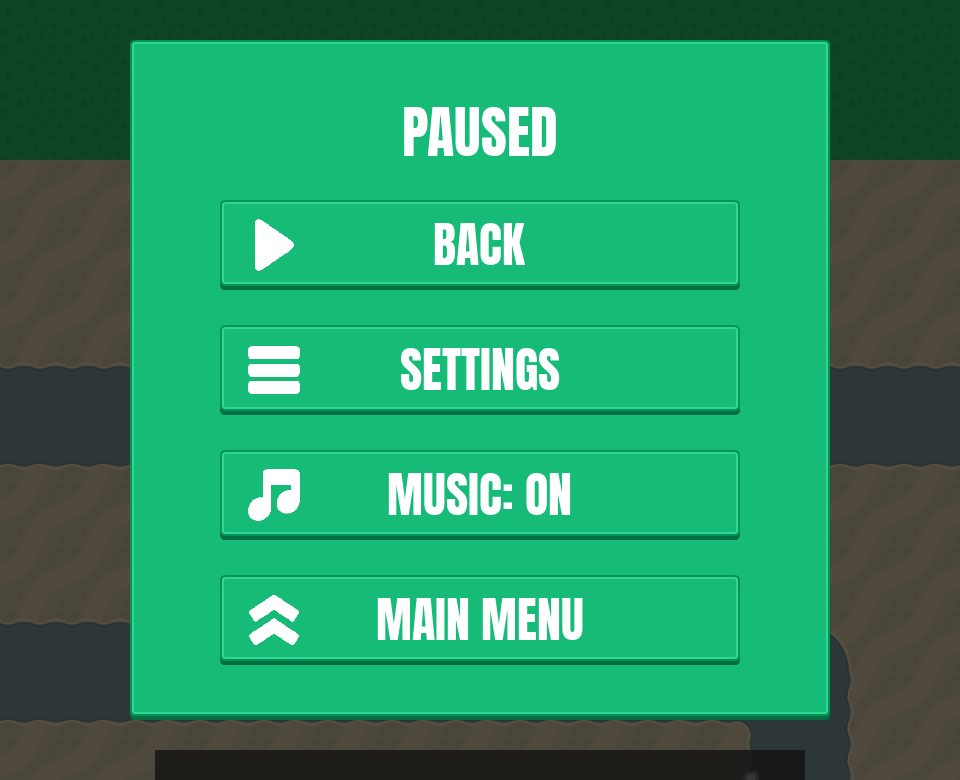
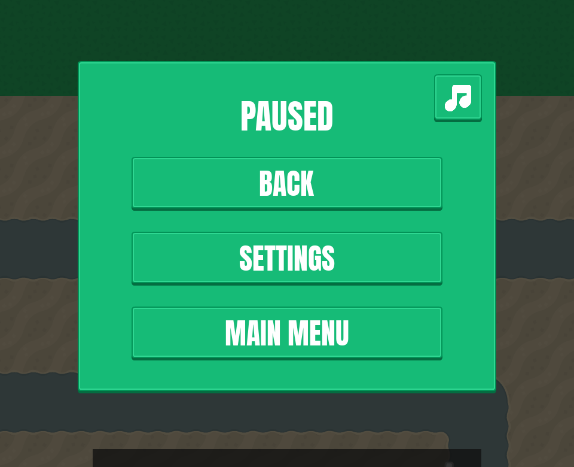

# Pause menu icons (postponed)
<!-- index | refs: #44 -->

**Date:** 2026-10-27 · **Area:** UI design · **Issue:** [#44](https://github.com/vectorviolet/chokepoint/issues/44)

## Context

The [pause menu](2026-10-26-pause-menu.md) uses text buttons: Back, Settings, Music: ON/OFF, Main
menu. The owner suggested (2026-10-26) that some or all of them could be icon buttons, like the HUD's
control buttons, or icon + label.

## Options

Rendered from `main` at 1920x1080 with only `config/panels.yaml` changed. Every icon is one the repo
already had. The repo has **no gear, home or back-arrow icon**, so in B and C, Settings and Main
menu use stand-ins.

<table>
<tr>
<td> A: text buttons (current).</td>
<td> B: icons only. Settings uses the hamburger and Main menu the up chevrons as stand-ins.</td>
</tr>
<tr>
<td> C: icon + label, the same icons as B.</td>
<td> D: text buttons, Music as an icon in the panel corner.</td>
</tr>
</table>

Claude recommended **D**: Music is the only button with an icon that clearly fits, and it is the
same icon the menus' music toggle uses. B and C would put misleading stand-ins on Settings (the
hamburger is also the button that opens this menu) and Main menu (the chevrons are also the upgrade
icon).

## Decision

**Postponed** by the owner (2026-10-27). The menu stays as text buttons.

## Revisit if

- The issue is picked up again. Icons for gear, home or back can come from the local Kenney packs
  (e.g. `game-icons`) or a newly downloaded Kenney pack (CC0), recorded in `assets/SOURCES.yaml`.
  With proper icons, B and C would no longer need stand-ins.
