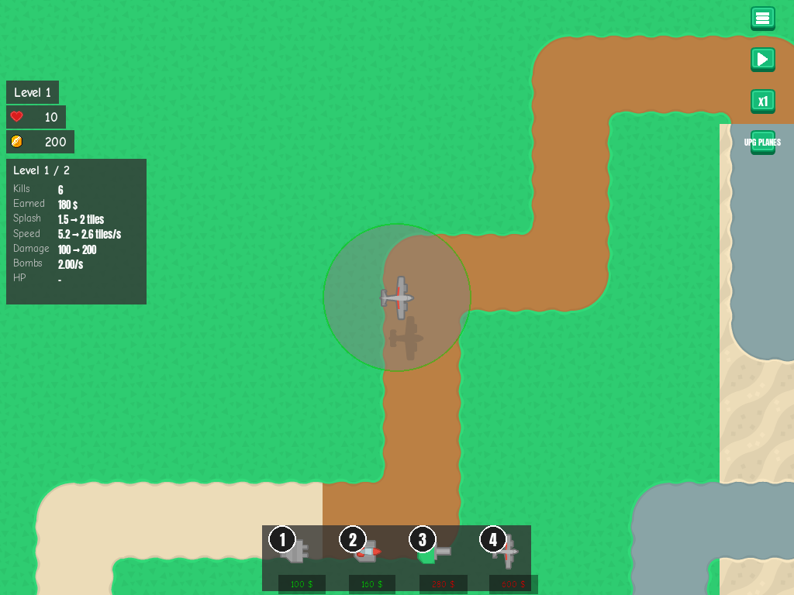
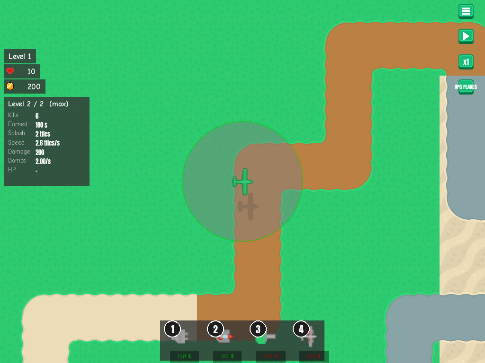

# Plane info panel

**Date:** 2026-10-27 · **Area:** UI · **Issue:** [#29](https://github.com/vectorviolet/chokepoint/issues/29) · **PR:** [#58](https://github.com/vectorviolet/chokepoint/pull/58)

## Context

The [tower info panel](2026-10-26-tower-info-panel.md) opens on a ground tower. Planes fly across
the map and couldn't be selected, so their stats were never visible, although their bomb kills were
already counted. Issue #29 asked for a plane panel and left two questions open: how it is opened
(clicking a flying plane, the UPG PLANES button, the plane's slot in the tower bar, or something
else), and one panel per plane or one for all planes.

## Options

- **Click a flying plane** (chosen), one panel per plane.
- **The UPG PLANES button** or **the plane's buy slot**: not built. No screenshots exist for these.

<table>
<tr>
<td> Level 1 plane: previews for the UPG PLANES upgrade.</td>
<td> After UPG PLANES: "Level 2 / 2 (max)", no previews.</td>
</tr>
</table>

## Decision

PR #58 implemented clicking a flying plane, with one panel per plane in the existing tower info
panel, and the owner approved it at merge. (The issue asked the owner to decide before work started;
that answer isn't recorded on GitHub.) Other choices from the PR:

- **Rows relabelled** instead of new rows: Range → **Splash** (blast radius), Blind spot → **Speed**
  (flight speed in tiles/s), Fire rate → **Bombs** (per second). "Bomb rate" ran into its value at
  1024x768, so the label is "Bombs".
- **Speed is shown** because UPG PLANES halves the flight speed rather than raising the bomb rate,
  which roughly doubles bombs per run (about 18 → 36 across the map). Bombs per run depend on where
  the plane was placed, so that number isn't shown.
- **HP "-"** with no bar; **no sell/upgrade buttons**: planes can't be sold and upgrade together.
- **Click priority:** plane, then enemy, then ground tower; hit area the 64x64 sprite padded by 8 px,
  like an enemy click. The panel closes when the plane leaves the map.

## Rejected alternatives

- Opening from UPG PLANES or the tower bar: not built, and PR #58 gives no reason beyond choosing the
  click. Clicking the plane opens and closes the panel by the same rules as a ground tower, as the
  issue asked.
- New dedicated rows for planes: PR #58 reused the existing rows under new labels instead.

## Result

Merged in PR #58. The PR also noted that a plane is removed when its centre, not its whole sprite,
crosses the right edge; that is tracked in
[#59](https://github.com/vectorviolet/chokepoint/issues/59).
