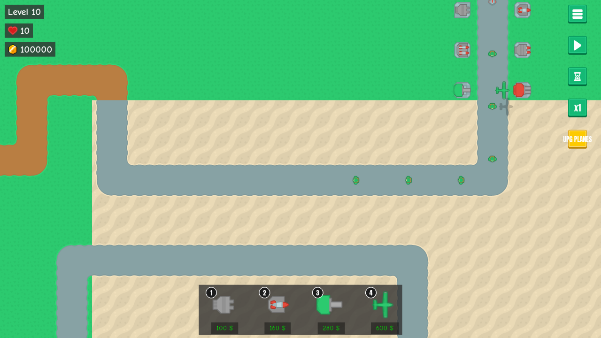

# Play-test save
<!-- index | refs: #63, PR #64 -->

**Date:** 2026-10-27 · **Area:** Tooling · **Issue:** [#63](https://github.com/vectorviolet/chokepoint/issues/63) · **PR:** [#64](https://github.com/vectorviolet/chokepoint/pull/64) (open when this entry was written)

## Context

The owner play-tests every PR in its own worktree. Each time, a run had to be built up first:
earning money, reaching a later wave, buying every tower. Issue #63 (owner request, 2026-10-27)
asked for a script that writes a ready-made save into a given folder.

## Options

How to produce the save:

- **Build it with the real game code**: start a `Game()` with saves redirected, set up the run, and
  write it with the game's own save functions.
- **A hand-written or checked-in `save.json`**: not discussed in the issue; listed here for
  contrast. It would break whenever the save format changes.

## Decision

Built with the game code (owner, in the issue: "It builds the save with the real game code, so it
always matches the current save format"). The contents were also specified by the owner: 100,000
money, wave 10 about halfway through and paused, one tower of every type at every level, UPG PLANES
bought with a plane in the air, music and SFX volume 0. See
[ADR 0006](../decisions/0006-playtest-save-from-game-code.md).

Details in PR #64: the script refuses to run without `--out`, refuses to overwrite without
`--overwrite`, and refuses to write into the main checkout's own `saves/`. `window_size` is left out
of the settings so the game picks its best fit for the screen.

After two code reviews on PR #64:
- The wave is filled to about half spawned under `BattleSimulation.waves_only()`: the towers
  (already placed) hold fire and nothing fights, and enemies that reach the end cost no lives, so
  any `--level` works (tested up to 200). When the towers fired, wave 10 kept only 1 of its 7
  spawned enemies, and the issue asks for half the wave on the path.
- In long, high-level waves many of the first enemies reach the end before half have spawned, so
  fewer are on the path (wave 100: 155 of 309 spawned, 91 on the path). The script prints the real
  number.
- The plane is added after the fill at the map's left edge, on the path's row, so it crosses the
  whole map (about 18 s at x1). Placed near the entrance (column 41 of 47), it left in 3 s.
- The main checkout is found from the shared git folder: its parent for a `.git` folder, the
  `core.worktree` of a submodule's `.git/modules/<name>`. A copy nested in another repository,
  or one with no `.git`, holds the real saves itself. Without git, `.git` is read directly. If the
  checkout still can't be found, any `saves` folder outside the current checkout is refused.
  Paths compare case-insensitively on Windows (`.../Saves` is refused too).
- Settings write `auto_pause_between_waves: false` explicitly.

## Rejected alternatives

- A checked-in save file: it would go stale with every save format change.

## Result



Continue after running the script: wave 10, 100000 coins, the towers and plane at the top of the
path. PR #64 was still open when this entry was written.

```bash
uv run python scripts/make_playtest_save.py --out saves
uv run python __main__.py   # Play → Continue
```
