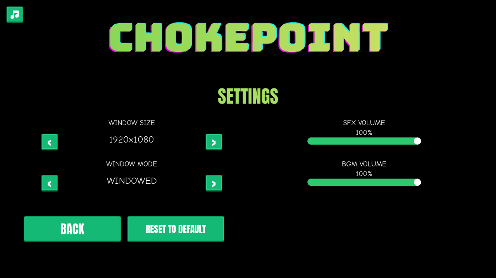
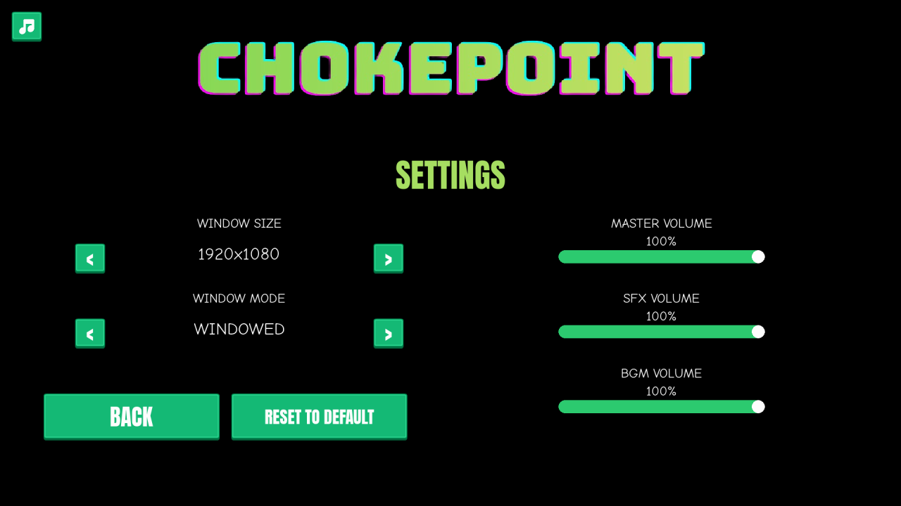
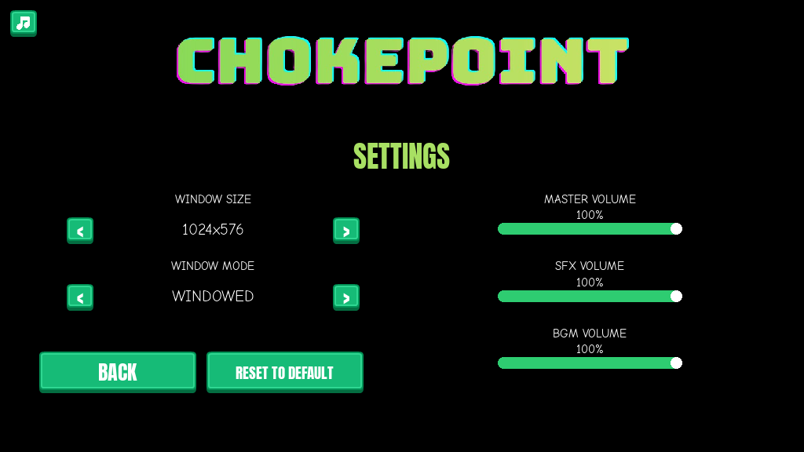

# Master volume
<!-- index | refs: #45, PR #73 -->

**Date:** 2026-10-28 · **Area:** Audio, UI · **Issue:** [#45](https://github.com/vectorviolet/chokepoint/issues/45) · **PR:** [#73](https://github.com/vectorviolet/chokepoint/pull/73) (open when this entry was written)

## Context

Settings had an SFX and a BGM (music) slider. Issue #45 (owner, 2026-10-26) asked for a **Master**
slider above them, so the whole game can be turned up or down without changing the balance between
music and sound effects. What you hear is master × music for the music and master × SFX for every
sound effect, including the life-lost bell on its own mixer channel 2.

## Options

Where the master volume lives:

- **In pygamine's `GameAudio`**: a class-wide master volume applied on top of the music and SFX
  volumes, so Highrise can use it too. Needs a pygamine release first.
- **In Chokepoint only**: multiply before calling `set_music_volume` / `set_sfx_volume`. No engine
  change, but every place that reads a volume back would have to undo the product, and sounds
  already playing wouldn't follow.

Layout: the audio column had room below BGM, so the three groups keep the 160 px step the Window
Size / Window Mode groups use, with Master on top.

| Before | After |
|---|---|
|  |  |

The smallest window size, 1024×576, still fits:

## Decision

The engine route, as the issue preferred (owner). pygamine v0.27.0 added
`GameAudio.set_master_volume()`, `master_volume()`, `effective_music_volume()` and
`effective_sfx_volume()`; it applies master live to the music channel, channel 1 and the SFX pool,
including sounds already playing. Chokepoint:

- shows MASTER VOLUME above SFX and BGM, same label, percentage and 440×28 slider;
- keeps showing the SFX and BGM sliders' own values (not multiplied by master);
- saves `master_volume` with the settings and restores it on start; old settings files without it
  load at the default from `config/settings.yaml` (100%); "Reset to default" sets it back to 100%;
  a saved volume that isn't a number (null, a string) loads at its default, and one outside 0-1
  is clamped, for all three volumes;
- plays the life-lost bell on channel 2 at `effective_sfx_volume()`, and re-applies that to channel
  2 whenever a volume changes, so master and SFX reach a bell that is already ringing too;
- drives the three sliders from one table (`src/app/volume_settings.py`: settings key, slider,
  label, GameAudio getter and setter) for loading, binding, labels, changes, saving and reset.

The pause menu has no sliders; its Settings button opens this same screen.

The same PR moves pygamine from 0.26.0 to v0.27.0, which also fixes the splash skip (Space, Enter or
a click that skipped the splash also activated the focused PLAY button on its release and started a
run) and renames `angle_between_delta` to `angle_of_delta`. It also drops `update = merge` from
`.gitmodules` (keeping `branch = main`): the owner's engine folder had been moved to pygamine's
`main` by an `update --remote`, past the released tag the game was written for, and the game
crashed. Without `update = merge`, a plain `git submodule update` checks out exactly the commit the
game records.

## Rejected alternatives

- Chokepoint-only multiplying (see Options): duplicates logic Highrise also needs and doesn't
  update sounds already playing.
- Squeezing the three groups into the old 350 px column height: the room below BGM was free, and the
  same 160 px step matches the Graphics column.

## Result

`tests/test_master_volume.py` checks the layout, live scaling, save and restore, old settings files,
reset, and that every slider, label and percentage stays on screen from 1024×576 to 1920×1200.
`tests/test_life_lost_feedback.py` checks the bell at master × SFX, and `tests/test_splash_skip.py`
posts real key and mouse events through the real splash and game loop.
