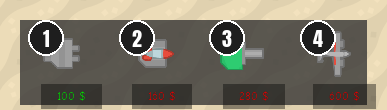
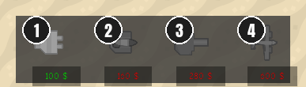
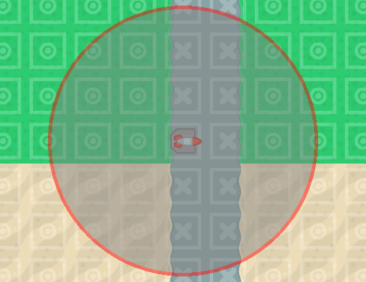
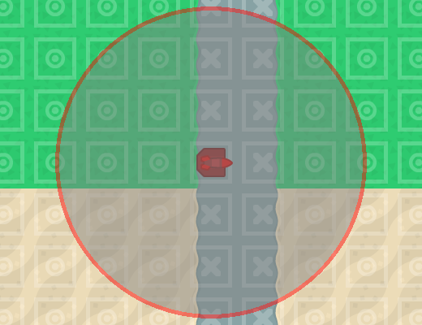
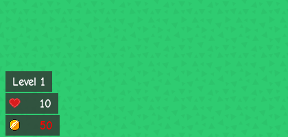

# Keep-placing toggle and no picking unaffordable towers

**Date:** 2026-10-28 · **Area:** Controls, UI · **Issue:** [#69](https://github.com/vectorviolet/chokepoint/issues/69) · **PR:** to be filled in at merge

## Context

The owner's playtest on 2026-10-27 found three problems with tower placement as
[Shift keeps placing](2026-10-27-shift-placement.md) (#9) left it:

- Holding Shift to keep placing is tiring, and on Windows holding or pressing Shift repeatedly can
  bring up the Sticky Keys prompt.
- The rules contradict each other: with Shift held, running out of gold ends placement, but a tower
  could still be *picked* (click or number key) without enough gold and then couldn't be placed.
- Nothing said *why* a tower couldn't be placed (not enough gold, or a blocked or occupied tile)
  without looking at the gold counter.

## Options

The issue listed three options:

- **0. Continuous placement becomes a toggle:** a "keep placing" button in the HUD's control column,
  and a Shift *press* flips it, instead of holding Shift.
- **1. A tower you can't afford can't be picked**, the usual tower-defense convention: its buy
  button looks disabled, and picking it only gives a "denied" sound and a red flash of the gold
  counter.
- **2. Show the reason a placement is refused:** gold versus a blocked or occupied tile.

Before and after (screenshots from the game, with 150 gold for the tower bar):

<table>
<tr>
<td> Before: every tower can be picked; only the price is red.</td>
<td> After: towers you can't afford are greyed out and can't be picked.</td>
</tr>
<tr>
<td> Before: on a path tile only the range ring turns red.</td>
<td> After: the tower preview is tinted red too.</td>
</tr>
<tr>
<td> Before: the control column.</td>
<td>  After: the keep-placing toggle (on, yellow) under the hourglass, and the gold counter flashing red after a refused pick.</td>
</tr>
</table>

## Decision

The owner chose **options 0 and 1**, plus the blocked-tile part of option 2:

- **Keep placing** is a toggle button in the control column, under auto-pause, styled like it (grey
  off, yellow on). Pressing Shift toggles it as well; holding Shift does nothing more. It is a global
  setting saved with the others (default off), and "reset to defaults" turns it off. Tab hides it
  with the rest of the column.
- With it on, placement mode stays on after each placement. When gold runs out, placement ends as
  before, but the toggle stays on, so the next tower you pick carries on the same way.
- **An unaffordable tower can't be picked.** Its buy button is greyed (the plane's too, in both its
  looks); a click or its number key plays a short "denied" sound and flashes the gold counter red.
  The tower already being placed, if any, stays picked.
- **Blocked tiles:** over a tile you can't build on (not buildable, or taken), the tower preview is
  tinted red as well as the range ring.

Choices Claude made where the issue was silent, listed for review in the PR:

- The icon is Kenney's `arrow_rotate` (Board Game Icons): a "repeat" sign.
- The denied sound is Kenney's `error_008` (Interface Sounds, a new pack for this repo).
- The flash blinks red, white, red over 0.45 s, so it shows even when the counter is already red at
  0 gold. If the HUD is hidden (Tab), the counter peeks back so the flash is seen.
- The plane upgrade button (UPG PLANES) gives the same denied sound and flash when you can't afford
  it. It isn't greyed: its price shows only on hover.
- A Shift press plays the usual click sound, like Space for start/pause.

## Rejected alternatives

- **Keep the Shift hold** (#9): tiring, and it triggers Windows' Sticky Keys prompt.
- **Let unaffordable towers be picked** and refuse only the placement: that is the contradiction the
  playtest found.

## Result

Headless tests in `tests/test_keep_placing.py` (a real `Game()` with saves in a temporary folder)
and `tests/test_tower_placement.py`: the toggle by button and by Shift press, the setting saved,
restored and reset, an unaffordable pick refused by click and by key, gold running out mid-placement,
the blocked-tile tint, and the control column fitting at every window size.

## Revisit if

- Players miss the toggle or don't know Shift flips it: add a tooltip to the control buttons.
- The denied sound or the greyed look reads poorly in play.
