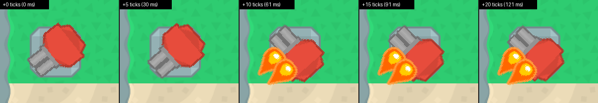
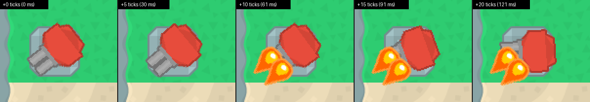

# Smooth turret turning
<!-- index | refs: #83, PR #89 -->

**Date:** 2026-11-02 · **Area:** Feel, rendering · **Issue:** [#83](https://github.com/vectorviolet/chokepoint/issues/83) · **PR:** [#89](https://github.com/vectorviolet/chokepoint/pull/89)

## Context

In a play-test the owner found turret rotation jittery ("fluttering"). Ground towers pick the
nearest enemy afresh every tick (165 times a second), and the sprite snapped straight to it, so the
barrel jumped whenever the nearest enemy changed. `pygame.transform.rotate` also returns a
differently sized image at each angle, and the rect was re-sized every tick, which could shift the
sprite by a pixel.

## Options

<table>
<tr>
<td> Before: the cannon snaps to its new target between two frames.</td>
</tr>
<tr>
<td> After: the same ticks; the barrel turns toward the new target at 540°/s. The shots and their damage are the same in both runs.</td>
</tr>
</table>

Both strips come from the real renderer: the same seeded wave 15 battle, every tower type at every
level beside the path, a frame every 5 ticks at speed x1.

- **Gameplay turn:** the barrel turns and the tower may only fire once it faces the target. It
  changes when shots land, so it is a balance change.
- **Cosmetic turn:** the drawn barrel eases toward the target at a capped rate; targeting, reload
  and damage stay exactly as they were.

## Decision

The owner chose the **cosmetic turn** on the issue, with the muzzle flash at the drawn barrel's
tips. Details chosen by Claude, for review in the PR:

- **Turn rate:** one constant, `TURN_RATE_DEG_PER_S = 540` in `ground_tower.py`, in degrees per
  second of game time, so pause freezes it and x2/x4 speed it up. It turns the shortest way across
  ±180°. The fastest enemy (1.6 px/tick, 264 px/s) passing a tile away sweeps about 240°/s, so the
  barrel keeps up with it. A retarget still reads as a turn (90° in about 0.17 s), and the barrel
  lags its shots only briefly. 360°/s was tried first; at that rate a 90° retarget took a quarter
  of a second, and the flashes of the shots fired meanwhile visibly pointed away from the target.
- **Shots mid-turn:** a tower still fires on reload whichever way its barrel is drawn. The flash
  appears at the drawn tips and points along the barrel; the damage goes to the target as before
  (muzzle flashes are instant hits, so their position never mattered for damage).
- **No wobble:** the drawn angle is rounded to 2° steps (the tip of a 26 px barrel moves under a
  pixel per step). The sprite is re-centred on the tower at every step, and it is only redrawn
  when its (image, step) pair changes, not every tick. Rotated images come from a shared cache
  with a least-recently-used bound of 512 entries: at most about 17 MB, since a 64 px sprite
  rotates to at most 91x91 px. A first version drew each angle onto a fixed 92 px canvas; the
  code review found it held up to about 50 MB with no bound, and measuring showed it didn't
  steady the sprite any better than re-centring the plain rotated image.
- **First update:** each tick turns the barrel by at most one tick's worth (`TICK_MS` × speed),
  so a tower built mid-run (whose clock starts at 0) turns toward its first target rather than
  snapping to it.
- **Missiles:** the missile tower's projectile still leaves from the tower's centre, whichever way
  the barrel is drawn. Spawning it at the drawn barrel tip would change its flight time, and so
  when its damage lands, which is gameplay. During a retarget a missile can be seen leaving
  sideways from a barrel that is still turning. Left for the owner to judge.
- **Saves:** unchanged. The drawn angle isn't saved; a loaded tower faces its sprite's default
  way until it next aims.
- Planes are unchanged. The menu demo uses the same towers, so it turns smoothly too.

## Rejected alternatives

- The gameplay turn (fire only when facing the target): a balance change, not what the owner asked
  for.
- A turn rate per tower type in `config/towers.yaml`: nothing called for different rates yet, so
  one constant keeps it simple.
- Rotating the image every tick without a cache: as costly as before at every tick a barrel turns.

## Result

A seeded headless battle (wave 6 at x1, 4,000 ticks, and x4, 4,000 ticks) records money, lives,
every enemy's id and HP, and every tower's kills, money earned and reload time on every tick; the
record is byte-for-byte the same before and after. `tests/test_turret_turning.py` covers the
stepping (rate, wrap-around, pause, x4, a tower built mid-run), hand-computed values for the
angle helpers, the fixed centre, the bounded cache, upgrades, the flash
position, and that a tower fires the same shots for the same damage whichever way its barrel starts.

## Revisit if

- Players find the turn too slow or too fast: tune `TURN_RATE_DEG_PER_S`, or make it per type.
- Towers ever have to face their target to fire (that would be a balance change).
