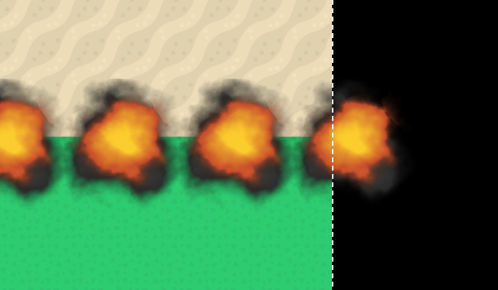
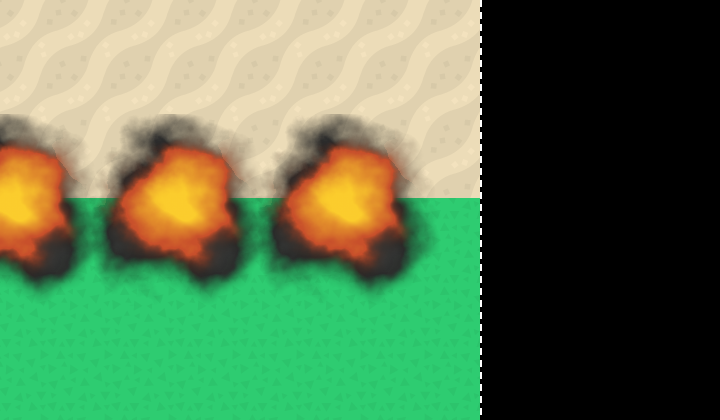

# Planes drop only bombs that land on the map
<!-- index | refs: #94, #59, PR #97 -->

**Date:** 2026-11-03 · **Area:** Feel, gameplay · **Issue:** [#94](https://github.com/vectorviolet/chokepoint/issues/94) · **PR:** [#97](https://github.com/vectorviolet/chokepoint/pull/97)

## Context

Since [#59](https://github.com/vectorviolet/chokepoint/issues/59) (PR #66) a plane flies on until
its whole sprite has left the map, and stops bombing once its center is past the right edge
(option (b) in [Planes leave the map whole](2026-10-28-planes-leave-the-map.md)). A bomb keeps the
plane's forward speed at release and slows with drag 0.94 per tick for its 600 ms fall, so it
lands ahead of where it was dropped. The last bombs could still land past the edge, where no
enemy ever walks.

## Options

A level 1 plane at x1 flying off the right edge (the dashed line; black is off the map). Each
picture shows every bomb's explosion at the same animation frame, so all landing points are
visible at once; the start position is chosen so the old rule's last drop falls just before the
plane's center crosses the edge (its worst case).

<table>
<tr>
<td> (b), main before this PR: the last bomb lands 32 px past the edge.</td>
<td> (c), this PR: that drop is skipped; the last bomb lands 134 px inside the edge.</td>
</tr>
</table>

- **(b)** Keep the center rule. The last bomb lands up to about 33 px (level 1, speed 2) or 17 px
  (level 2, speed 1) past the edge. The blast radius is 96 / 128 px, so most of the explosion is
  still on the map.
- **(c)** Predict where a bomb would land (the plane's x plus its drift) and skip the drop when
  that point is past the map's width.

## Decision

(c), the owner's decision on 2026-11-03 (issue #94): stop earlier, so no bomb lands off the map.

The drift comes from `Bomb`'s own constants: `Bomb.landing_offset(velocity, game_speed)` mirrors
`Bomb.update()` (each tick it moves by velocity × speed, then drag scales the velocity by
0.94^speed) and returns the series' limit, velocity × speed / (1 − 0.94^speed). A fall at that
speed comes within 0.1 px of it, and a slower tick or a speed change mid-fall covers less, so it is
an upper bound while the speed doesn't exceed the given one. The plane predicts at the fastest
game speed (`MAX_GAME_SPEED`, the top of `GAME_SPEEDS` in `util/constants.py`), so no bomb lands
off the map even if the player speeds up from x1 to x4 while it falls. It checks only when its
drop timer is due. Drift per game speed:

| Plane | x1 | x2 | x4 |
|---|---|---|---|
| Level 1 (speed 2) | 33.3 px | 34.4 px | 36.5 px |
| Level 2 (speed 1) | 16.7 px | 17.2 px | 18.2 px |

The cut-off uses the x4 column at every speed: at x1 the last bomb may be dropped about 3 px (level
1) or 1.5 px (level 2) earlier than an x1-only prediction would allow.

The plane still flies on until its whole sprite has left the map, and bombs already falling land as
before (orphan shots, [#62](https://github.com/vectorviolet/chokepoint/issues/62)).

## Rejected alternatives

- (b), the center rule: some bombs landed off the map, a wasted explosion the player can see.

## Result

`PlaneTower._bomb_would_land_past_the_edge()` replaces `_is_past_the_edge()`. Tests fly level 1 and
level 2 planes off the map at x1, x2 and x4 and check that every bomb lands at or before the edge
and that the last one lands within one drop interval of the cut-off; that a drop 0.01 px before the
cut-off happens and one 0.01 px after it doesn't; that a bomb dropped at the cut-off at x1 still
lands on the map when the game switches to x4 mid-fall; and that a real falling bomb drifts the
predicted distance to within 0.1 px at every speed. The orphan-bomb tests now start from the last
bomb that may land on the edge. The speed button cycles through the new `GAME_SPEEDS` constant
instead of its own table.

## Revisit if

- A faster game speed is added: `MAX_GAME_SPEED` follows `GAME_SPEEDS`, so the cut-off moves in
  with it (about 3 px further from the edge at x1 than an x1-only rule).
- Bombs get a different drag, fall time or drop velocity: the prediction follows `Bomb`'s
  constants, but check the table above.
