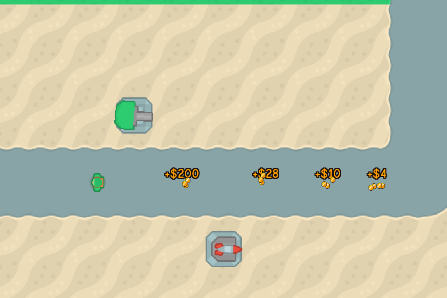
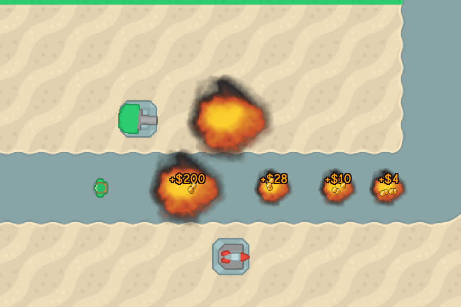
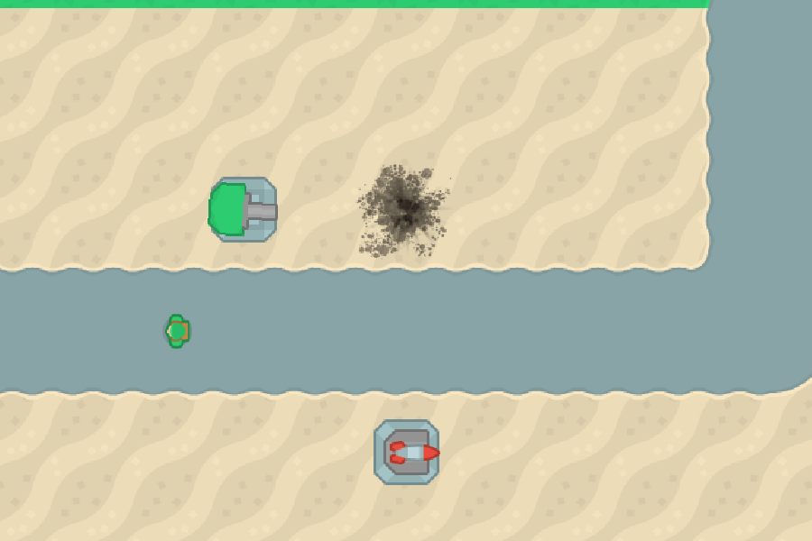
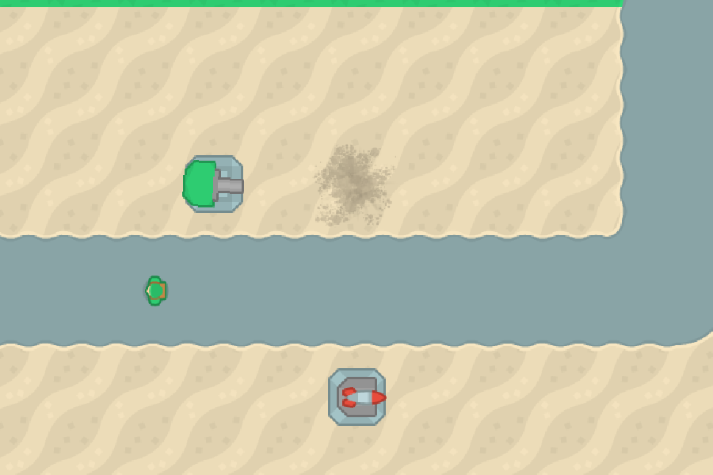

# Death effects: explosions and rubble
<!-- index | refs: #85, PR #109 -->

**Date:** 2026-11-03 · **Area:** Feel, feedback · **Issue:** [#85](https://github.com/vectorviolet/chokepoint/issues/85) · **PR:** [#109](https://github.com/vectorviolet/chokepoint/pull/109)

## Context

In the owner's play-test on 2026-11-02, enemies and towers had no death effect: they just
disappeared. A kill showed only its "+$N" reward, and a tower destroyed by tanks left an empty tile
with no sign of what happened.

## Options

The same moment without and with the effects: three soldiers and a tank killed on the path, and
the gun tower (top middle) destroyed by tanks. Zoom 1.4, HUD hidden.

<table>
<tr>
<td> Before: the enemies and the tower are just gone.</td>
<td> After, 0.2 s later: each kill explodes, the tank's and the tower's bigger.</td>
</tr>
<tr>
<td> After, 1.4 s later: the blasts are over; the tower's tile shows scorched rubble.</td>
<td> After, 3.2 s later: the rubble fades out (gone at 4 s).</td>
</tr>
</table>

The issue named the decision directly: an explosion, plus a wreck for towers. The open questions
were the details:

- **Explosion art:** reuse the bomb impact's smoke + fireball animation (Kenney's Smoke Particles),
  or a new sheet. Reusing it keeps the look consistent and adds no asset.
- **Rubble art:** Kenney's Particle Pack has a scorch mark and a dirt splatter, both white masks
  meant to be tinted. Tinted dark and stacked, they read as scorched rubble on sand and on grass.
- **Sounds:** the bomb impact's own sound, or other explosions from the same Sci-Fi Sounds pack.
  Two others, one short and light, one low and heavy, tell a soldier from a tank or a tower.
- **Rate cap:** one cap for every death sound, or one per size. One per size keeps a stream of
  soldier kills from silencing a falling tower.

## Decision

The owner decided the look (issue #85, 2026-11-02): explosion + wreck. Enemies: a small explosion
and smoke puff, bigger for tanks. Destroyed towers: an explosion plus a scorched rubble decal that
fades over a few seconds. Sold towers keep their coin effect; escaped enemies get nothing. Sounds
through the SFX pool, rate-capped like bomb impacts; cosmetic, real time, capped, no gameplay
change; the menu demo shows the explosions, silent. Claude chose the numbers within that:

| Constant | Value | Why |
|---|---|---|
| `ENEMY_BLAST_SIZE` | 56 world px | A soldier fills about half of its 64 px sprite; the blast covers it with a little spill |
| `TANK_BLAST_SIZE` | 112 world px | Twice the soldier's: "bigger for tanks" |
| `TOWER_BLAST_SIZE` | 128 world px | Two tiles across: a tower is the biggest loss |
| `MAX_EFFECTS` | 32 | Blasts playing at once (0.7 s each); past that the oldest makes room |
| `DECAL_SIZE`, `RUBBLE_SIZE` | 112, 80 world px | The scorch mark's art fills its middle; the rubble sits on the tile |
| `DECAL_HOLD_MS` + `DECAL_FADE_MS` | 1.5 s + 2.5 s | "Fades over a few seconds": readable after the blast, gone in 4 s |
| `MAX_DECALS` | 16 | Rubble at once; past that the oldest goes |
| Sound caps | 150 ms gap, 3 per second | The bomb impacts' numbers (`SfxRateCap`), one cap for soldiers, one for tanks and towers |

Sounds: soldiers `explosionCrunch_000` (short, light), tanks and towers
`lowFrequency_explosion_001` (low, heavy), both from Kenney's Sci-Fi Sounds (CC0). The rubble's
turn (a quarter turn per tile) comes from its tile, not a random stream, so seeded runs (the README
capture, the menu demo tests) are unchanged.

## Rejected alternatives

- The bomb impact's sound for deaths too: a soldier's death would sound like a bomb, and the bomb's
  rate cap would be shared with it.
- A wreck sprite for dead enemies: the issue's decision leaves wrecks to towers only.
- Rubble on game time: pausing would freeze it on the map. Like the other feedback, it runs on real
  time.
- A random turn for the rubble: it would draw from a seeded stream and shift seeded runs.

## Result

`ui.death_feedback.DeathFeedback`, owned by the game and by the menu demo (silent) like
`bomb_impacts` and `hit_feedback`, cleared on new game, load and after the demo's pre-warm.
`BombImpactFeedback`'s frame building and sound cap moved into `ExplosionFrames` and `SfxRateCap`
(same module), which both use.

- Every enemy kill goes through `BattleSimulation.enemy_killed` (shots, missiles, bomb splash,
  planes, tanks), which tells it after the payout. A tank is told apart as an `ArmedEnemy`.
- A destroyed tower is seen in `_update_towers` (`BaseTower.is_destroyed`: its HP ran out), so a
  plane leaving the map and a tower sold between ticks show nothing.
- An effect keeps only a position and a time, never the dead entity: it outlives it and never holds
  up its removal or payout. A test runs the same seeded menu-demo battle (with a tank and frail
  towers, so towers fall) with and without it and compares money, lives, level, every enemy's and
  tower's HP, kills and damage.
- Rubble is drawn right over the terrain, under towers and enemies; the blasts right after the bomb
  explosions, under hit sparks, planes and HP bars. `tests/test_draw_order.py` checks both.

## Revisit if

- Play-tests at x4 in late waves still feel noisy: lower `SOUNDS_PER_WINDOW` for the death caps
  only, or share one cap with the bomb impacts.
- The owner wants wrecks for tanks too: `tower_destroyed`'s decal path is the model.
