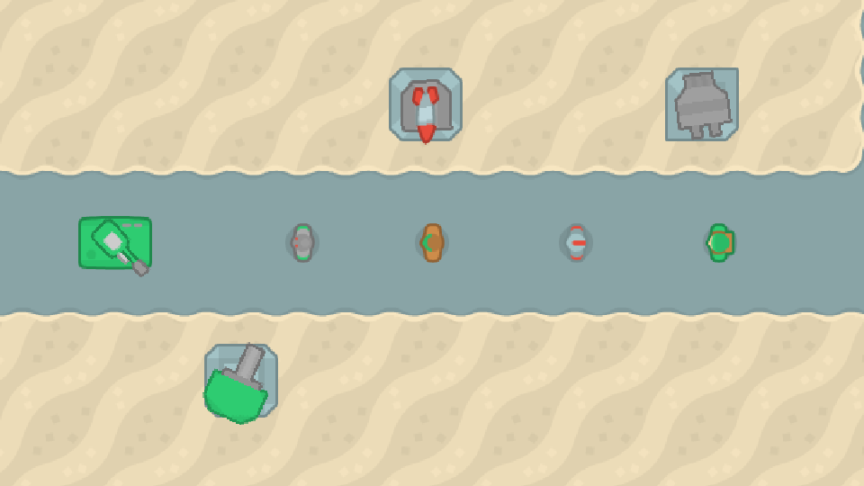
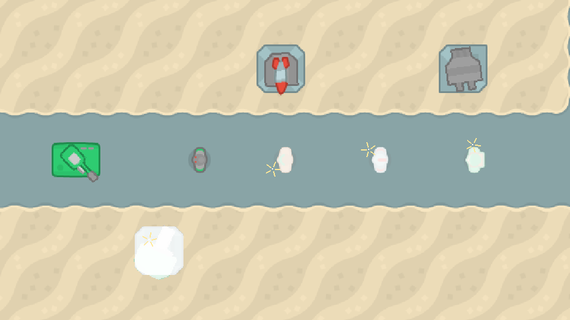

# Hit feedback: white flash and spark
<!-- index | refs: #84, PR #104 -->

**Date:** 2026-11-03 · **Area:** Feel, feedback · **Issue:** [#84](https://github.com/vectorviolet/chokepoint/issues/84) · **PR:** [#104](https://github.com/vectorviolet/chokepoint/pull/104)

## Context

In the owner's play-test on 2026-11-02, enemies and towers gave no sign that they were taking
damage. The only cue was the HP bar shrinking, which is small and easy to miss when many enemies
are on the path.

## Options

The same moment without and with the feedback: three enemies hit by the gun, the missile and the
cannon, and the cannon (bottom left) hit by the tank's shell. Zoom 1.6, 50 ms after the hits.

<table>
<tr>
<td> Before: nothing shows a hit.</td>
<td> After: each hit sprite is white for 80 ms, and a small spark bursts where the shot landed.</td>
</tr>
</table>

The issue named the decision directly: a white flash on the sprite and a small spark at the impact
point, rate-capped so gunfire doesn't strobe. The open questions were the details.

- **Flash:** a white silhouette of the sprite drawn over it (the shape is kept, per-pixel alpha
  included), or a tint of the whole sprite. A silhouette is the classic hit flash and reads at any
  zoom.
- **Spark:** a sprite from a pack, or a few short rays drawn in code. Drawn rays need no new asset
  and scale cleanly with the zoom.
- **Rate cap:** per target or global. Per target keeps every enemy's hits readable when many are
  hit at once.
- **Menu demo:** the issue's default, flash on, sparks on, no sound.

## Decision

The owner decided the look (issue #84, 2026-11-02): white flash about 80 ms, small spark at the
impact point, rate-capped, cosmetic on real time, capped with `MAX_EFFECTS`, no gameplay change.
Claude chose the numbers within that:

| Constant | Value | Why |
|---|---|---|
| `FLASH_MS` | 80 | The issue's "about 80 ms" |
| `FLASH_ALPHA` | 220 | Nearly solid white; a hint of the sprite still shows through |
| `HIT_MIN_INTERVAL_MS` | 250 | At most 4 flashes a second per target, 80 ms on, 170 ms off: a pulse, not a strobe. One rapid gun (600 ms reload) never reaches it; several towers on one enemy, or x4, do |
| `SPARK_LIFE_MS` | 150 | Short enough to fit in the interval, long enough to see |
| `SPARK_RAYS`, `SPARK_REACH` | 5 rays, 14 world px | Small next to a 64 px tile |
| `IMPACT_REACH` | 16 world px | The spark sits on the target's edge facing the shot, not on its center |
| `MAX_EFFECTS` | 64 | Hits playing at once; past that a new hit shows nothing |

A hit inside a target's interval shows nothing (neither flash nor spark). The flash covers every
part of the target: a ground tower's platform and turret, a tank's hull and turret. Each silhouette
is made from the surface actually drawn, rotation included, so the flash matches the sprite exactly.
They are kept in the feedback's own LRU (`MAX_CACHED_SILHOUETTES`) keyed on that surface: an enemy
keeps its rotated surface between turns and a turret's comes from the rotation cache, so they are
built once. The tank turret's surface is rebuilt every tick, so its small silhouette is rebuilt
each frame while it flashes.

Where the spark sits: a missile or tank shell's position when it lands, the shooting tower for an
instant hit (gun, cannon), and the bomb's landing point for a bomb, so each enemy in a splash
sparks on the side facing the blast (an enemy right under it sparks on its center).

The menu demo shows the same flash and sparks, with no sound. Nothing makes a sound: the issue's
decision has none.

## Rejected alternatives

- A spark sprite from a Kenney pack: works, but a new asset for a few pixels of lines.
- A global rate cap: under heavy fire one enemy's hits would hide another's.
- Flashing on game time: pausing would freeze a sprite white, and x4 would shorten the flash to
  20 ms. Like the other feedback, it runs on real time.

## Result

`ui.hit_feedback.HitFeedback`, owned by the game and by the menu demo like `bomb_impacts`. A hit
goes through a new `IGameContext.target_hit(target, hit_from)`: `Enemy.decrease_hp()` calls it
(after its "still on the map" check, before the damage), and so does `BaseTower.decrease_hp()`
when it applies damage (a tower without HP, the plane, shows nothing). It only records the hit; damage, kills, money and lives are untouched, and a test runs the
same seeded battle with and without it and compares money, lives, every enemy's and tower's HP,
kills and damage. A target that dies on the hit is simply not drawn any more; its record lets go of
it when its interval ends.

The flash is drawn right after its target's sprite (under its shots), the sparks with the bomb
explosions (under planes and HP bars); `tests/test_draw_order.py` checks both.

## Revisit if

- The owner wants a hit sound: `HitFeedback` would need a capped sound like `BombImpactFeedback`.
- Heavy-fire play-tests still feel busy: raise `HIT_MIN_INTERVAL_MS`.
