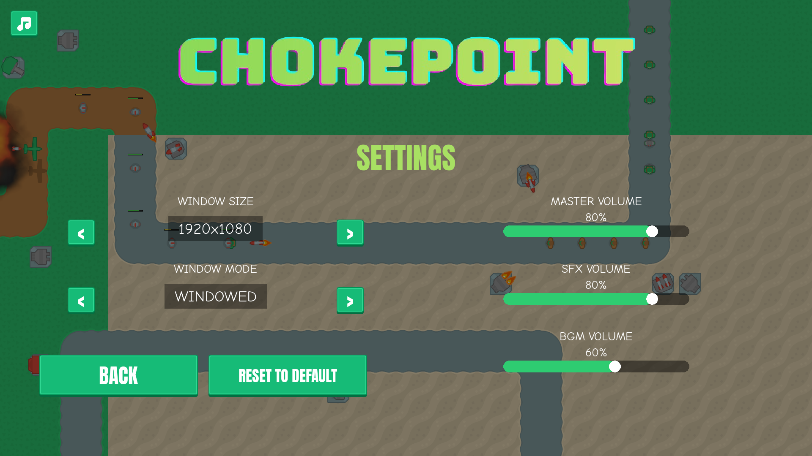
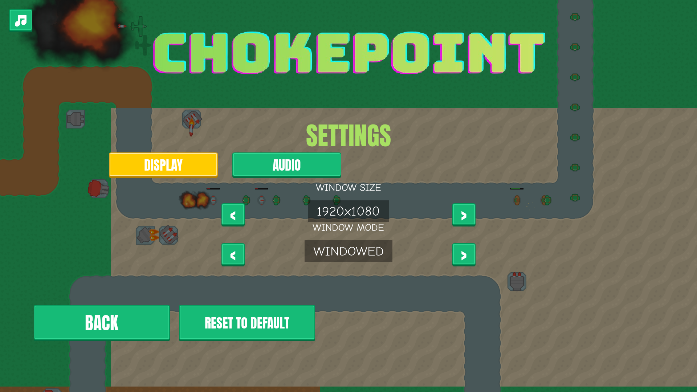
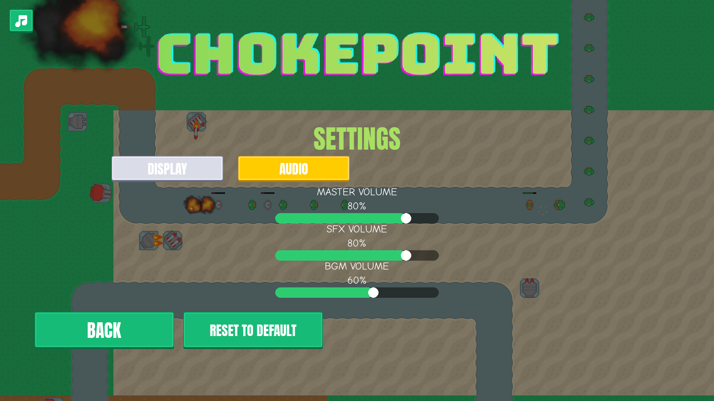

# Settings tabs: Display, Audio, Game, Controls
<!-- index | refs: #114, PR #121 -->

**Date:** 2026-11-03 · **Area:** UI · **Issue:** [#114](https://github.com/vectorviolet/chokepoint/issues/114) · **PR:** [#121](https://github.com/vectorviolet/chokepoint/pull/121)

## Context

Settings was one page: window size and mode on the left, three volume sliders on the right. Six
more settings are planned (FPS limit, language, edge scroll and others, issues #115 to #120), and
they would not fit without crowding the buttons at the bottom.

## Options

<table>
<tr>
<td> Before: one page, two columns.</td>
<td> After: the DISPLAY tab (opens first).</td>
<td> After: the AUDIO tab.</td>
</tr>
</table>

The owner approved the layout on 2026-11-03: tab buttons along the top (DISPLAY, AUDIO, GAME,
CONTROLS), Back and Reset to default staying below the tabs on every tab.

## Decision

The owner decided the layout (issue #114). Claude chose how it is built:

- Each tab is a button (`tab_<key>_button`) and a group object (`<key>_tab`) in
  `config/panels.yaml`; a tab's rows are objects with `parent: <key>_tab`. No positions in code.
- `src/app/settings_tabs.py` lists the tabs. GAME and CONTROLS have no rows yet, so their
  buttons stay hidden (`shown=False`); a later card adds rows to the group, adds one `SettingsRow` per `<` / `>`
  button (button, handler, argument) and sets `shown=True`.
- The open tab's button uses the yellow `btn_active` look (an existing asset, like the speed
  button's x2 state). Settings always opens on DISPLAY.
- The keyboard (up/down, Enter or Space) cycles the tab buttons, the open tab's `<` / `>`
  buttons, Back and Reset. Settings had no keyboard focus before. The volume sliders stay
  mouse-only: they can't take focus (a pygamine limitation, out of scope here).
- A hidden tab's rows are inactive objects: not drawn, no events, and `_activate()` refuses an
  inactive button, so they can't be clicked or focused.
- Reset to default resets every setting on every tab, as before.

## Rejected alternatives

- A second page with a "next" button: no overview of what's there, and worse for keyboard users.
- Hiding the GAME and CONTROLS buttons with an empty-looking tab: a tab with nothing in it is a
  dead end for the player.
- Editing pygamine so a `parent:` in the YAML switches visibility: the loader only uses it to
  place objects. This PR links the objects to their parents in the game instead
  (`settings_tabs.link_hierarchy`, once per panel load), and leaves pygamine alone.

## Result

All current settings work as before on their new tab and are saved as before. The tab buttons sit
at the left of the row for now (the hidden two leave room on the right); they fill the row once
GAME and CONTROLS are shown. Tests: `tests/test_settings_tabs.py`.
