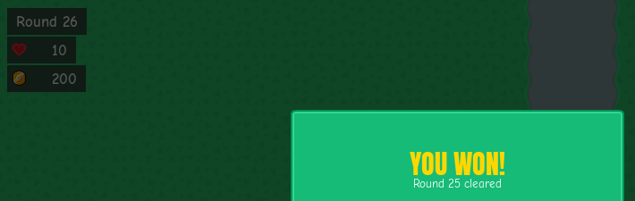

# Victory popup on clearing round 25
<!-- index | refs: #96, PR #105 -->

**Date:** 2026-11-03 · **Area:** UI, bug · **Issue:** [#96](https://github.com/vectorviolet/chokepoint/issues/96) · **PR:** [#105](https://github.com/vectorviolet/chokepoint/pull/105)

## Context

Found in the PR #81 review. The victory popup opened when the round counter changed to 26, so
the HUD behind it already read "Round 26" while the popup said "Round 25 cleared". The subtitle
was also hardcoded in `config/panels.yaml`, so it wouldn't follow `WIN_WAVE`, the winning round
in `src/util/constants.py`.

## Options

<table>
<tr>
<td> Before: the popup opens as round 26 starts; the HUD says "Round 26".</td>
<td> After: the popup opens as round 25 is cleared; the HUD still says "Round 25".</td>
</tr>
</table>

Both are 1024×768 captures of the same staged run (round 25 played to its end, its enemies
cleared), cropped to the counter and the popup's title. The "before" capture comes from `main`,
the "after" capture from this PR.

## Decision

The owner decided (2026-11-03) that:

- the popup opens as soon as round `WIN_WAVE` is cleared, before the next round starts, and the
  HUD keeps showing round 25 while it is open;
- the subtitle is built from `WIN_WAVE`;
- if the player continues, the counter moves to 26 when the next round starts, as for any other
  round.

The popup now hangs off the wave manager's `on_wave_cleared` hook, the same moment auto-pause
uses, instead of the level change. It pauses the run, and the wave manager holds the next round
until the run is started again. Continue starts it, so round 26 begins after the usual
end-of-round delay. With auto-pause on, the popup takes that moment instead, and auto-pause
doesn't stop the run again after Continue.

## Rejected alternatives

- Keep opening on the level change and show the previous round on the HUD while the popup is open:
  the counter would have to lie about the round, and round 26 would already be spawning behind the
  popup.

## Result

Clearing round 25 opens the popup with "Round 25" on the HUD and the subtitle "Round 25 cleared",
which is built in code from `WIN_WAVE`. A run saved on the popup (Main menu, or Esc) now saves the
end of round 25, already won. It loads paused there, without the popup, and Start goes on to
round 26. A save from before this change, made after round 25 was cleared but before round 26
started, opens the popup when it loads.

In the headless balance simulator, which answers the popup with Continue on the same tick, round 26
can start one tick later than before, so its numbers from wave 25 on shift slightly.
