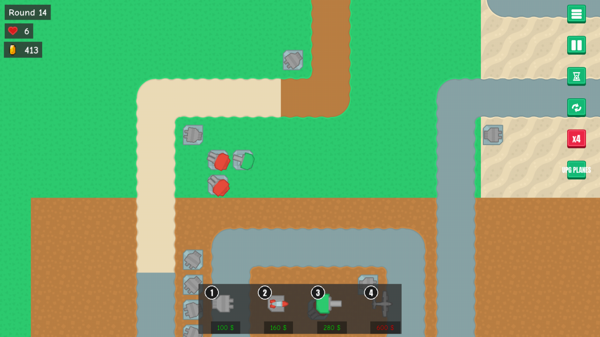
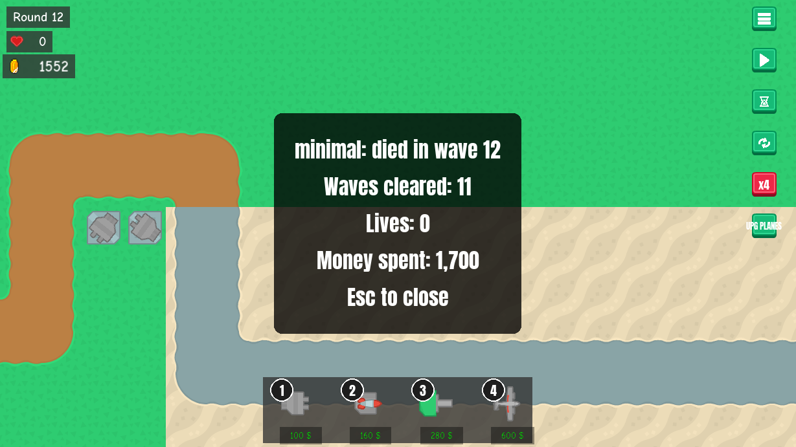

# Watch the balance bots play
<!-- index | refs: #100, PR #PRNUM -->

**Date:** 2026-11-03 · **Area:** Tooling, balance · **Issue:** [#100](https://github.com/vectorviolet/chokepoint/issues/100) · **PR:** [#PRNUM](https://github.com/vectorviolet/chokepoint/pull/PRNUM)

## Context

The [balance simulator](2026-10-29-balance-simulator.md) plays whole runs headless and writes
tables. Tables say *what* happened (a build loses four lives in waves 4 to 6, planes earn 3% of
their cost) but not *how*: where the leaks happen, how the bot's towers sit along the path, what
a tank wave does to a tower line. The owner asked to watch a bot play a run with human eyes, in a
normal game window, and approved the spec in issue #100.

## Options

<table>
<tr>
<td><br>gun_cannon in wave 14, at x4, the camera
scrolled over its towers.</td>
<td><br>minimal at the end of its run: the summary
stays on screen until Esc.</td>
</tr>
</table>

How to show a run:

- **The real game window, driven by the simulator's own steps** (`--watch`): the game's `update()`
  and draw path, with every game tick handed to the simulator's step, so the bot plays exactly as
  it does headless.
- **A recording**: render frames headless and save a video. Out of scope in the issue.
- **An overlay of the bot's plan** (next purchase, saved money). Out of scope in the issue.

## Decision

The spec is the owner's (issue #100): `uv run python scripts/balance_sim.py --watch --strategy
<name>` opens a window and plays that strategy from wave 1 with the full screen and HUD, in real
time at the bot's game speed (x4 by default, `--game-speed`). Space pauses, + and - change the speed
(x1, x2, x4), F toggles fast-forward, Esc or closing the window quits. The camera scrolls as in
the game, with no auto-follow. A watched run writes nothing, and its saves go to a temporary
folder like every simulator run.

How it is built (Claude):

- The run loop became `StrategyRun.step()`: one game tick, then the victory popup, game over, the
  bot's half-second look at its money and the stall watchdog. Headless runs call it in a tight
  loop; a watched game's `_tick()` calls it, so `Game.update()` paces it in real time (one tick
  per `TICK_MS`, each moving game time on by `TICK_MS` times the speed). Fast-forward ticks for
  50 ms of real time between drawn frames, with no frame cap. Headless output is byte for byte
  what it was (6 strategies over 8 and 30 waves, diffed before and after), and a test checks that
  a watched run's rows equal the headless ones.
- The bot buys by "clicking" a tile after centering the camera on it. In a watched run the camera
  goes back where the viewer left it after each purchase, so the view never jumps.
- The window is windowed (Chokepoint's default after a fresh install is fullscreen; the
  redirected settings are empty). The title shows the strategy and "(paused)" or
  "(fast-forward)"; the HUD's start/pause button shows the pause and its speed button the speed.
- The summary replaces the game-over popup, whose buttons would do nothing here.
- Sound stays off, as in headless runs (the dummy audio driver).

The headless video driver is no longer set when the script is imported: `run()` sets it, and
`--watch` leaves the real one.

## Rejected alternatives

- A separate watch loop that ticks and draws by itself: it would copy the game's update steps
  (camera, HUD, effects) and drift from them; reusing `Game.update()` and `Game.draw()` keeps the
  window the game's own.
- Pausing through the game's own pause (`is_started`): the stall watchdog counts ticks, and the
  game ticks on while paused, so a long pause would have ended the run with an error. A watched
  pause drops the ticks instead.

## Result

```bash
uv run python scripts/balance_sim.py --watch --strategy gun_cannon
uv run python scripts/balance_sim.py --watch --strategy minimal --game-speed 2
```

## Revisit if

- The owner wants the bot's plan on screen, several strategies side by side or a video.
