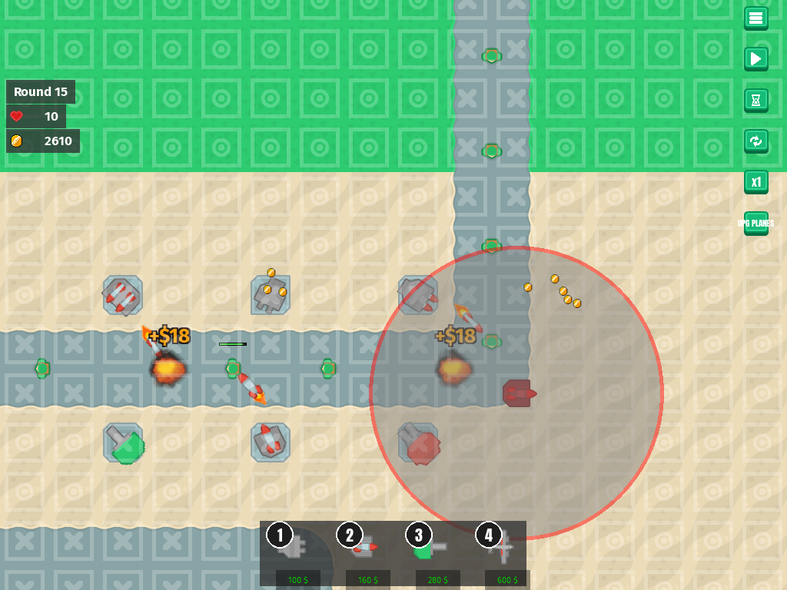
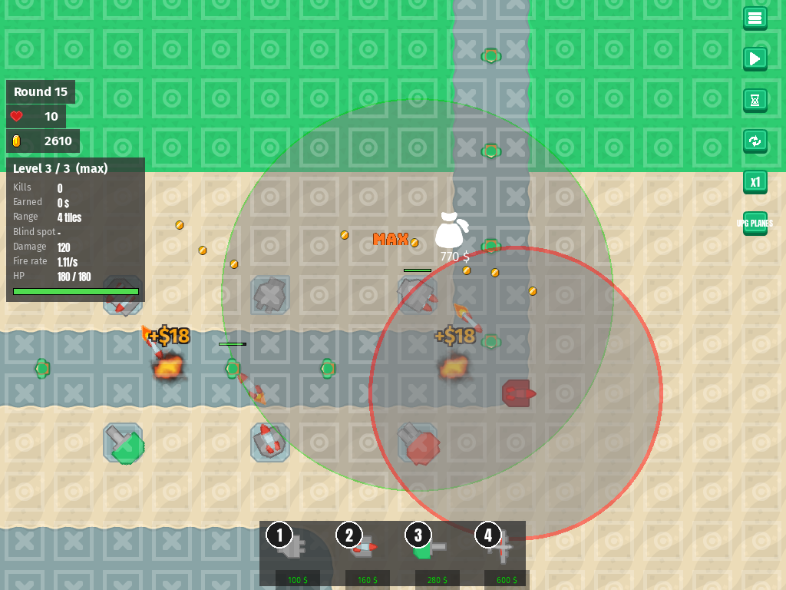
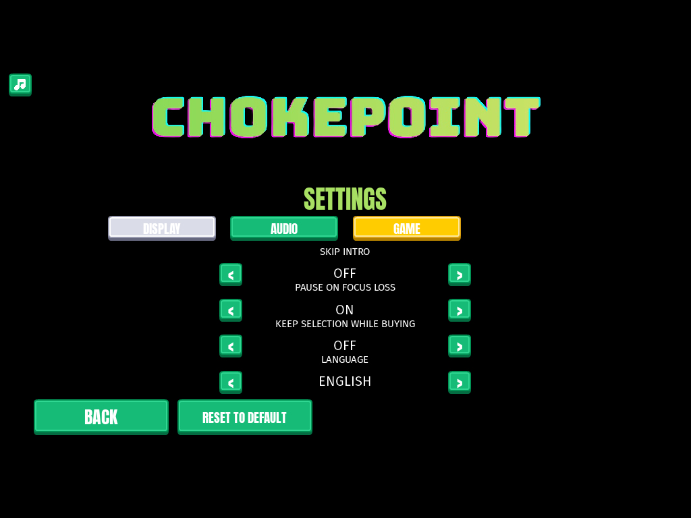

# Setting: keep the selected tower while buying
<!-- index | refs: #132, #133, PR #136 -->

**Date:** 2026-11-04 · **Area:** UI, settings · **Issues:** [#132](https://github.com/vectorviolet/chokepoint/issues/132), [#133](https://github.com/vectorviolet/chokepoint/issues/133) · **PR:** [#136](https://github.com/vectorviolet/chokepoint/pull/136)

## Context

Until now picking a tower to buy (a buy button or 1-4) never touched the selection: a selected
tower stayed selected, with its info panel and range ring, while the new tower's placement grid
opened. Nothing ever cleared it, so this was a side effect, not a decision. Sometimes that helps
(placing a new tower relative to the selected one's range), sometimes it clutters the screen. The
owner decided on 2026-11-04 to make it a setting, off by default.

## Options

<table>
<tr>
<td> OFF (default): picking tower 2 deselects the tower; no info panel, no range ring.</td>
<td> ON: the tower stays selected, with its info panel and range ring, while the new tower is placed.</td>
</tr>
</table>

The new row on the GAME tab:

## Decision

The owner decided the behavior (#132). Claude built it as one more `TOGGLE_SETTINGS` row, so it is
loaded, saved and reset like the other toggles (Reset to default sets it OFF).
`TowerPlacementController._pick()` clears `selected_tower` on a successful pick unless
`keep_selection_while_buying` is on; a refused pick (not enough money) changes nothing. The GAME
tab now has four rows, so its rows sit 100 px apart instead of 110 and Back / Reset moved down to
fit.

Issue #133, in the same PR: `scripts/make_playtest_save.py` writes Skip intro = ON, so worktree
play-tests open on the menu. The game's own default stays OFF.

## Rejected alternatives

- Keeping today's behavior as the default: the owner chose OFF.
- Also clearing a selected enemy: the setting is about the selected tower and its panel.

## Result

Both modes are tested on a real `Game()` (button and key, saved, reset, the settings row) in
`tests/test_keep_selection.py`; the play-test save is tested in `tests/test_make_playtest_save.py`.
