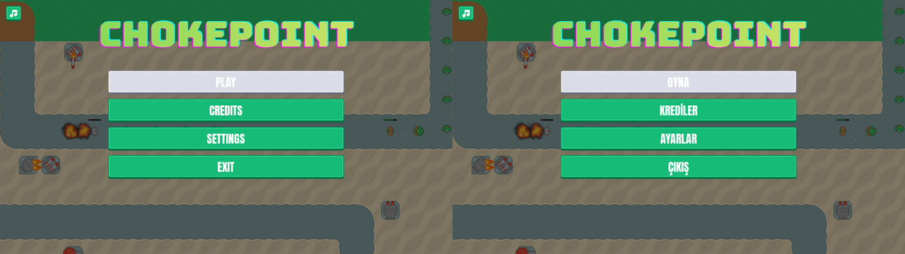
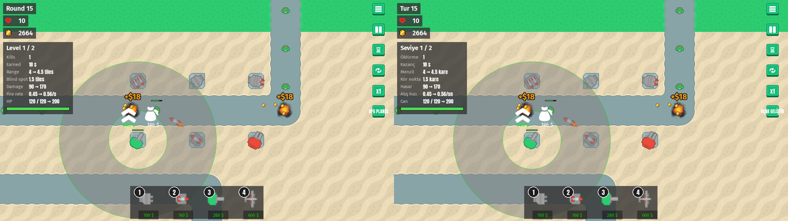
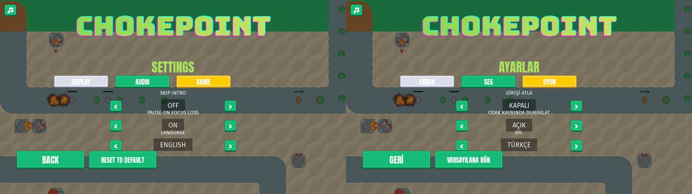
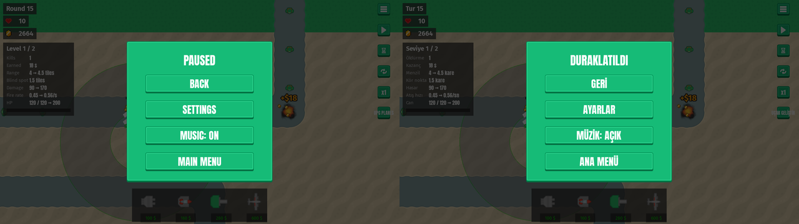
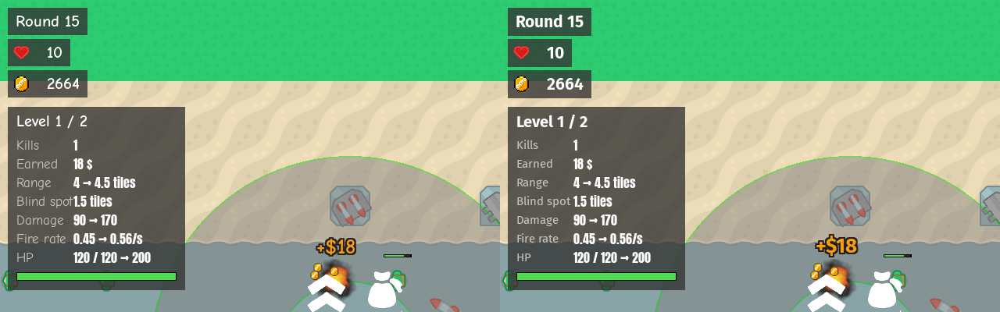
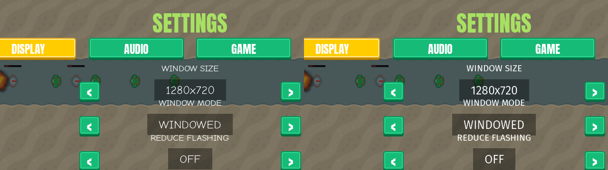
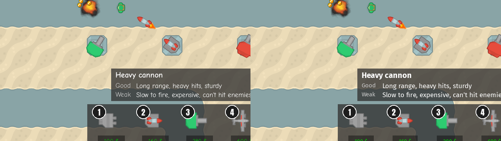

# Language setting: English and Türkçe, and the move to Fira Sans
<!-- index | refs: #120 -->

**Date:** 2026-11-04 · **Area:** UI, localization · **Issue:** [#120](https://github.com/vectorviolet/chokepoint/issues/120)

## Context

The owner decided (2026-11-03) that Chokepoint speaks English and Turkish, switchable on the
Settings GAME tab (`Language  < ENGLISH >`), applied instantly, English by default, saved with the
other settings. pygamine 0.29.0 brought the engine side (string tables, `text_key:` in panels YAML,
a live switch; its ADR 0001 has the design). This card moves every player-visible string out of
`config/panels.yaml` and `src/` into `config/lang/en.yaml`, drafts `config/lang/tr.yaml`, and
checks that the Turkish text fits.

## Options

The same four screens in English and Türkçe, side by side (1280x720 captures, shrunk):

<table>
<tr><td> Main menu: English | Türkçe.</td></tr>
<tr><td> HUD and tower panel: English | Türkçe. "UPG PLANES" becomes "UÇAK GELİŞTİR".</td></tr>
<tr><td> Settings, GAME tab with the new Language row: English | Türkçe.</td></tr>
<tr><td> Pause menu: English | Türkçe.</td></tr>
</table>

### The font: Comic Neue cannot spell Turkish

The glyph check (`check_glyph_coverage`, run on the bundled fonts) found that **Comic Neue lacks
Ğ, ğ and İ** (it has ç ö ş ü ı). Those letters are everywhere in Turkish ("AYARLAR", "GERİ",
"ÇERÇEVESİZ"), so a missing-glyph box would show up on most screens. Anton has all of them.

- **Fira Sans** (SIL OFL 1.1, Mozilla and Telefonica; static Regular and Bold, unmodified from
  `google/fonts`, `ofl/firasans`): very legible at small UI sizes, clear numerals for the money and
  round counters, static weights (pygame can pick Regular and Bold), and it covers Latin Extended.
  It also has the `→` of the tower info panel.
- **Nunito** was the first pick. Upstream only ships a variable font, and pygame can't set one to
  Regular or Bold. Rejected.
- **Atkinson Hyperlegible** lacks İ. Rejected.
- **A second font only for Turkish** would make the game look different per language and double the
  font code. Rejected.
- **Anton for all Turkish text** is a condensed display face; the long sentences in tooltips and
  the settings labels would be hard to read. Rejected.

Fira Sans is wider than Comic Neue, so its sizes were checked:

<table>
<tr><td> Counters and tower panel: Comic Neue | Fira Sans (English).</td></tr>
<tr><td> Settings rows: Comic Neue | Fira Sans (English).</td></tr>
<tr><td> Buy tooltip: Comic Neue | Fira Sans (English).</td></tr>
</table>

## Decision

- **Strings** live in `config/lang/<code>.yaml` (nested keys, `_meta.name` is the language's own name
  shown on the Language row). `config/panels.yaml` uses `text_key:`; code uses `tr()`. Texts the
  game builds itself (round counter, prices, ON/OFF, window mode, the pause menu's music button,
  the plane upgrade label, the victory subtitle) go through keys with `{placeholders}`
  (`hud.round`, `format.money`, ...), and `Game.set_language()` rebuilds them on a switch.
  Tower names and buy-tooltip lines moved out of `config/towers.yaml` into the language files.
- **What stays English:** logs, debug overlays and the balance tools; the credits' proper names
  (people, packs, URLs).
- **The row** is `LANGUAGE < ENGLISH >` on the GAME tab, cycling through the languages found in
  `config/lang`, applied at once, saved as `language` in `settings.json` (an unknown saved code loads
  as English). Reset to default returns to English, like every other setting. Decided by the worker
  following the "Reset covers every tab" rule; easy to drop if the owner prefers.
- **Turkish** is a draft by Claude for the owner's review (PR body lists every string). Captions are
  written in capitals by hand (İ and I).
- **Fira Sans** for all text (labels, values, sentences, floating "+$N"), Anton stays for headings,
  buttons and the tower panel's values. Size changes: the tower info labels went from 25 to 22
  (Fira Sans is wider; "Blind spot" would run into its value). Nothing else needed a new size.
- **Checks in CI** (`tests/test_localization.py`, part of the app test job): every language has the
  keys and `{placeholders}` of English, a key named in code or YAML exists, no English key is
  unused, every font has every glyph of every language, and the Language row switches, saves,
  loads and resets. `tests/test_localization_fit.py` measures every text in both languages at 1920x1080
  and 1280x720 (parent buttons and rows, the control column, every tower and level in the info panel,
  every buy tooltip).
- **Spelling check:** `config/lang/tr.yaml` is skipped by codespell (Turkish words trip the English
  dictionaries).

## Rejected alternatives

- A restart to apply the language: the engine switches live.
- Keeping the tower texts in `towers.yaml`: they would have been a second place for strings. The
  stats pages still read the English ones from `en.yaml`.
- Translating the credits' names, packs and URLs.

## Result

Switching the language updates every visible text at once with no restart. All Turkish strings fit
their buttons, rows, HUD and panels at both sizes; the longest, "UÇAK GELİŞTİR" on the plane upgrade
button, is wider than its 60 px button, like the English "UPG PLANES" already was, and fits the
120 px control column.
