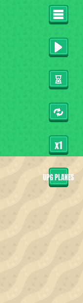
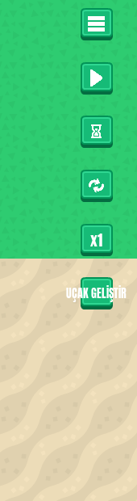
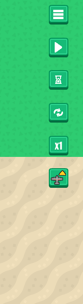
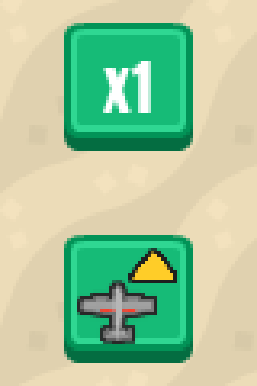
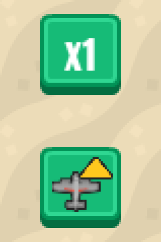

# UPG PLANES button as an icon, with key U
<!-- index | refs: #131, #141, PR #137, PR #147 -->

**Date:** 2026-11-04 · **Area:** UI, controls · **Issue:** [#131](https://github.com/vectorviolet/chokepoint/issues/131)

## Context

The plane upgrade was a text button, "UPG PLANES" ("UÇAK GELİŞTİR" in Turkish), wider than its 60 px
button, with the price and "MAX" on hover. Every other control button in the column is an icon, so
the text stuck out, and the label needed its own width checks in both languages. The owner decided
on 2026-11-04 to replace the text with an icon, a small plane with an upgrade arrow, and to add the
shortcut U.

## Options

Before, in English and Turkish, and after (the same icon in both languages):

<table>
<tr>
<td> Before (English).</td>
<td> Before (Turkish).</td>
<td> After: the icon, no text.</td>
</tr>
</table>

## Decision

The owner decided on the icon and on U (issue #131). Claude chose how it is built:

- **The icon** is composed from two Kenney CC0 sprites already in the repo's packs: the plane
  tower's own sprite (Tower Defense Top-Down, `towerDefense_tile271`), rotated nose-up, and the UI
  Pack's `icon_arrow_up_dark`, tinted yellow. Both get a dark outline so they read on the green
  button at the size they're drawn (48 px in a 60 px button). A gray plane with a green arrow was
  tried first and the arrow vanished against the green button. The file is
  `assets/images/hud/icons/icon_upgrade_planes.png`, listed in `SOURCES.yaml`.
- **Once bought**, the button and its icon are both grayed (the icon gets a grayed copy of itself,
  like the buy buttons' disabled looks) and clicks do nothing, as before.
- **U** runs the same method as a click (`_upgrade_planes`): affordability, max level, the click
  or denied sound and the money flash are one code path. Like Space and Shift it ignores key repeat
  and Ctrl/Alt/Meta chords, works with the HUD hidden, and waits while the pause menu or a popup
  has the input.
- The strings `hud.upgrade_planes` and `hud.maxed` and the text object are removed: nothing else
  used them.

## Update: centered plane (#141)

In the #137 review the owner noticed the icon looked off-center on its button: the plane sat in the
lower left and the arrow in the upper right. On 2026-11-04 the owner decided to put the plane in
the middle of the image and let the arrow overlap it
([#141](https://github.com/vectorviolet/chokepoint/issues/141)). Claude recomposed it from the same
two Kenney sprites at the same display size (48 px in the 60 px button): the plane (92 px wide,
dark outline) sits 8 px left of and 8 px below the 128 px canvas center, and a smaller yellow arrow
(58 px wide) sits in the top right corner, above the plane's upper right and just touching its right
wing, clear of the nose, drawn on top. Moving the arrow only a few pixels was not enough: it read as
part of the wing, so it went to the corner and the plane moved down and left to keep the nose clear.

<table>
<tr>
<td> Before: plane low left, arrow high right.</td>
<td> After: plane centered, arrow over its wing.</td>
</tr>
</table>

The arrow had to shrink (58 px instead of 64 px: at 64 px it hid the plane's nose), so it
reads slightly smaller than before. The icon is still shown at 48 px; going to 32 px is a separate
1.1 card.

## Rejected alternatives

- Keeping the price on hover: it would draw over the icon. The price belongs in the button's
  tooltip, which is its own card ([#130](https://github.com/vectorviolet/chokepoint/issues/130)).
- Putting U into an input map: that is the key-bindings card
  ([#129](https://github.com/vectorviolet/chokepoint/issues/129)); U is checked directly like Space
  and Shift for now.

## Result

The button is language-neutral and U upgrades the planes. Covered by `tests/test_keep_placing.py`
(U buys it, is denied when unaffordable, does nothing once maxed or on repeat/chords, waits for
the pause menu and popups) and `tests/test_game_hud.py`.

## Revisit if

- The icon is still hard to read next to the others on a small window.
- Players miss the price before the tooltip card (#130) lands.
