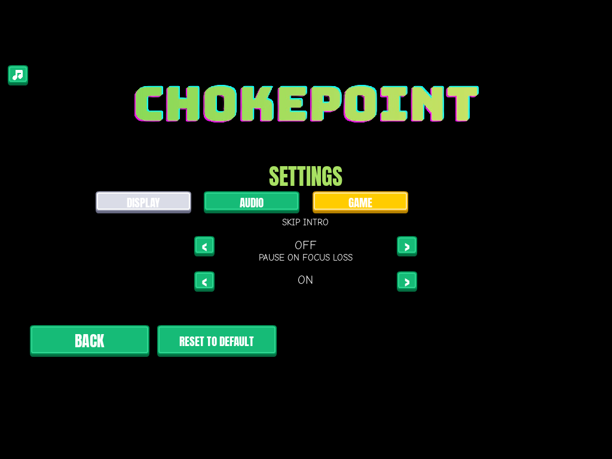
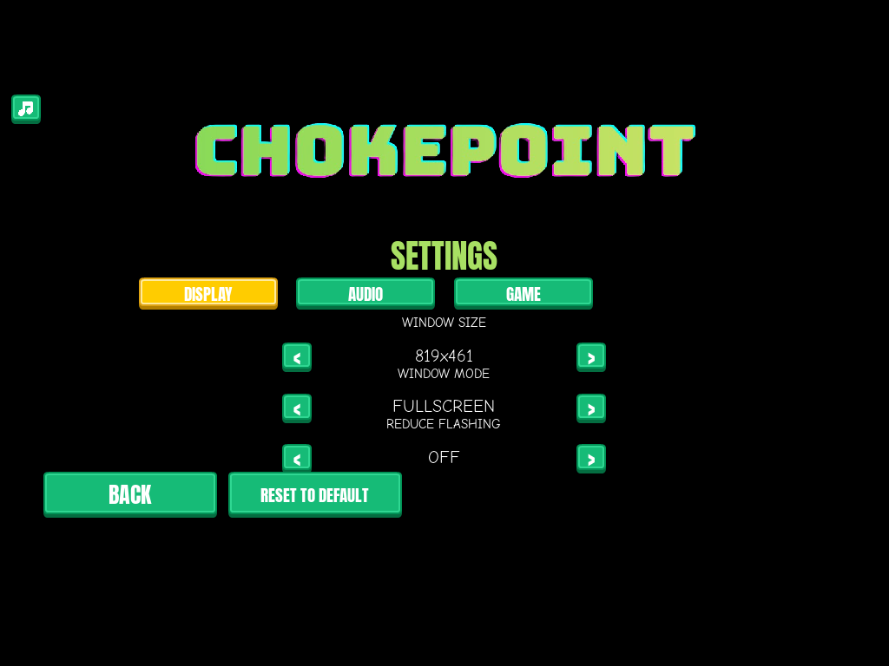
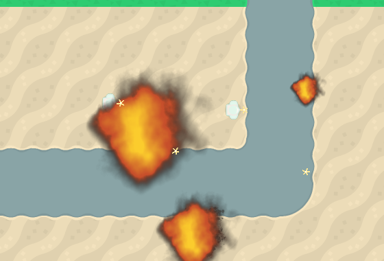
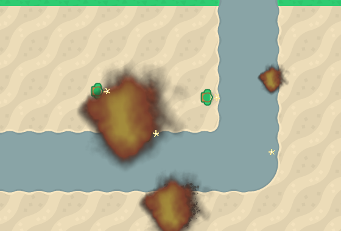

# Settings toggles: skip intro, pause on focus loss, reduce flashing
<!-- index | refs: #115, #116, #117, PR #125 -->

**Date:** 2026-11-04 · **Area:** UI, accessibility · **Issues:** [#115](https://github.com/vectorviolet/chokepoint/issues/115), [#116](https://github.com/vectorviolet/chokepoint/issues/116), [#117](https://github.com/vectorviolet/chokepoint/issues/117) · **PR:** [#125](https://github.com/vectorviolet/chokepoint/pull/125)

## Context

The settings tabs (PR #121) left GAME empty and DISPLAY with two rows. Three small, owner-approved
settings (2026-11-03) fill them: how the game starts, what it does when you alt-tab away, and an
accessibility option for the brightest effects. They ship as one PR because they touch the same
files (the settings panel, `Game`'s settings code and the tab list).

## Options

<table>
<tr>
<td> GAME tab: Skip intro (default OFF) and Pause on focus loss (default ON).</td>
<td> DISPLAY tab with the new Reduce flashing row (default OFF).</td>
</tr>
</table>

Reduce flashing, same scene both times (three hit enemies, a bomb impact on the left, a soldier's
death blast on the right and a tower's blast below):

<table>
<tr>
<td> OFF: white hit flashes, solid fireballs.</td>
<td> ON: no white flash (the spark stays), fireballs at about 50% alpha.</td>
</tr>
</table>

## Decision

The owner decided what each setting does (issues #115 to #117). Claude chose how it is built:

- **Skip intro** is read once at startup: when on, no `SplashScreen` is built, so `run()` goes
  straight to the main menu. Turning it on or off in Settings takes effect on the next launch. With
  it off, a key press or click still skips the splash as before.
- **Pause on focus loss** listens for `WINDOWFOCUSLOST`, but only marks it pending: the next
  `update()` opens the pause menu (the same `_open_pause_menu()` as Esc) if the window is still
  unfocused (`pygame.key.get_focused()`). That keeps the focus-lost/-gained pair SDL sends when F11
  changes the window mode from pausing the run. Nothing happens in the menus or with a popup open,
  and `WINDOWFOCUSGAINED` does not resume; the click that brings the window back (the first mouse
  press after a focus-loss pause, and its release) is swallowed so it can't hit the pause menu's
  buttons. Whatever the toggle says, `Game` reads the window's focus every update (so focus taken
  during the splash is not missed) and the camera's edge scrolling doesn't run while it is
  unfocused, so the map can't drift after an alt-tab.
- **Reduce flashing** is one `reduce_flashing` flag passed to `HitFeedback`, `BombImpactFeedback`
  and `DeathFeedback` (not a global). `BattleSimulation.set_reduce_flashing()` sets it on a
  battle's three feedback objects, and `Game` calls it for the game and for the menu demo, so the
  demo behind the menus follows it at once. With it on, `HitFeedback.draw_flash` draws nothing
  (the spark stays) and `ExplosionFrames.frames(size, reduced=True)` returns frames whose
  fireball is blitted at `REDUCED_FIREBALL_ALPHA` (128 of 255); the smoke and the rubble decal
  are unchanged. Sounds and gameplay don't change.
- All three are saved with the other settings (defaults in `config/settings.yaml`, reset by
  Reset to default) and are `< value >` rows built like the window rows. One list,
  `TOGGLE_SETTINGS`, drives their load, save, reset, labels and keyboard rows, so a fourth toggle
  is a key, a default and its panel objects. `ExplosionFrames` keeps only the variant (normal or
  reduced) asked for last, so the cache doesn't double when the setting changes.

## Rejected alternatives

- A module-level flag for reduce flashing: the issue asked for a flag passed to the classes, and a
  global would be shared by tests and the menu demo.
- Dimming the whole frame instead of only the fireball: the smoke and the rubble are not what
  flashes, and the issue says to leave them.

## Result

The three rows work as specified and are covered by `tests/test_game_toggles.py` and
`tests/test_reduce_flashing.py`.

## Revisit if

- Players still find the hit spark or the explosions too bright with Reduce flashing on.
- Focus loss should also pause in other situations (for example while placing a tower), which the
  issue leaves out.
