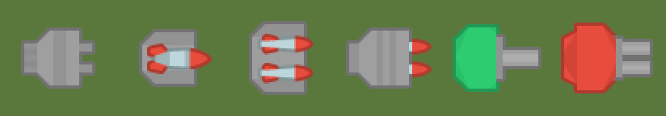
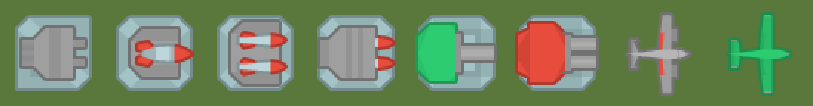

# Tower and enemy pictures in the stats reference and wiki
<!-- index | refs: #95, PR #156 -->

**Date:** 2026-11-05 · **Area:** Docs, tooling · **Issue:** [#95](https://github.com/vectorviolet/chokepoint/issues/95) · **PR:** [#156](https://github.com/vectorviolet/chokepoint/pull/156)

## Context

The generated stats reference (`docs/stats/`, mirrored to the wiki) was text and tables only, so
a reader had to guess which tower or enemy a heading meant. Issue #95 asked for each tower's and
enemy's picture next to its heading, per level where the sprite changes, picked from the game's
config rather than a hand-kept list.

## Options

- **A: the raw turret sprite only.** Simplest, and the PNG would be byte-identical to the asset.
  But a turret alone is a floating gun: it doesn't show the platform under it, so it isn't what a
  player sees on the map.
- **B: the platform with the turret on top, as the game draws it.** Needs a small compositor, and
  a pixel comparison in `--check` because the pictures are generated, not copied.

<table>
<tr>
<td> A: the raw turret sprites (rejected).</td>
<td> B: platform plus turret, and the planes (chosen).</td>
</tr>
</table>

## Decision

B, decided by the owner in the issue (2026-11-05). How it is built:

- `scripts/gen_stats.py` finds the images through the game's own asset keys in
  `config/assets.yaml` (`tower_N_lvlL`, `tower_N_platform`, `enemy_N`, `enemy_N_muzzle`), loaded
  with pygamine's `AssetManager`, and the level counts from `config/towers.yaml` and the enemy
  types from `config/enemies.yaml`. Levels whose key resolves to the same file share one picture.
- A ground tower is the platform with the unrotated turret on top, both centered, as
  `GroundTower.draw` does at camera scale 1; the turret's resting rotation goes through the game's
  `quantise_angle` and `cached_rotation`. The plane is its sprite without the shadow. A tank also
  gets its muzzle on top.
- Pictures go to `docs/stats/images/` as `stats-*.png`, linked as `images/<file>` on both GitHub
  and the wiki, so no link needs rewriting. The prefix keeps the wiki's other images apart.
- `--check` compares decoded size and RGBA pixels, never PNG bytes, so another zlib or libpng
  build (local Windows, CI Linux) can't make it fail. It also reports missing and no-longer
  generated images. CI already runs it through `tests/test_stats_docs.py`.
- `.github/workflows/wiki.yml` copies the images into the wiki's `images/` folder and removes
  `images/stats-*.png` files that are no longer generated.

## Rejected alternatives

- A: raw turret sprites only, see above.
- Comparing PNG bytes in `--check`: breaks across zlib and libpng builds.

## Result

The generated tower pictures side by side (a contact sheet, not a screenshot of the rendered
page). Tower 1, tower 2 levels 1 to 3, tower 3 levels 1 and 2, then the planes of levels 1 and 2.

## Revisit if

- A tower gets a platform per level, or a new tower type with parts the compositor doesn't know.
