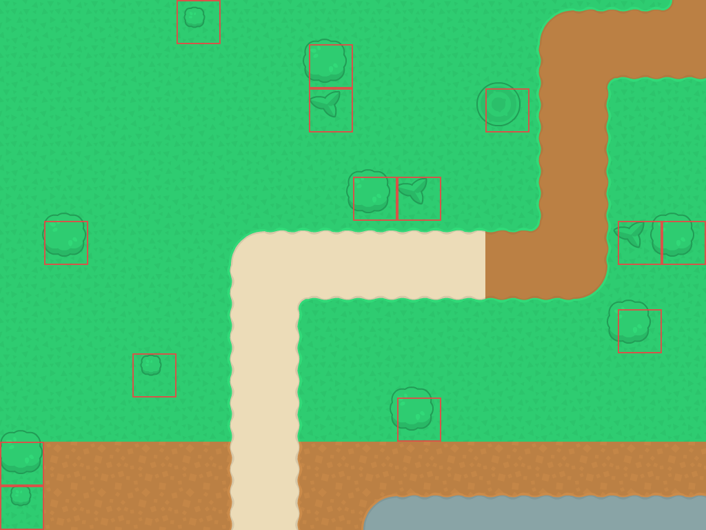
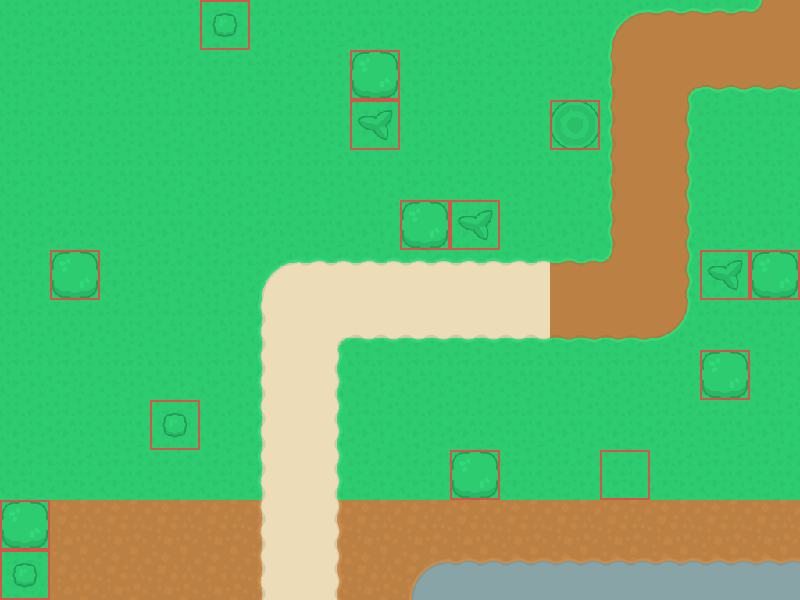

# Map obstacles and blocked build tiles
<!-- index | refs: #166, PR #167 -->

**Date:** 2026-11-07 · **Area:** Gameplay, rendering · **Issue:** [#166](https://github.com/vectorviolet/chokepoint/issues/166) · **PR:** [#167](https://github.com/vectorviolet/chokepoint/pull/167)

## Context

The owner placed trees and rocks in an `Obstacles` object group in the Tiled map
and asked for a review of their rendering and placement blocking. The initial
loader found tile images, but the draw code subtracted grid indices from pixel
positions. That shifted each image away from its blocked cell. A rectangle with
no image was also ignored, leaving its cell available for construction.

## Options

<table>
<tr>
<td> Initial approach: subtract grid indices while baking obstacles.</td>
<td> Chosen approach: use the loaded pixel positions and block the full bounds.</td>
</tr>
</table>

These are cropped map previews rendered from the actual TMX and tileset, with red
outlines showing obstacle blockers. They illustrate the coordinate change; they
are not screenshots of a running game. The empty outlined cell in the corrected
preview is the owner's image-less rectangle, object 101.

Drawing obstacles individually every frame would support moving objects, but the
current obstacles are static. They can share the existing map surface and camera
scale cache.

## Decision

The owner authorized the correction and the obstacle feature. Keep the authored
layout and existing tileset, load obstacle bounds independently of images, and
include static obstacle images in the game's `pre_render()` override.

`pytmx` already converts a tile object's bottom anchor to its top-left position.
Use those coordinates directly, without subtracting a tile height again or
changing the saved position during drawing. Resize tile images once when their
authored bounds differ from the source tile size.

For construction, block every grid cell intersecting an obstacle's bounds.
The right and bottom edges are exclusive, so a rectangle ending exactly at a
tile boundary does not block the next tile. Clip coverage to the map and ignore
zero-area objects. Image-less rectangles block construction without drawing a
sprite. The supported authoring convention is unrotated tile objects and
rectangles in the `Obstacles` group.

## Result

Ground-tower placement and its existing preview use the updated buildable grid.
The menu demo uses the same grid when choosing tower positions. The enemy path
and plane placement rules keep their existing behavior. Obstacles are drawn
above the ground and below towers through the normal cached map draw.

Regression tests cover tile position and size, image-less rectangles, fractional
and multi-cell bounds, map edges, repeated rendering, and camera zoom. Existing
menu-demo tests check that its towers stand only on buildable cells. All tests
and simulations use temporary saves.

Paying to clear obstacles and saving cleared state remain in [#20](https://github.com/vectorviolet/chokepoint/issues/20).
Existing saves retain their saved tower positions; this change does not relocate
towers from an older map layout.
