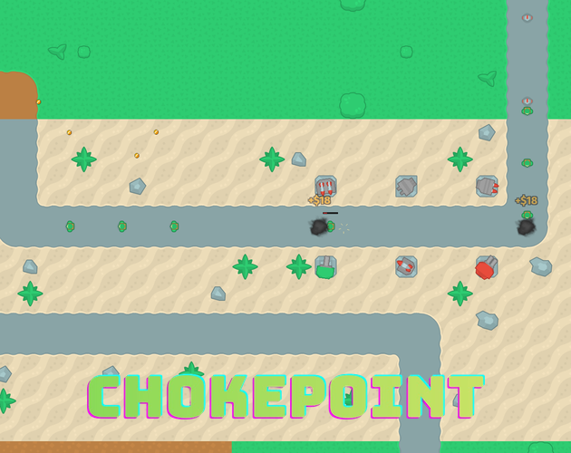
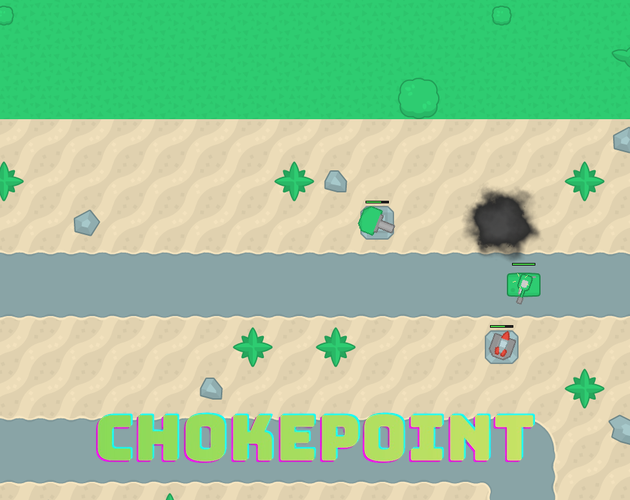
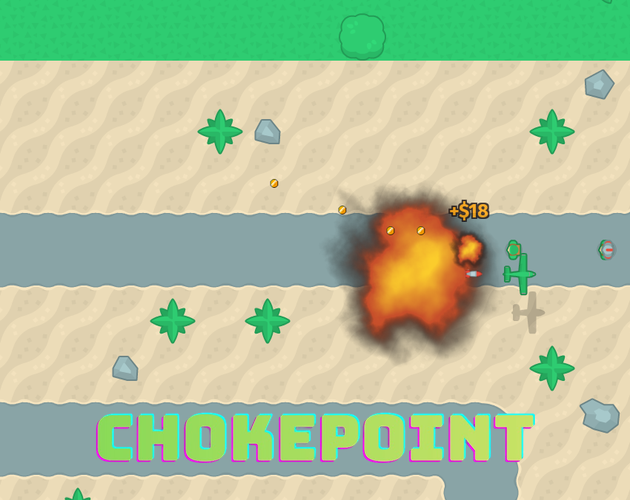
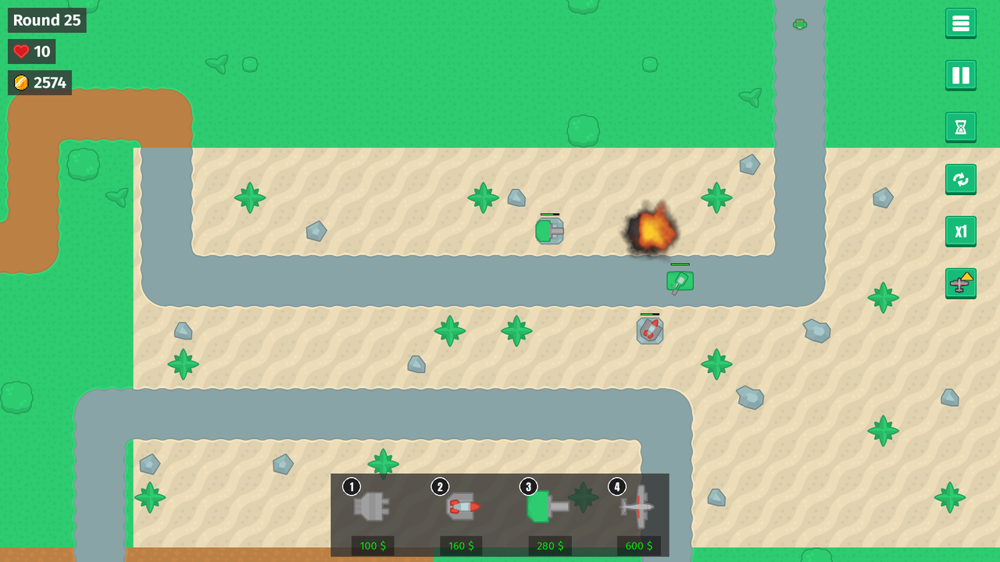

# Store media: new screenshots, preview GIF and cover candidates
<!-- index | refs: #13 -->

**Date:** 2026-11-09 · **Area:** Docs, tooling · **Issue:** [#13](https://github.com/vectorviolet/chokepoint/issues/13)

## Context

The 1.0 store page and the README still showed screenshots from before hit flashes, death
explosions, bomb impacts, kill coins, the settings tabs, the language setting and the map
obstacles. Issue #13 lists what to retake and what to add. The owner decided there is no trailer
for 1.0 (the preview GIF only) and that he picks the cover himself from candidates.

## What was captured, and how

All of it comes from `scripts/capture_readme.py`, so the media can be retaken with one command
after the game changes. The script builds a real `Game()` with a fixed seed, a dummy audio driver
and saves redirected to a temporary folder, so two runs write identical files (see
`tests/test_capture_readme.py`). It stages each scene by driving the game's own objects: the cursor
is pinned over a tile or a buy button, a tank and towers are placed beside the path, a plane is added
over the wave, and the run is stepped frame by frame until the moment worth keeping (for example
the frame where the destroyed tower's blast has started and its rubble is down).

| File | What it shows |
|---|---|
| `docs/preview.gif` | The README and itch.io GIF: six seconds of a round-15 wave, 1280x720 |
| `docs/plane-run.gif` | A plane crossing the wave and bombing it (optional extra) |
| `docs/screenshots/01_menu.png` to `04_pause.png` | Retaken: menu over the demo battle, gameplay, tower info with upgrade previews, pause menu |
| `05_settings_display.png`, `06_settings_audio.png`, `07_settings_game.png` | The settings tabs |
| `08_placing_tower.png`, `09_unbuildable_tile.png`, `10_buy_tooltip.png` | Placing: range ring on a free tile, the red preview on a tile that can't be built on, the buy tooltip |
| `11_tank_fight.png` | A tank shooting towers: their HP bars and a destroyed tower's blast and rubble |
| `12_plane_bombing.png` | Bomb explosions and the plane's info panel |
| `13_enemy_hp.png` | A clicked enemy with its HP numbers |
| `14_turkish.png` | The game in Turkish, with a buy tooltip |
| `15_victory.png`, `16_game_over.png` | The two end popups |
| `17_hud_hidden.png` | The HUD hidden with Tab: a clean battlefield |

Screenshots are shrunk to 1280 px wide (the devlog rule), and the GIFs are 1280x720 with one
shared palette each: `preview.gif` is about 0.75 MB. The tooltip and the range ring can't both
show at once in the real game (one cursor), so they are separate shots (`08` and `10`). The map
now has trees and rocks; they are in every shot, and the placement shots show that they are not
build tiles.

I opened every image and fixed what looked wrong: the cursor stayed over a buy button, so a tooltip
leaked into later shots (it now rests over bare map); the placement shot first landed on a crowded
spot with the ring covering the towers; the game-over popup showed 10 lives (it now shows 0); the
tank shot was taken while the tank flashed white from a hit, and a few frames before the rubble.

## Cover candidates (decision pending)

itch.io shows covers at 630x500. Each candidate is cropped from a clean HUD-hidden frame (the
script's `--covers <folder>` writes them) with the game's own logo (`assets/images/branding/logo.png`)
over the bottom. No new assets are used.

<table>
<tr>
<td> 1: the wave and all four tower types, full framing.</td>
<td> 2: a tank and a destroyed tower's rubble, tighter framing.</td>
<td> 3: a plane's bombing run, tight on the explosion.</td>
</tr>
</table>

## Decision

README gallery: the menu, gameplay, placing a tower, the tank fight, the plane run and the upgrade
panel (six shots, the GIF stays on top). The itch.io gallery list is in `docs/store/README.md`.
The cover is the owner's to pick from the three above; until then the store page keeps its
current cover. The itch.io upload is by hand and also pending.

## Rejected alternatives

- A trailer: the owner decided against it for 1.0.
- Recording the shots by hand: not repeatable, and the next UI change would date them again.
- One shot with the range ring and the tooltip together: it would need two cursors, so it
  would not be something a player can see.

## Result

## Revisit if

- The UI or the map changes in a way players see: run `scripts/capture_readme.py` again.
