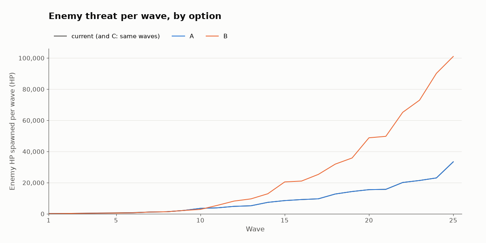
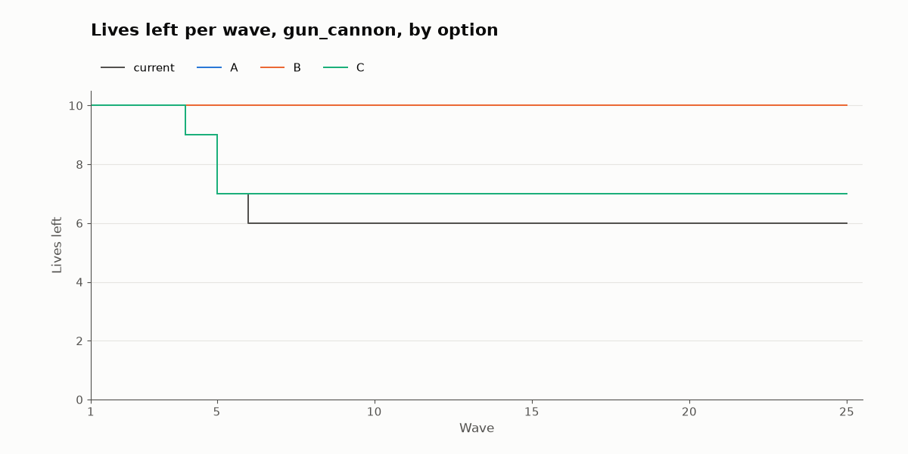
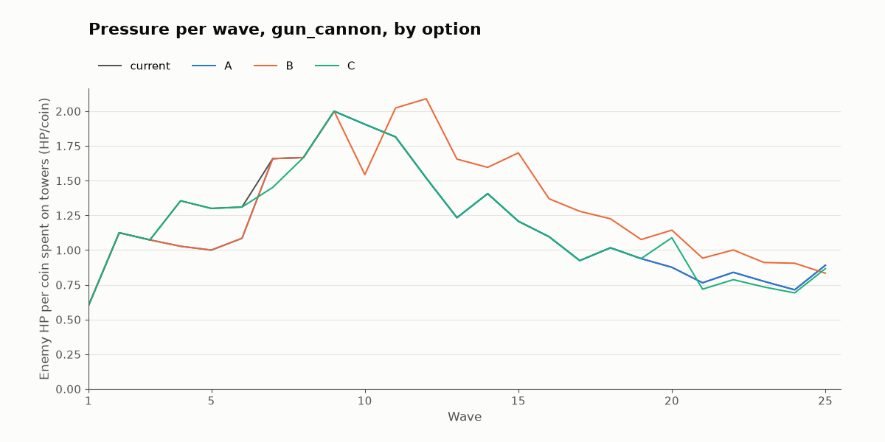

# Wave balance: smoother waves 4 to 6, more pressure in 11 to 25
<!-- index | refs: #10, PR #170 -->

**Date:** 2026-11-09 · **Area:** Gameplay, balance · **Issue:** [#10](https://github.com/vectorviolet/chokepoint/issues/10) · **PR:** [#170](https://github.com/vectorviolet/chokepoint/pull/170) (open when this entry was written)

## Context

The balance simulator ([#70](https://github.com/vectorviolet/chokepoint/issues/70), report in
[`docs/balance/`](../balance/report.md) and [`docs/BALANCE.md`](../BALANCE.md)) measured the owner's
playtest impressions on the current map:

- **The early spike is waves 4 to 6.** Every normal build leaks 1, 2 and 1 enemies in waves 4, 5 and
  6 (4 of 10 lives), always the same waves. The cause is money: waves 1 to 5 pay 24, 45, 63, 87 and
  84, so a player has about 4 to 5 guns by wave 4.
- **Waves 11 to 25 cost nothing.** No normal build loses a life, an enemy or a tower there (wave 10 is
  the missile build's own cliff: its first heavy costs it 3 lives). Income
  grows from 631 to 6,377 a wave and the bots turn all of it into towers.
- **Heavies (type 4) are a cliff.** With 3 heavies in wave 12 instead of 1, gun_spam and missile die
  in wave 12; with 2 everything holds. They have to be tuned in steps of 1.

The owner holds the balance numbers, so the simulator's job was to compare candidates, not to pick.

## Options

Each candidate was run through the simulator in a scratch copy of the repo (waves 1 to 25 only);
nothing was committed.

- **A, minimal:** smooth waves 4 to 6 only (fewer enemies in 4 and 5, wave 6 at the default spawn
  spacing). Waves 10 to 25 stay as they are.
- **B, A plus a rework of waves 10 to 25:** no heavy in wave 10, heavies 1, 2, 2, 3 in waves 11 to
  14 and 4 to 8 by wave 20, the first tank moved from wave 25 to wave 15, heavy tanks (type 6) from
  wave 22, tighter spawn spacing (600 ms from wave 15, 550 from wave 20, 500 in wave 25), types 2
  and 3 up to 1.8 and 2 times as many by wave 25 (18 fast runners instead of 10, 14 bruisers
  instead of 7, 10 heavies instead of 5), and no grunts from wave 21.
- **C, spacing only:** the same enemies, spawned slower in waves 4 to 6 and faster later, one tank
  in wave 20. Income stays identical to the old waves.

*B's waves carry three times the HP of the current ones by wave 25 (about 101,000 against 33,000).
A is the current curve with a small dip in waves 4 to 6; C has the same enemies as the current waves,
so it is not drawn separately.*

*gun_cannon in waves 1 to 25: the current waves and C leak in waves 4 to 6; A and B (drawn on top of
each other at 10 lives) don't.*

*Enemy HP per coin spent on towers: B sits above the others from wave 10 on, so the same defense
faces more HP per coin.*

Headline numbers of the candidate runs (to wave 25):

| | lives lost 1-10 (gun_cannon) | lives lost 11-25 | who dies |
|---|---|---|---|
| current | 4 | 0 | minimal in wave 12 |
| A | 0 | 0 | minimal in wave 10 |
| B | 0 | 0 for guns, cannon, missile and mixed | plane_spam in wave 25, minimal in wave 11 |
| C | 3 | 0 | minimal in wave 9 |

## Decision

**The owner chose B on 2026-11-09. The simulator recommended A**: it removes the early spike with the
smallest change and puts no new risk in waves 10 to 25. B is the option that adds pressure to waves 11 to 25, which A and C leave as they are. `config/waves.yaml` is B exactly as simulated, with its
comments updated (the first tank is in wave 15, the first heavy tank in wave 22).

## Rejected alternatives

- **A:** safe, but waves 11 to 25 stay as trivial as measured.
- **C:** keeps income identical, but it still leaks 3 lives in waves 4 to 6 and its later waves only
  differ in spacing.
- **More heavies in wave 12 (3 instead of 2):** gun_spam and missile die in that one wave, so B keeps
  to 2.

## Result

The full 40-wave simulation with B (seed 70, x4, saves redirected), against the same run on main:

| strategy | before | after |
|---|---|---|
| gun_spam | died wave 32, 4 lives lost in 1-10 | died wave 32, 0 lives lost in 1-25 (all 10 lost in wave 32), 834 towers lost (450) |
| gun_cannon | cleared 40, 6 lives left | cleared 40, 10 lives left |
| missile | cleared 40, 3 lives left | cleared 40, 8 lives left (2 lost, in wave 10) |
| plane_spam | died wave 29 | died wave 25 (all 10 lives lost in wave 25) |
| mixed | cleared 40, 6 lives left | cleared 40, 10 lives left |
| minimal | died wave 12 | died wave 11 |

Waves 4 to 6 no longer leak for any normal build. The honest reading of waves 11 to 25 is mixed: in
the simulation B's extra pressure only shows as the plane-only build dying in wave 25 (it switches to
planes at wave 20 and meets the first of the waves with 5 tanks and 2 heavy tanks) and the minimal
build dying a wave earlier. The builds with guns, cannons or missiles still lose no lives in
waves 11 to 25, because the bots rebuild within half a second of game time at x4, which a player
can't do. Whether 11 to 25 now feels tight but fair is for the play-test to say. Waves 26 to 40 were
never simulated for B before this run: the same builds clear them, gun_spam still dies in wave 32
(now losing all 10 lives in that one wave), and the tank wear is higher (834 towers lost for
gun_spam, 626 for gun_cannon). Income is higher too (599,939 earned by wave 40 against 514,954), since
there are more and tougher enemies to kill.

Charts of the full run are in [`docs/balance/`](../balance/report.md).
