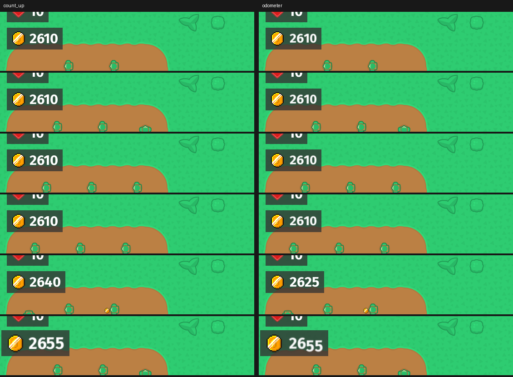

# The money HUD follows each coin as it lands
<!-- index | refs: #189, PR #191 -->

**Date:** 2026-11-12 · **Area:** Feel, feedback · **Issue:** [#189](https://github.com/vectorviolet/chokepoint/issues/189) · **PR:** [#191](https://github.com/vectorviolet/chokepoint/pull/191)

## Context

When an enemy died, the money was added at once while the coins were still flying to the counter,
so the number had already jumped before the first coin arrived. The owner said it didn't feel good
(2026-11-12) and asked for the number to grow as each coin lands, and for a slot-machine roll like
Highrise's cash display (Highrise #61) to be tried next to it.

## Options

Same seeded run, same frames, 150 ms apart around one kill burst (the
bursts of the staged wave 15; the crop is the money counter). Left: **count-up**, the number jumps
by each coin's value as the coin lands. Right: **odometer**, the digits that change roll.

The pop (the counter grows ~25% for 160 ms when a coin lands) already existed and stays in both;
it is what makes the last row look larger. GIFs of both styles were made too but are not committed
(devlog images are PNGs).

- **Count-up:** simplest, and exact: every landing coin is one visible step.
- **Odometer:** looks richer on one kill. Late waves land dozens of coins a second, so the digits
  are rolling nearly all the time (`hud.money_roll_ms`, 200 by default); a new change retargets the
  roll instead of queueing, so it never lags behind, but it is busier.

## Decision

Pending the owner's pick. Both are built; `hud.money_style` in `config/settings.yaml` is
`count_up` (the default for now) or `odometer`. It is a config flag, not a Settings option.

How it works:

- The balance is paid on the kill, exactly as before. Each coin carries a share of its kill's
  reward (as even as whole coins allow). `KillFeedback.pending_money` is the sum of the shares of
  the coins still flying, derived from the live coins, so it can't drift from them.
- The HUD shows `max(0, money - pending_money)`. Landing a coin lowers `pending_money`, so the
  number goes up by its share; spending lowers `money`, so the number drops at once. After the last
  coin lands the number is the balance, by construction, however the money changed meanwhile.
- A kill the effect cap has no room for holds nothing back: its reward shows at once.
- Snap to the balance, no animation: the pause menu, the wave pause, the victory and game-over
  popups (`Game._snap_money()`: the coins in flight stay as pictures but their shares are
  released), load and new game (the coins are cleared), and Reduce flashing (no shares are held,
  no roll, no pop).
- Odometer style: the money text object only lays out the plate (with an invisible font) and
  `ui/odometer.py` draws the digits over it, moved with the sliding HUD. It is Highrise's
  odometer, copied, plus a color setter (the red flash) and a draw offset. It belongs in
  pygamine for both games: that is a separate change, not part of this PR.
- Kills are announced to the HUD before the reward is paid (`BattleSimulation.enemy_killed`
  swapped two lines), so the number never flickers up and back.

Buy buttons use the real balance, so for a moment the number can read less than a tower's price
while its button is already lit. In play this reads as "the coins are on their way"; the owner
should say if it confuses.

## Rejected alternatives

- **Delay the real balance until the coins land.** It would be simpler to display, but the balance
  is saved, drives affordability and the balance numbers, and a kill must pay when it happens:
  a save or a purchase mid-flight would be wrong. Same reasoning as shots that outlive their
  shooter (#71): the effect is visual, the rules don't wait for it.
- **A separate displayed value that ticks toward the balance.** It can drift (spend while coins
  fly) and needs reconciling; deriving it from the coins in flight can't.

## Result

`KillFeedback.pending_money`/`settle()`, `GameHUD.shown_money`/`snap_money()`/`draw_money_odometer()`,
`ui/odometer.py`, `hud:` in `config/settings.yaml`. `tests/test_money_hud.py` covers both styles:
many kills at once, pausing, saving and loading mid-flight, spending while coins fly, Reduce
flashing, and that the number equals the balance once all coins have landed.
