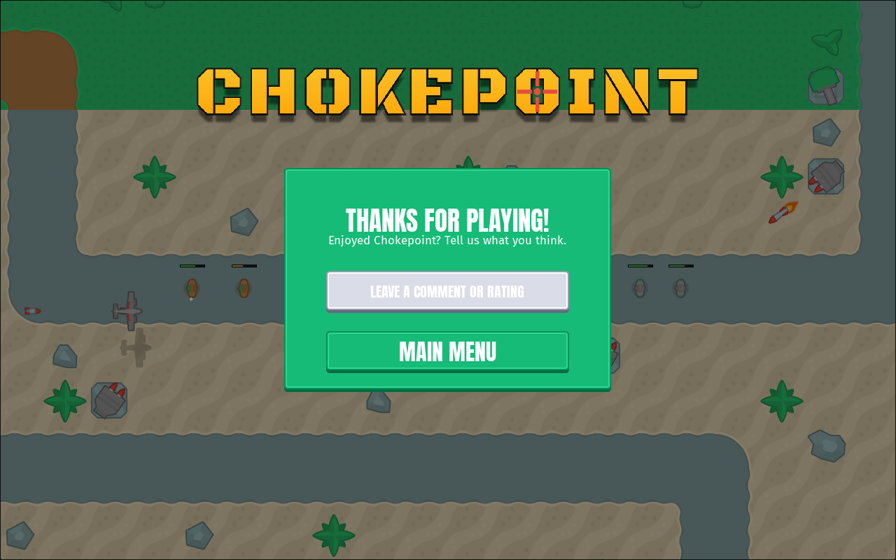
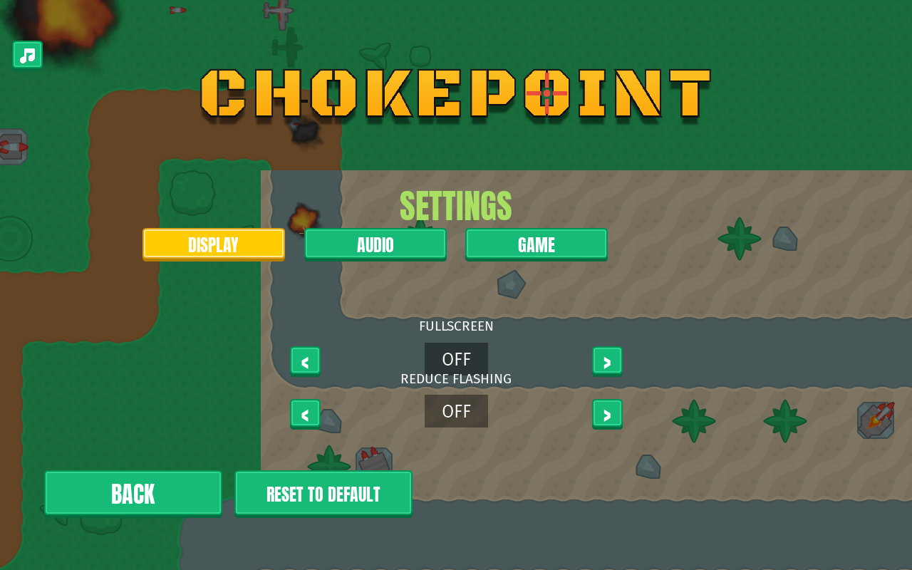
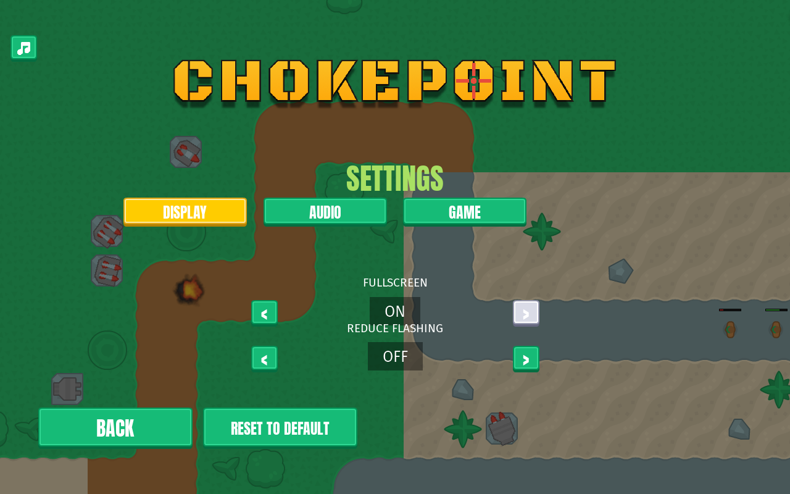

# Web build: the game's side of it
<!-- index | refs: #152, #186, PR #187 -->

**Date:** 2026-11-12 · **Area:** Platform, UI · **Issue:** [#152](https://github.com/vectorviolet/chokepoint/issues/152) · **PR:** [#187](https://github.com/vectorviolet/chokepoint/pull/187)

## Context

Chokepoint should also play in a desktop browser on its itch.io page (owner decision 2026-11-04:
web only, no mobile). A throwaway spike built the game with pygbag and listed what breaks; the
engine part (an async main loop, a fast alpha blit, saves in `localStorage`) is merged in pygamine
(PR #50). This PR is the game's side: the changes the browser needs, and the screens that make
sense there. The CI build script and the release job are the next PR.

Things a browser has no use for, and what we did about them:

- **No quitting.** A game can't close its tab, so Exit has nothing to do.
- **No window modes or resolutions.** The page owns the canvas; only the browser's fullscreen exists.
- **A splash that plays from a thread.** The browser build has no real threads and the splash loop
  blocks it.
- **MP3 music.** pygbag refuses it.

## Options

The three screens as they are in a real Chrome tab (a pygbag build of this branch):

<table>
<tr>
<td> Exit on the web: the green panel of the pause menu over the menu background.</td>
<td> DISPLAY on the web: Fullscreen ON/OFF replaces the Window size and Window mode rows.</td>
<td> The same row after a click, with the browser in fullscreen (the label follows the browser's real state).</td>
</tr>
</table>

Questions that had options:

- **Exit.** (a) Hide the Exit button on the web, (b) make it do nothing, (c) open a "Thanks for
  playing" screen with a link to the itch.io page.
- **Music format.** (a) Convert `bg.mp3` to OGG for everyone, (b) ship both and pick by platform,
  (c) convert only in the web build script.
- **Window settings.** (a) Hide the whole DISPLAY tab on the web, (b) keep the rows and let them do
  nothing, (c) drop the size and mode rows and add one Fullscreen toggle.
- **Splash.** (a) Skip it on the web, (b) write an async splash in pygamine, (c) a short logo-only
  intro after the first click.

## Decision

The owner decided these on 2026-11-12; Claude built them.

- **Exit opens a "Thanks for playing" screen (c).** It shows a thank-you title, a line asking what
  you think, a button that opens `https://umutcanekinci.itch.io/chokepoint` in a new tab
  (`window.open(url, "_blank")`) asking for a comment or rating, and a Main menu button. It is drawn
  with the same `btn` nine-slice panel as the pause menu, over the menu's own background (the logo
  and the battle playing behind). Esc on the main menu opens it too, and Esc on it goes back. The
  desktop Exit is unchanged.
- **Music is OGG for everyone (a).** `bg.mp3` became `bg.ogg` (ffmpeg, libvorbis quality 3: 7.4 MB
  to 2.7 MB, same length). One file, one source of truth. `SOURCES.yaml` records it as a transcode
  of the same licensed source file; the license is unchanged (CC BY 3.0) and CREDITS says the game
  ships the converted file.
- **Fullscreen toggle (c).** DISPLAY stays. On the web the Window size row (and the GAME tab's Skip intro row, since there is no splash) is hidden and the Window
  mode row becomes `FULLSCREEN: OFF/ON` (the same objects and keyboard focus order, so there is no
  second copy of the row). It asks the browser (`document.documentElement.requestFullscreen()` or
  `document.exitFullscreen()`), which only allows that from a click or key press; both a button
  press and F11 are one. The label reads the browser's real state every frame in Settings. Reset
  leaves browser fullscreen. Reduce flashing and the rest of DISPLAY are unchanged.
- **No splash on the web (a).** `Game` builds no `SplashScreen` when `sys.platform ==
  "emscripten"`. Whether to restore it is open as [#186](https://github.com/vectorviolet/chokepoint/issues/186).
- **Saves** keep working through pygamine's `localStorage` store. If the browser blocks storage the
  game starts with its defaults and the session runs without saving (tested).
- **Alpha blits** use pygamine's `ALPHA_BLIT` flag in the three hot places the spike found (the
  menu overlay, the placement grid, the range ring). It is `0` on desktop, so nothing changes there.
  In the spike, tower placement went from about 28 to 32 FPS to about 64 to 66 FPS in the browser
  (spike measurements, not repeated here).

The Turkish texts of the Thanks screen need the owner's OK before release.

## Rejected alternatives

- **A fullscreen AI-generated "thanks" picture.** It would be a new asset with an unclear origin
  and license (the repo's rule is to never add an asset whose license we can't state), and it
  can't change language.
- **A flat black rectangle behind the text.** It looks like a debug screen next to the green pause
  menu; reusing the panel style costs nothing.
- **Hiding the Exit button on the web.** The menu would differ per platform for no gain, and the
  Thanks screen is a place to ask for a rating.
- **An MP3 for desktop and an OGG for the web.** Two files for one track, and two entries to keep
  in step.
- **A separate Fullscreen row next to hidden Window rows.** It would duplicate a row and its
  keyboard wiring; relabeling the window mode row on the web reuses all of it.

## Result

The branch runs in a headed Chrome tab (pygbag 0.9.3, staged by hand since the build script is the
next PR): the menu, Settings, the Fullscreen toggle (click and F11), Exit and the Thanks screen, its
link opening the itch.io page in a new tab, and Reduce flashing surviving a page reload all worked.
The rest is covered by tests in `tests/test_web.py`, which pretend to be the browser.

Merged in PR #187.

## Release pipeline

The build script, the release jobs and the owner's itch.io steps came in a follow-up PR
([#190](https://github.com/vectorviolet/chokepoint/pull/190)). `scripts/build_web.py` stages a clean
folder and runs the pinned pygbag 0.9.3; the release workflow builds it in a `web` job that no
desktop job waits for, and a `publish-web` job attaches `chokepoint-web.zip` to the GitHub Release and
pushes it to the itch.io `html5` channel only after the desktop release exists. A pygbag failure (it
needs internet) therefore can't block the Windows, Linux and macOS release. CI only stages the bundle
(no pygbag) on every PR. The owner turns on "played in the browser" on itch.io after the first upload.

## Revisit if

- The owner wants the intro back on the web ([#186](https://github.com/vectorviolet/chokepoint/issues/186)).
- The browser changes the rule that fullscreen and new tabs need a click or key press.
